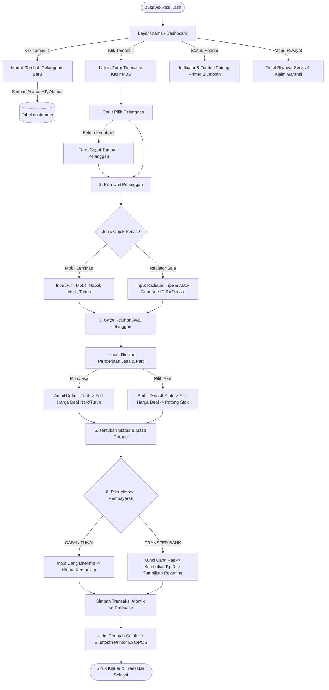

# MASTER PRODUCT REQUIREMENT DOCUMENT (PRD) — v2.0
## BengkelPOS Radiator: Sistem Kasir, Manajemen Servis Multi-Unit & Cetak Struk Bluetooth Thermal

---

### Informasi Dokumen
| Parameter | Keterangan |
| :--- | :--- |
| **Nama Produk** | BengkelPOS Radiator |
| **Versi Dokumen** | 2.0.0 (Master Production Specification) |
| **Target Implementasi** | VS Code (Autonomous Coding with AI Agents: Roo Code / Cline / Cursor / Copilot) |
| **Tech Stack Baku** | Python 3.11+ / FastAPI / SQLite (SQLAlchemy 2.0) / Tailwind CSS / Web Bluetooth API (ESC/POS) |
| **Prinsip Operasional** | 100% Offline-First / Localhost, Tanpa Dependensi Cloud / Telegram / WhatsApp |

---

## DAFTAR ISI
1. [BAB 1: Visi Produk & Karakteristik Khusus Bengkel Radiator](#bab-1-visi-produk--karakteristik-khusus-bengkel-radiator)
2. [BAB 2: Alur Pengguna & Wireframe Interaksi Kasir](#bab-2-alur-pengguna--wireframe-interaksi-kasir)
3. [BAB 3: Matriks Kebutuhan Fungsional (Functional Requirements)](#bab-3-matriks-kebutuhan-fungsional-functional-requirements)
4. [BAB 4: Arsitektur Basis Data (Exact DDL SQL & SQLAlchemy Models)](#bab-4-arsitektur-basis-data-exact-ddl-sql--sqlalchemy-models)
5. [BAB 5: Spesifikasi Kontrak REST API (Pydantic Schemas & Endpoints)](#bab-5-spesifikasi-kontrak-rest-api-pydantic-schemas--endpoints)
6. [BAB 6: Spesifikasi Driver & Protokol Cetak Bluetooth (ESC/POS 58mm & 80mm)](#bab-6-spesifikasi-driver--protokol-cetak-bluetooth-escpos-58mm--80mm)
7. [BAB 7: Spesifikasi Antarmuka Kasir (UI Layout & Komponen Modern)](#bab-7-spesifikasi-antarmuka-kasir-ui-layout--komponen-modern)
8. [BAB 8: Kebutuhan Non-Fungsional & Keamanan (NFR)](#bab-8-kebutuhan-non-fungsional--keamanan-nfr)
9. [BAB 9: Matriks Skenario Uji Otomatis (Test Cases TC-01 s/d TC-20)](#bab-9-matriks-skenario-uji-otomatis-test-cases-tc-01-sd-tc-20)

---

## BAB 1: Visi Produk & Karakteristik Khusus Bengkel Radiator

### 1.1 Latar Belakang & Problem Statement
Bengkel radiator memiliki alur kerja yang unik dibandingkan bengkel servis kendaraan konvensional:
1. **Dua Jenis Unit Servis**:
   - **Mobil Lengkap**: Pelanggan membawa mobil berpelat nomor (Nopol).
   - **Bawa Radiator Saja (Copotan)**: Banyak bengkel mobil rekanan, sopir truk ekspedisi, atau pemilik genset industri yang hanya membawa unit radiatornya saja (tanpa mobil/nopol). Sistem harus mampu menangani unit tanpa nopol ini dengan membuat label/kode identitas fisik otomatis (misal: `RAD-20261028-001`) agar fisik radiator tidak tertukar saat dipatri/dikorok di bengkel.
2. **Relasi 1 Pelanggan Multi-Unit**:
   - Satu data pelanggan (misal: juragan angkutan atau bengkel rekanan) memiliki banyak mobil atau sering membawa beberapa radiator secara berkala. Riwayat perbaikan harus dapat dipantau per unit maupun per pelanggan.
3. **Fleksibilitas Harga Deal di Lapangan (Bargaining / Negotiation)**:
   - Harga pengerjaan jasa (las/patri, korok, ganti tangki) dan harga suku cadang seringkali disepakati langsung lewat negosiasi antara kasir/teknisi dengan pelanggan.
   - Master data suku cadang (`StockItem`) dan tarif jasa (`HargaJasa`) **hanya berfungsi sebagai patokan/saran awal**. Kasir **wajib bisa menaikkan atau menurunkan harga deal secara langsung di form kasir** tanpa merusak harga dasar di database gudang.
4. **Pilihan Pembayaran Cash vs Transfer Bank**:
   - Pelanggan dapat membayar dengan Uang Tunai (**CASH**) atau **TRANSFER BANK**.
   - Jika Cash: kasir menginput uang diterima dan sistem menghitung kembalian.
   - Jika Transfer: uang bayar otomatis pas (kembalian Rp 0), dan nomor rekening resmi bengkel (BCA/Mandiri/BRI) tercetak jelas pada struk fisik.
5. **Pencetakan Struk Thermal Bluetooth (ESC/POS)**:
   - Kasir mencetak struk fisik via printer thermal Bluetooth (ukuran 58mm atau 80mm) yang berfungsi ganda: sebagai bukti transaksi kasir dan kartu bukti garansi servis radiator.

### 1.2 Penyesuaian & Pembersihan Arsitektur (Zero External Bots)
- **Eliminasi Total**: Menghapus seluruh modul Telegram Bot, WhatsApp Bot, Baileys gateway, dan webhook pihak ketiga yang ada di proyek referensi.
- **Pemanfaatan Inti**: Mengadopsi mesin kalkulasi presisi tinggi (`decimal.Decimal`), pengelolaan stok barang gudang, dan pencatatan transaksi servis.

---

## BAB 2: Alur Pengguna & Wireframe Interaksi Kasir



---

## BAB 3: Matriks Kebutuhan Fungsional (Functional Requirements)

### 3.1 Modul Pelanggan (Customer Management)
* **FR-CUST-01**: Sistem wajib menyediakan form pendaftaran pelanggan mencakup `nama` (wajib), `nomor_hp` (wajib), dan `alamat` (opsional).
* **FR-CUST-02**: Sistem wajib menormalisasi format `nomor_hp` (menghapus spasi, strip, dan menyeragamkan awalan `08` / `62`).
* **FR-CUST-03**: Sistem wajib menyediakan fitur pencarian cepat (*autocomplete search*) berdasarkan nama atau nomor HP dalam waktu < 100ms.
* **FR-CUST-04**: Sistem wajib mendukung pembuatan pelanggan baru secara langsung dari dalam form kasir tanpa me-refresh atau meninggalkan halaman transaksi.
* **FR-CUST-05**: Sistem wajib menyimpan riwayat seluruh kendaraan dan unit radiator yang pernah didaftarkan oleh pelanggan tersebut (1 pelanggan dapat memiliki $\ge 1$ unit).

### 3.2 Modul Kendaraan & Unit Radiator (Vehicle & Radiator Unit Management)
* **FR-UNIT-01**: Setiap unit servis wajib terhubung ke satu `customer_id`.
* **FR-UNIT-02**: Sistem wajib mendukung dua kategori unit: `MOBIL` dan `RADIATOR_ONLY`.
* **FR-UNIT-03 (Mobil)**: Jika unit berupa `MOBIL`:
  - `nopol` wajib diisi, otomatis dikonversi ke huruf kapital (*uppercase*) dan spasi dinormalisasi (contoh: `b 1234 abc` $\rightarrow$ `B 1234 ABC`).
  - Kolom opsional: `jenis_mobil` (misal: Avanza, Innova, Canter HD) dan `tahun_mobil`.
* **FR-UNIT-04 (Bawa Radiator Saja)**: Jika unit berupa `RADIATOR_ONLY`:
  - `nopol` bernilai `NULL` / kosong.
  - Sistem wajib men-generate kode label unik otomatis dengan rumus: `RAD-YYYYMMDD-XXX` (contoh: `RAD-20261028-001`).
  - Kolom pendukung: `tipe_radiator` (misal: *Radiator APV Bensin 2-Ply*) dan `keterangan_kondisi` (misal: *Upper tank retak, kisi penyok, tanpa tutup*).
* **FR-UNIT-05**: Kasir dapat memilih unit yang sudah pernah terdaftar pada pelanggan tersebut atau menambahkan unit baru.

### 3.3 Modul Transaksi Kasir & Presisi Finansial (POS Engine)
* **FR-POS-01**: Setiap transaksi kasir wajib memiliki nomor nota unik dengan format: `INV-YYYYMMDD-XXXX` (contoh: `INV-20261028-0001`).
* **FR-POS-02**: Transaksi wajib mencatat `keluhan_awal` pelanggan (disediakan preset tombol cepat: *Overheat, Air tekor, Bocor tangki atas, Bocor tangki bawah, Korok/kuras kerak, Las kisi-kisi*).
* **FR-POS-03 (Fleksibilitas Harga Jasa)**:
  - Kasir dapat memilih jasa dari master `harga_jasa` atau mengetik jasa kustom ad-hoc.
  - Nominal tarif jasa otomatis terisi dari master, tetapi **wajib bisa diubah (naik/turun) langsung di tabel transaksi kasir** sesuai kesepakatan dengan pelanggan.
* **FR-POS-04 (Fleksibilitas Harga Part & Potong Stok Atomik)**:
  - Kasir dapat memilih sparepart dari master `stock_items` atau mengetik nama part kustom.
  - Harga jual part otomatis terisi dari master, tetapi **wajib bisa diubah (naik/turun) langsung di kasir**.
  - Jika part berasal dari `stock_items`, sistem wajib mengurangi kuantitas stok barang di gudang secara otomatis saat transaksi disimpan.
  - Jika kuantitas yang diminta melebihi stok yang ada, sistem wajib menampilkan dialog konfirmasi peringatan stok minus.
* **FR-POS-05 (Kalkulasi Presisi Decimal)**:
  - Seluruh operasi uang dihitung di backend menggunakan `decimal.Decimal` (Python) / `Numeric(14, 2)`:
    $$\text{Subtotal Jasa} = \sum(\text{jumlah} \times \text{harga\_deal})$$
    $$\text{Subtotal Part} = \sum(\text{jumlah} \times \text{harga\_satuan\_deal})$$
    $$\text{Grand Total} = \text{Subtotal Jasa} + \text{Subtotal Part} - \text{Diskon}$$
* **FR-POS-06 (Metode Pembayaran CASH)**:
  - Jika memilih `CASH`, kasir menginput nominal `bayar`.
  - Sistem memvalidasi `bayar` $\ge$ `Grand Total`.
  - Sistem otomatis menghitung `kembalian = bayar - Grand Total`.
* **FR-POS-07 (Metode Pembayaran TRANSFER BANK)**:
  - Jika memilih `TRANSFER`, sistem otomatis mengunci nilai `bayar = Grand Total` dan `kembalian = 0`.
  - Sistem menampilkan informasi rekening tujuan bengkel (`BENGKEL_BANK_NAMA`, `BENGKEL_NO_REKENING`, `BENGKEL_ATAS_NAMA`).
* **FR-POS-08 (Atomicity Transaksi)**:
  - Penyimpanan `ServiceRecord`, baris `ServiceJob`, baris `ServicePart`, dan pemotongan stok `StockItem` wajib dibungkus dalam satu blok transaksi database tunggal (`with session.begin():`). Jika terjadi galat di salah satu proses, seluruh transaksi di-rollback utuh.

### 3.4 Modul Garansi Servis & Klaim (Warranty Management)
* **FR-WAR-01**: Setiap transaksi kasir memiliki konfigurasi garansi: `bergaransi` (Boolean: Ya / Tidak).
* **FR-WAR-02**: Jika `bergaransi == True`, kasir dapat memilih preset durasi garansi (1 Bulan, 2 Bulan, 3 Bulan, atau tanggal kustom). Sistem menghitung `garansi_sampai`.
* **FR-WAR-03**: Sistem menyimpan `catatan_garansi` standar (contoh: *"Garansi berlaku khusus kebocoran pada area pengerjaan las dan tangki baru"*).
* **FR-WAR-04**: Di menu Riwayat Servis, sistem secara otomatis menandai status garansi:
  - 🟢 **Aktif**: Tanggal sekarang $\le$ `garansi_sampai`.
  - 🔴 **Kedaluwarsa**: Tanggal sekarang $>$ `garansi_sampai`.
* **FR-WAR-05 (Klaim Garansi)**:
  - Kasir dapat menekan tombol **[ Proses Klaim Garansi ]**.
  - Sistem mencatat `tanggal_klaim = hari ini` dan memperbarui `status_klaim = 'Sudah claim'`.

### 3.5 Modul Cetak Struk Bluetooth Thermal (ESC/POS Printing)
* **FR-PRN-01**: Frontend menyediakan modul `bluetooth-printer.js` yang memanfaatkan **Web Bluetooth API** (`navigator.bluetooth`).
* **FR-PRN-02**: Sistem mendeteksi profil Bluetooth Thermal Printer (SPP / BLE Serial Port UUID `000018f0-0000-1000-8000-00805f9b34fb` atau `0000ffe0-0000-1000-8000-00805f9b34fb`).
* **FR-PRN-03**: Status koneksi printer ditampilkan jelas di header dashboard:
  - 🔴 `Printer: Belum Terhubung [Klik untuk Pairing]`
  - 🟢 `Printer: Terhubung (MPT-II / 58mm)`
* **FR-PRN-04**: Format struk mendukung ukuran kertas 58mm (lebar standar 32 karakter/baris) dan 80mm (lebar 48 karakter/baris).
* **FR-PRN-05**: Komponen data yang dicetak pada struk:
  1. Header Bengkel (Nama, Tagline, Alamat, No Telp/WA dari `.env`).
  2. Garis Pembatas (`================================`).
  3. No. Nota, Tanggal & Jam Transaksi, Nama Kasir.
  4. Garis Pemisah (`--------------------------------`).
  5. Data Pelanggan (Nama, No HP).
  6. Data Objek Servis (Nopol & Merk Mobil ATAU Label `[BAWA RADIATOR SAJA] RAD-xxxx`).
  7. Keluhan Awal Pelanggan.
  8. Rincian Pengerjaan Jasa beserta harga deal.
  9. Rincian Penggantian Sparepart beserta qty dan harga deal.
  10. Subtotal Jasa, Subtotal Part, Diskon, Grand Total (Teks Tebal/Bold).
  11. Metode Pembayaran (`CASH / TUNAI` beserta Bayar & Kembalian, ATAU `TRANSFER BANK`).
  12. Keterangan Garansi Servis (Status Bergaransi, Tanggal Expired, Syarat Garansi).
  13. Informasi Rekening Bank Bengkel (Nama Bank, No Rek, Atas Nama).
  14. Footer Ucapan Terima Kasih.
* **FR-PRN-06**: Transmisi data ESC/POS dikirim dalam paket-paket kecil (*chunking* 50 s/d 100 bytes) guna mencegah printer thermal murah mengalami *buffer overflow*.
* **FR-PRN-07**: Wajib tersedia fitur **[ Cetak Ulang Struk (Reprint) ]** dari tabel riwayat servis.
* **FR-PRN-08**: Jika Web Bluetooth tidak didukung browser pengguna, sistem menyediakan tombol cetak alternatif dialog browser standar (*Window Print Fallback*).

### 3.6 Modul Stok Sparepart & Tarif Jasa (Inventory & Catalog)
* **FR-STK-01**: CRUD Master Stok: `kode` (unik), `nama`, `harga_modal`, `harga_jual` (patokan saran), `jumlah` (stok fisik).
* **FR-STK-02**: Peringatan visual jika stok $\le 3$ unit.
* **FR-STK-03**: CRUD Master Tarif Jasa: `nama`, `harga_standar` (patokan saran).
* **FR-STK-04**: Preset data awal suku cadang radiator (Upper Tank Fiber Avanza, Tutup Radiator 0.9/1.1, Coolant Hijau/Merah galon, Selang radiator atas/bawah, dll).
* **FR-STK-05**: Preset data awal jasa radiator (Korok/Kuras Kotoran, Las/Patri Kuningan 1 Titik, Ganti Tangki Atas, Bongkar Pasang Radiator Mobil, dll).

---

## BAB 4: Arsitektur Basis Data (Exact DDL SQL & SQLAlchemy Models)

### 4.1 Skrip DDL SQLite Relasional Baku

```sql
-- 1. TABEL PELANGGAN
CREATE TABLE IF NOT EXISTS customers (
    id INTEGER PRIMARY KEY AUTOINCREMENT,
    nama VARCHAR(255) NOT NULL,
    nomor_hp VARCHAR(64) NOT NULL,
    alamat TEXT,
    created_at DATETIME DEFAULT CURRENT_TIMESTAMP,
    updated_at DATETIME DEFAULT CURRENT_TIMESTAMP
);
CREATE INDEX IF NOT EXISTS idx_customers_nama ON customers(nama);
CREATE INDEX IF NOT EXISTS idx_customers_hp ON customers(nomor_hp);

-- 2. TABEL KENDARAAN / UNIT RADIATOR COPOTAN
CREATE TABLE IF NOT EXISTS vehicle_or_units (
    id INTEGER PRIMARY KEY AUTOINCREMENT,
    customer_id INTEGER NOT NULL,
    unit_type VARCHAR(32) NOT NULL, -- 'MOBIL' atau 'RADIATOR_ONLY'
    nopol VARCHAR(32),              -- NULL jika RADIATOR_ONLY
    jenis_mobil VARCHAR(255),       -- misal: 'Avanza 2018', 'Truk Canter'
    tahun_mobil INTEGER,
    label_radiator VARCHAR(100),    -- misal: 'RAD-20261028-001', NULL jika MOBIL
    tipe_radiator VARCHAR(255),     -- misal: 'Radiator Canter 2-Ply Kuningan'
    keterangan TEXT,
    created_at DATETIME DEFAULT CURRENT_TIMESTAMP,
    updated_at DATETIME DEFAULT CURRENT_TIMESTAMP,
    FOREIGN KEY (customer_id) REFERENCES customers(id) ON DELETE RESTRICT
);
CREATE INDEX IF NOT EXISTS idx_units_customer ON vehicle_or_units(customer_id);
CREATE INDEX IF NOT EXISTS idx_units_nopol ON vehicle_or_units(nopol);
CREATE INDEX IF NOT EXISTS idx_units_label ON vehicle_or_units(label_radiator);

-- 3. TABEL MASTER STOK SPAREPART GUDANG
CREATE TABLE IF NOT EXISTS stock_items (
    id INTEGER PRIMARY KEY AUTOINCREMENT,
    kode VARCHAR(64) UNIQUE,
    nama VARCHAR(255) NOT NULL,
    harga_modal NUMERIC(14, 2) DEFAULT 0,
    harga_jual NUMERIC(14, 2) NOT NULL,
    jumlah INTEGER NOT NULL DEFAULT 0,
    created_at DATETIME DEFAULT CURRENT_TIMESTAMP,
    updated_at DATETIME DEFAULT CURRENT_TIMESTAMP
);

-- 4. TABEL MASTER TARIF JASA SERVIS
CREATE TABLE IF NOT EXISTS harga_jasa (
    id INTEGER PRIMARY KEY AUTOINCREMENT,
    nama VARCHAR(255) NOT NULL,
    harga_standar NUMERIC(14, 2) NOT NULL,
    created_at DATETIME DEFAULT CURRENT_TIMESTAMP,
    updated_at DATETIME DEFAULT CURRENT_TIMESTAMP
);

-- 5. TABEL TRANSAKSI SERVIS KASIR
CREATE TABLE IF NOT EXISTS service_records (
    id INTEGER PRIMARY KEY AUTOINCREMENT,
    unit_id INTEGER NOT NULL,
    no_nota VARCHAR(64) UNIQUE NOT NULL,
    waktu_service DATETIME DEFAULT CURRENT_TIMESTAMP,
    keluhan_awal TEXT NOT NULL,
    catatan_pengerjaan TEXT,
    biaya_jasa NUMERIC(14, 2) DEFAULT 0,
    total_part NUMERIC(14, 2) DEFAULT 0,
    diskon NUMERIC(14, 2) DEFAULT 0,
    total_servis NUMERIC(14, 2) NOT NULL,
    metode_bayar VARCHAR(32) NOT NULL DEFAULT 'CASH', -- 'CASH' atau 'TRANSFER'
    bayar NUMERIC(14, 2) NOT NULL,
    kembalian NUMERIC(14, 2) NOT NULL DEFAULT 0,
    bergaransi BOOLEAN NOT NULL DEFAULT 1,
    garansi_sampai DATE,
    catatan_garansi TEXT,
    status_klaim VARCHAR(32) NOT NULL DEFAULT 'Belum claim', -- 'Belum claim', 'Sudah claim'
    tanggal_klaim DATE,
    created_at DATETIME DEFAULT CURRENT_TIMESTAMP,
    updated_at DATETIME DEFAULT CURRENT_TIMESTAMP,
    FOREIGN KEY (unit_id) REFERENCES vehicle_or_units(id) ON DELETE RESTRICT
);
CREATE INDEX IF NOT EXISTS idx_records_nota ON service_records(no_nota);
CREATE INDEX IF NOT EXISTS idx_records_waktu ON service_records(waktu_service);
CREATE INDEX IF NOT EXISTS idx_records_unit ON service_records(unit_id);

-- 6. TABEL BARIS PEKERJAAN JASA PADA TRANSAKSI (HARGA DEAL)
CREATE TABLE IF NOT EXISTS service_jobs (
    id INTEGER PRIMARY KEY AUTOINCREMENT,
    service_record_id INTEGER NOT NULL,
    harga_jasa_id INTEGER,
    deskripsi VARCHAR(255) NOT NULL,
    jumlah INTEGER NOT NULL DEFAULT 1,
    harga NUMERIC(14, 2) NOT NULL,      -- Harga deal yang disepakati kasir & pelanggan
    subtotal NUMERIC(14, 2) NOT NULL,
    FOREIGN KEY (service_record_id) REFERENCES service_records(id) ON DELETE CASCADE,
    FOREIGN KEY (harga_jasa_id) REFERENCES harga_jasa(id) ON DELETE SET NULL
);

-- 7. TABEL BARIS SPAREPART PADA TRANSAKSI (HARGA DEAL & POTONG STOK)
CREATE TABLE IF NOT EXISTS service_parts (
    id INTEGER PRIMARY KEY AUTOINCREMENT,
    service_record_id INTEGER NOT NULL,
    stock_item_id INTEGER,
    nama_part VARCHAR(255) NOT NULL,
    jumlah INTEGER NOT NULL DEFAULT 1,
    harga_satuan NUMERIC(14, 2) NOT NULL, -- Harga satuan deal yang disepakati
    subtotal NUMERIC(14, 2) NOT NULL,
    FOREIGN KEY (service_record_id) REFERENCES service_records(id) ON DELETE CASCADE,
    FOREIGN KEY (stock_item_id) REFERENCES stock_items(id) ON DELETE SET NULL
);
```

### 4.2 Deklarasi Model SQLAlchemy 2.0 (`database/models.py`)

```python
from datetime import date, datetime, timezone
from decimal import Decimal
from typing import Optional, List
from sqlalchemy import Boolean, Date, DateTime, ForeignKey, Integer, Numeric, String, Text
from sqlalchemy.orm import Mapped, mapped_column, relationship
from database.base import Base

def utcnow() -> datetime:
    return datetime.now(timezone.utc).replace(tzinfo=None)

class Customer(Base):
    __tablename__ = "customers"

    id: Mapped[int] = mapped_column(Integer, primary_key=True, autoincrement=True)
    nama: Mapped[str] = mapped_column(String(255), nullable=False, index=True)
    nomor_hp: Mapped[str] = mapped_column(String(64), nullable=False, index=True)
    alamat: Mapped[Optional[str]] = mapped_column(Text, nullable=True)
    created_at: Mapped[datetime] = mapped_column(DateTime, default=utcnow, nullable=False)
    updated_at: Mapped[datetime] = mapped_column(DateTime, default=utcnow, onupdate=utcnow, nullable=False)

    units: Mapped[List["VehicleOrUnit"]] = relationship(back_populates="customer", cascade="all, delete-orphan")

class VehicleOrUnit(Base):
    __tablename__ = "vehicle_or_units"

    id: Mapped[int] = mapped_column(Integer, primary_key=True, autoincrement=True)
    customer_id: Mapped[int] = mapped_column(ForeignKey("customers.id", ondelete="RESTRICT"), nullable=False, index=True)
    unit_type: Mapped[str] = mapped_column(String(32), nullable=False) # 'MOBIL' atau 'RADIATOR_ONLY'
    nopol: Mapped[Optional[str]] = mapped_column(String(32), nullable=True, index=True)
    jenis_mobil: Mapped[Optional[str]] = mapped_column(String(255), nullable=True)
    tahun_mobil: Mapped[Optional[int]] = mapped_column(Integer, nullable=True)
    label_radiator: Mapped[Optional[str]] = mapped_column(String(100), nullable=True, index=True)
    tipe_radiator: Mapped[Optional[str]] = mapped_column(String(255), nullable=True)
    keterangan: Mapped[Optional[str]] = mapped_column(Text, nullable=True)
    created_at: Mapped[datetime] = mapped_column(DateTime, default=utcnow, nullable=False)
    updated_at: Mapped[datetime] = mapped_column(DateTime, default=utcnow, onupdate=utcnow, nullable=False)

    customer: Mapped["Customer"] = relationship(back_populates="units")
    service_records: Mapped[List["ServiceRecord"]] = relationship(back_populates="unit")

class StockItem(Base):
    __tablename__ = "stock_items"

    id: Mapped[int] = mapped_column(Integer, primary_key=True, autoincrement=True)
    kode: Mapped[Optional[str]] = mapped_column(String(64), nullable=True, unique=True)
    nama: Mapped[str] = mapped_column(String(255), nullable=False)
    harga_modal: Mapped[Decimal] = mapped_column(Numeric(14, 2), default=Decimal("0.00"), nullable=False)
    harga_jual: Mapped[Decimal] = mapped_column(Numeric(14, 2), default=Decimal("0.00"), nullable=False)
    jumlah: Mapped[int] = mapped_column(Integer, default=0, nullable=False)
    created_at: Mapped[datetime] = mapped_column(DateTime, default=utcnow, nullable=False)
    updated_at: Mapped[datetime] = mapped_column(DateTime, default=utcnow, onupdate=utcnow, nullable=False)

class HargaJasa(Base):
    __tablename__ = "harga_jasa"

    id: Mapped[int] = mapped_column(Integer, primary_key=True, autoincrement=True)
    nama: Mapped[str] = mapped_column(String(255), nullable=False)
    harga_standar: Mapped[Decimal] = mapped_column(Numeric(14, 2), default=Decimal("0.00"), nullable=False)
    created_at: Mapped[datetime] = mapped_column(DateTime, default=utcnow, nullable=False)
    updated_at: Mapped[datetime] = mapped_column(DateTime, default=utcnow, onupdate=utcnow, nullable=False)

class ServiceRecord(Base):
    __tablename__ = "service_records"

    id: Mapped[int] = mapped_column(Integer, primary_key=True, autoincrement=True)
    unit_id: Mapped[int] = mapped_column(ForeignKey("vehicle_or_units.id", ondelete="RESTRICT"), nullable=False, index=True)
    no_nota: Mapped[str] = mapped_column(String(64), unique=True, nullable=False, index=True)
    waktu_service: Mapped[datetime] = mapped_column(DateTime, default=utcnow, nullable=False, index=True)
    keluhan_awal: Mapped[str] = mapped_column(Text, nullable=False)
    catatan_pengerjaan: Mapped[Optional[str]] = mapped_column(Text, nullable=True)
    biaya_jasa: Mapped[Decimal] = mapped_column(Numeric(14, 2), default=Decimal("0.00"), nullable=False)
    total_part: Mapped[Decimal] = mapped_column(Numeric(14, 2), default=Decimal("0.00"), nullable=False)
    diskon: Mapped[Decimal] = mapped_column(Numeric(14, 2), default=Decimal("0.00"), nullable=False)
    total_servis: Mapped[Decimal] = mapped_column(Numeric(14, 2), nullable=False)
    metode_bayar: Mapped[str] = mapped_column(String(32), default="CASH", nullable=False) # 'CASH' atau 'TRANSFER'
    bayar: Mapped[Decimal] = mapped_column(Numeric(14, 2), nullable=False)
    kembalian: Mapped[Decimal] = mapped_column(Numeric(14, 2), default=Decimal("0.00"), nullable=False)
    bergaransi: Mapped[bool] = mapped_column(Boolean, default=True, nullable=False)
    garansi_sampai: Mapped[Optional[date]] = mapped_column(Date, nullable=True)
    catatan_garansi: Mapped[Optional[str]] = mapped_column(Text, nullable=True)
    status_klaim: Mapped[str] = mapped_column(String(32), default="Belum claim", nullable=False)
    tanggal_klaim: Mapped[Optional[date]] = mapped_column(Date, nullable=True)
    created_at: Mapped[datetime] = mapped_column(DateTime, default=utcnow, nullable=False)
    updated_at: Mapped[datetime] = mapped_column(DateTime, default=utcnow, onupdate=utcnow, nullable=False)

    unit: Mapped["VehicleOrUnit"] = relationship(back_populates="service_records")
    jobs: Mapped[List["ServiceJob"]] = relationship(back_populates="service_record", cascade="all, delete-orphan")
    parts: Mapped[List["ServicePart"]] = relationship(back_populates="service_record", cascade="all, delete-orphan")

class ServiceJob(Base):
    __tablename__ = "service_jobs"

    id: Mapped[int] = mapped_column(Integer, primary_key=True, autoincrement=True)
    service_record_id: Mapped[int] = mapped_column(ForeignKey("service_records.id", ondelete="CASCADE"), nullable=False, index=True)
    harga_jasa_id: Mapped[Optional[int]] = mapped_column(ForeignKey("harga_jasa.id", ondelete="SET NULL"), nullable=True)
    deskripsi: Mapped[str] = mapped_column(String(255), nullable=False)
    jumlah: Mapped[int] = mapped_column(Integer, default=1, nullable=False)
    harga: Mapped[Decimal] = mapped_column(Numeric(14, 2), nullable=False) # Deal price
    subtotal: Mapped[Decimal] = mapped_column(Numeric(14, 2), nullable=False)

    service_record: Mapped["ServiceRecord"] = relationship(back_populates="jobs")

class ServicePart(Base):
    __tablename__ = "service_parts"

    id: Mapped[int] = mapped_column(Integer, primary_key=True, autoincrement=True)
    service_record_id: Mapped[int] = mapped_column(ForeignKey("service_records.id", ondelete="CASCADE"), nullable=False, index=True)
    stock_item_id: Mapped[Optional[int]] = mapped_column(ForeignKey("stock_items.id", ondelete="SET NULL"), nullable=True)
    nama_part: Mapped[str] = mapped_column(String(255), nullable=False)
    jumlah: Mapped[int] = mapped_column(Integer, default=1, nullable=False)
    harga_satuan: Mapped[Decimal] = mapped_column(Numeric(14, 2), nullable=False) # Deal price
    subtotal: Mapped[Decimal] = mapped_column(Numeric(14, 2), nullable=False)

    service_record: Mapped["ServiceRecord"] = relationship(back_populates="parts")
```

---

## BAB 5: Spesifikasi Kontrak REST API (Pydantic Schemas & Endpoints)

### 5.1 Skema Pydantic (`api/schemas.py`)

```python
from datetime import date, datetime
from decimal import Decimal
from typing import Optional, List
from pydantic import BaseModel, Field

# --- CUSTOMER & UNIT SCHEMAS ---
class CustomerCreate(BaseModel):
    nama: str = Field(..., min_length=2, max_length=255)
    nomor_hp: str = Field(..., min_length=8, max_length=64)
    alamat: Optional[str] = None

class CustomerOut(CustomerCreate):
    id: int
    created_at: datetime
    class Config:
        from_attributes = True

class UnitCreate(BaseModel):
    customer_id: int
    unit_type: str = Field(..., pattern="^(MOBIL|RADIATOR_ONLY)$")
    nopol: Optional[str] = None
    jenis_mobil: Optional[str] = None
    tahun_mobil: Optional[int] = None
    tipe_radiator: Optional[str] = None
    keterangan: Optional[str] = None

class UnitOut(UnitCreate):
    id: int
    label_radiator: Optional[str] = None
    created_at: datetime
    class Config:
        from_attributes = True

# --- STOCK & JASA SCHEMAS ---
class StockItemCreate(BaseModel):
    kode: Optional[str] = None
    nama: str
    harga_modal: Decimal = Field(default=Decimal("0.00"))
    harga_jual: Decimal
    jumlah: int = Field(default=0, ge=0)

class StockItemOut(StockItemCreate):
    id: int
    class Config:
        from_attributes = True

class HargaJasaCreate(BaseModel):
    nama: str
    harga_standar: Decimal

class HargaJasaOut(HargaJasaCreate):
    id: int
    class Config:
        from_attributes = True

# --- TRANSACTION POS SCHEMAS ---
class ServiceJobInput(BaseModel):
    harga_jasa_id: Optional[int] = None
    deskripsi: str
    jumlah: int = 1
    harga: Decimal # Harga deal

class ServicePartInput(BaseModel):
    stock_item_id: Optional[int] = None
    nama_part: str
    jumlah: int = 1
    harga_satuan: Decimal # Harga deal

class CreateServiceTransactionRequest(BaseModel):
    unit_id: int
    keluhan_awal: str
    catatan_pengerjaan: Optional[str] = None
    diskon: Decimal = Field(default=Decimal("0.00"))
    metode_bayar: str = Field(default="CASH", pattern="^(CASH|TRANSFER)$")
    bayar: Decimal
    bergaransi: bool = True
    garansi_bulan: int = 1
    catatan_garansi: Optional[str] = None
    jobs: List[ServiceJobInput] = []
    parts: List[ServicePartInput] = []

class ServiceTransactionReceiptOut(BaseModel):
    id: int
    no_nota: str
    waktu_service: datetime
    customer_nama: str
    customer_hp: str
    unit_deskripsi: str # "B 1234 ABC (Avanza)" atau "[BAWA RADIATOR SAJA] RAD-20261028-001"
    keluhan_awal: str
    biaya_jasa: Decimal
    total_part: Decimal
    diskon: Decimal
    total_servis: Decimal
    metode_bayar: str
    bayar: Decimal
    kembalian: Decimal
    bergaransi: bool
    garansi_sampai: Optional[date]
    catatan_garansi: Optional[str]
    jobs: List[dict]
    parts: List[dict]
    # Konfigurasi Bengkel dari .env
    bengkel_nama: str
    bengkel_alamat: str
    bengkel_wa: str
    bengkel_bank_nama: str
    bengkel_no_rekening: str
    bengkel_atas_nama: str
```

### 5.2 Rangkuman Endpoint REST API

| Method | Endpoint | Deskripsi |
| :--- | :--- | :--- |
| `GET` | `/api/customers/search?q=...` | Cari pelanggan via nama / HP |
| `POST`| `/api/customers` | Tambah pelanggan baru |
| `GET` | `/api/customers/{id}/units` | Daftar kendaraan & radiator milik pelanggan |
| `POST`| `/api/units` | Daftarkan mobil baru atau radiator lepas baru |
| `GET` | `/api/stock` | Ambil seluruh daftar suku cadang gudang |
| `POST`| `/api/stock` | Tambah stok suku cadang baru |
| `GET` | `/api/harga-jasa` | Ambil seluruh daftar tarif standar pengerjaan |
| `POST`| `/api/pos/transaction` | **Buat Transaksi Kasir, potong stok & keluarkan data struk** |
| `GET` | `/api/service-records` | Ambil riwayat seluruh transaksi servis |
| `GET` | `/api/service-records/{id}/receipt` | Ambil data struk untuk **Cetak Ulang (Reprint)** |
| `PUT` | `/api/service-records/{id}/claim` | Proses klaim garansi servis |
| `GET` | `/api/reports/daily-cash` | Rekap kas masuk harian (Cash vs Transfer) |
| `POST`| `/api/admin/backup` | Buat salinan cadangan basis data SQLite |

---

## BAB 6: Spesifikasi Driver & Protokol Cetak Bluetooth (ESC/POS 58mm & 80mm)

### 6.1 Konektivitas Web Bluetooth API (`frontend/js/bluetooth-printer.js`)
* **Service UUID**: Standar printer thermal portabel Bluetooth:
  - `000018f0-0000-1000-8000-00805f9b34fb` (Printer Serial Service)
  - `0000ffe0-0000-1000-8000-00805f9b34fb` (SPP Characteristic)
* **Kode Transmisi Paket (Chunking Safe Write)**:
```javascript
// Kirim byte buffer secara bertahap (50 byte per chunk) dengan jeda 25ms
async function sendToPrinterInChunks(characteristic, dataBuffer) {
    const CHUNK_SIZE = 50;
    for (let i = 0; i < dataBuffer.length; i += CHUNK_SIZE) {
        const chunk = dataBuffer.slice(i, i + CHUNK_SIZE);
        await characteristic.writeValue(chunk);
        await new Promise(r => setTimeout(r, 25));
    }
}
```

### 6.2 Perintah Byte ESC/POS
* **Inisialisasi Printer**: `[0x1B, 0x40]` (`ESC @`)
* **Perataan Teks**:
  - Rata Kiri: `[0x1B, 0x61, 0x00]` (`ESC a 0`)
  - Rata Tengah: `[0x1B, 0x61, 0x01]` (`ESC a 1`)
  - Rata Kanan: `[0x1B, 0x61, 0x02]` (`ESC a 2`)
* **Format Huruf**:
  - Teks Normal: `[0x1B, 0x45, 0x00]`
  - Teks Tebal (Bold): `[0x1B, 0x45, 0x01]` (`ESC E 1`)
  - Double Height / Title: `[0x1D, 0x21, 0x01]`
* **Line Feed & Potong Kertas**: `[0x0A, 0x0A, 0x0A]` + `[0x1D, 0x56, 0x42, 0x00]` (`GS V B 0`)

### 6.3 Layout Grid Teks Struk 58mm (32 Karakter per Baris)
```text
12345678901234567890123456789012 (32 Kolom)
================================
    BENGKEL RADIATOR BERKAH
Spesialis Servis & Las Radiator
  Jl. Raya Otomotif No. 88, Jkt
        WA: 0812-3456-7890
================================
No. Nota : INV-20261028-0001
Tanggal  : 28/10/2026 21:30
Kasir    : Dita
--------------------------------
Pelanggan: Pak Slamet
No. HP   : 08123456789
Unit     : B 1234 ABC (Avanza)
Keluhan  : Air tekor, panas naik
--------------------------------
JASA:
- Korok Radiator       Rp 150.000
- Las Bocor Tangki     Rp  50.000
PART:
- Coolant 1 Galon      Rp  85.000
- Tutup Radiator 0.9   Rp  40.000
--------------------------------
Total Jasa   : Rp 200.000
Total Part   : Rp 125.000
Grand Total  : Rp 325.000
Metode Bayar : CASH / TUNAI
Bayar        : Rp 350.000
Kembali      : Rp  25.000
--------------------------------
GARANSI SERVIS:
Status  : BERGARANSI
Sampai  : 28/11/2026 (1 Bulan)
Catatan : Khusus kebocoran las &
          pemasangan radiator.
--------------------------------
REKENING BENGKEL (TRANSFER):
BCA: 123-456-7890
a/n BENGKEL RADIATOR BERKAH
--------------------------------
    Simpan struk ini sebagai
      kartu bukti garansi!
       Terima kasih!
================================
```

---

## BAB 7: Spesifikasi Antarmuka Kasir (UI Layout & Komponen Modern)

### 7.1 Komponen Header Aplikasi
- Logo / Nama Bengkel & Tagline.
- Widget Status Bluetooth:
  - Tombol: `[ 🔴 Hubungkan Printer Bluetooth ]` $\rightarrow$ setelah pairing berubah hijau: `[ 🟢 Terhubung: MPT-II (58mm) ]`.
- Tanggal & Jam Aktif.

### 7.2 Beranda Kasir (Hero Buttons)
- 🟢 **[ + TAMBAH SERVICE BARU ]**: Tombol utama paling besar (warna hijau emerald), membuka layar transaksi kasir.
- 🔵 **[ + TAMBAH PELANGGAN ]**: Tombol sekunder (warna biru laut), membuka modal registrasi pelanggan.
- 📊 **Kartu Ringkasan Hari Ini**:
  - Total Kendaraan/Radiator Diservis Hari Ini.
  - Total Uang Tunai (Cash) Masuk.
  - Total Uang Transfer Masuk.
  - Jumlah Klaim Garansi Aktif.

### 7.3 Formulir Transaksi Kasir (Single-Page Form / Wizard)
1. **Pilih Pelanggan**:
   - Kolom Autocomplete Nama / HP.
   - Tombol "+ Pelanggan Baru".
2. **Pilih / Tambah Unit**:
   - Menampilkan unit-unit yang pernah dibawa pelanggan tersebut.
   - Opsi Switch: `[ Mobil Lengkap ]` atau `[ Bawa Radiator Saja ]`.
   - Jika "Bawa Radiator Saja": Muncul field *Tipe Radiator* dan info label otomatis *RAD-xxxx*.
3. **Keluhan Awal**:
   - Textarea dengan *chips button* keluhan populer.
4. **Tabel Rincian Pengerjaan (Jasa & Sparepart)**:
   - Baris interaktif: Nama Item, Qty, Harga Default $\rightarrow$ **Kolom Harga Deal (dapat diketik bebas naik/turun)** $\rightarrow$ Subtotal.
5. **Panel Pembayaran & Garansi**:
   - Toggle Garansi (Ya/Tidak) + Pilihan Durasi (1/2/3 Bulan).
   - Radio Button Metode Bayar: `CASH` vs `TRANSFER BANK`.
   - Jika Cash: Input Bayar Tunai $\rightarrow$ Kalkulasi Kembalian instan.
   - Jika Transfer: Input bayar terkunci pas, menampilkan nomor rekening BCA bengkel.
6. **Tombol Aksi**:
   - 🟢 **[ SIMPAN & CETAK STRUK BLUETOOTH ]**
   - ⚪ **[ SIMPAN SAJA (TANPA CETAK) ]**

---

## BAB 8: Kebutuhan Non-Fungsional & Keamanan (NFR)

* **NFR-LOC-01 (100% Offline Capable)**: Aplikasi dapat berjalan penuh di komputer lokal kasir tanpa perlu koneksi internet.
* **NFR-PERF-01 (Kecepatan Transaksi)**: Waktu simpan transaksi dan generate nota tidak boleh melebihi 200ms.
* **NFR-SEC-01 (Sanitasi Input)**: Seluruh input nama pelanggan, keluhan, dan teks disanitasi dari karakter berbahaya guna mencegah serangan Cross-Site Scripting (XSS).
* **NFR-DAT-01 (Integritas Finansial)**: Dilarang menggunakan tipe float floating-point JS untuk perhitungan akhir; seluruh perhitungan total dan kembalian divalidasi oleh backend Python `Decimal`.
* **NFR-DAT-02 (Backup Otomatis)**: File database SQLite disimpan di folder `./data/bengkel_radiator.db` dan disediakan tombol backup satu-klik untuk mendownload salinan database harian.

---

## BAB 9: Matriks Skenario Uji Otomatis (Test Cases TC-01 s/d TC-20)

| ID Uji | Modul | Skenario Pengujian | Hasil yang Diharapkan |
| :--- | :--- | :--- | :--- |
| **TC-01** | Pelanggan | Tambah pelanggan dengan nama dan nomor HP valid | Tersimpan di tabel `customers` |
| **TC-02** | Pelanggan | Normalisasi nomor HP `0812-3456-7890` | Tersimpan seragam `081234567890` |
| **TC-03** | Pelanggan | 1 Pelanggan mendaftarkan 2 mobil berbeda | Kedua mobil terhubung ke 1 `customer_id` |
| **TC-04** | Unit | Pendaftaran unit `MOBIL` dengan nopol huruf kecil `b 1234 cd` | Dinormalisasi menjadi `B 1234 CD` |
| **TC-05** | Unit | Pendaftaran unit `RADIATOR_ONLY` tanpa nopol | Nopol bernilai `NULL`, generate label `RAD-YYYYMMDD-001` |
| **TC-06** | Transaksi | Input jasa dengan harga deal dinaikkan dari master | Tersimpan harga deal, master jasa tidak berubah |
| **TC-07** | Transaksi | Input part dengan harga deal didiskon dari master | Tersimpan harga deal, master part tidak berubah |
| **TC-08** | Stok | Servis menggunakan part dari stok gudang (Qty 2) | Stok di `stock_items` otomatis berkurang 2 unit |
| **TC-09** | Stok | Servis meminta part dengan kuantitas melebihi stok | Muncul validasi peringatan stok gudang tidak mencukupi |
| **TC-10** | Keuangan | Pembayaran `CASH` total 325.000 dibayar 350.000 | Kembalian tercatat tepat 25.000 |
| **TC-11** | Keuangan | Pembayaran `CASH` uang diterima kurang dari total | Transaksi ditolak dengan error validasi |
| **TC-12** | Keuangan | Pembayaran `TRANSFER` total 325.000 | Bayar otomatis 325.000, kembalian = 0 |
| **TC-13** | Garansi | Transaksi servis dengan garansi 1 bulan | `garansi_sampai` terhitung tepat 30 hari ke depan |
| **TC-14** | Garansi | Transaksi servis tanpa garansi (`bergaransi = False`) | `garansi_sampai` bernilai `NULL` |
| **TC-15** | Klaim | Klaim garansi saat masih dalam masa aktif | Status klaim berubah menjadi `Sudah claim` |
| **TC-16** | Klaim | Klaim garansi setelah tanggal kedaluwarsa | Sistem memberi peringatan masa garansi telah habis |
| **TC-17** | Bluetooth | Generate byte array ESC/POS struk 58mm | Panjang baris tidak melebihi 32 karakter per baris |
| **TC-18** | Bluetooth | Teks struk memuat rekening bank bengkel dari `.env` | BCA, No Rek, dan a/n tercetak jelas di struk |
| **TC-19** | Riwayat | Cetak ulang nota lama (*Reprint*) | Data struk nota lama terpanggil utuh dan identik |
| **TC-20** | Backup | Ekspor file cadangan basis data SQLite | Berkas `.db` cadangan berhasil diunduh tanpa korup |
