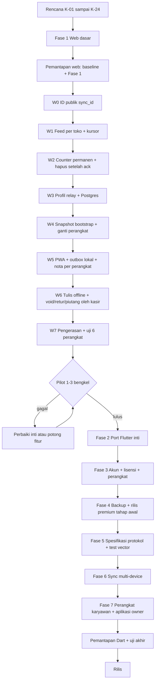

# Rencana, Pengujian, dan Status Premium Multi-Toko — PusatkuPOS

Status: **dokumen tunggal aktif** — 2026-11-03. Dokumen ini menggabungkan tiga
dokumen sebelumnya — rencana premium multi-toko, skenario uji pemantapan, dan
papan status pengerjaan — menjadi satu sumber.

Produk target: **PusatkuPOS (Flutter)**. Aplikasi 2.7.0 yang berjalan sekarang
tetap **BengkelPOS Radiator** (web) dan **menerima fitur ini lebih dulu** sebagai
kanal uji web; setelah perilakunya teruji, fitur dibawa ke PusatkuPOS Flutter.

### Ringkasan cepat

- **Keputusan produk:** `K-01`–`K-24`. Aturan baru offline-first, relay
  sementara, Postgres, dan kebijakan tulis uang ada di K-12, K-13, K-23, K-24.
- **Fokus kode saat ini:** web relay offline-first. Kode W2–W7, E2E 81/81, dan
  suite pytest 403 lulus. Berikutnya uji beban perangkat nyata, reverse proxy
  produksi, lalu pilot. Port Dart/APK belum dikerjakan.
- **Skenario uji:** bagian **Skenario uji**.
- **Status dan riwayat:** bagian **Status dan riwayat**.
- **Uji otomatis terakhir:** rangkaian E2E nyata **81/81 lulus** pada database
  dan relay kosong (2026-11-03), mencakup gratis, premium, karyawan, backup
  semua toko, relay, dan offline PWA. Rincian di
  [`TEMUAN_UJI_E2E_20261103.md`](TEMUAN_UJI_E2E_20261103.md). Suite pytest
  penuh **403 lulus** setelah satu tes K-12 lama diperbarui.

### Status prototipe web (ringkas)

- **Sudah ada kodenya:** header, registry toko, ganti toko, isolasi database,
  gating gratis/premium, kuota Follow up lokal, akun owner/karyawan,
  peran/izin, password/PIN, lisensi manual, ID owner (kartu + salin + QR lokal),
  perangkat, kunci toko terbungkus, relay E2E, outbox, snapshot terenkripsi,
  konflik, TTL, arsip semua toko, re-key, login perangkat karyawan, dan ringkasan
  aplikasi owner.
- **Sudah lulus uji otomatis:** 400 tes desktop (baseline) dan 17 tes premium
  web setelah feed per toko. Suite penuh belum dijalankan ulang setelah
  perubahan retensi amplop. Bukti terperinci ada di bagian **Status dan riwayat**.
- **Belum:** uji UI web manual, pilot 1–3 bengkel, dokumen protokol + test
  vector, port Dart/Flutter, Play Billing, secure storage, notifikasi sistem,
  dan pengujian kunci/relay pada perangkat nyata.

## Cara membaca dokumen

- **`## Keputusan (sumber kebenaran)` adalah satu-satunya tempat aturan produk
  ditetapkan.** Setiap keputusan punya ID `K-xx`.
- Bagian lain hanya **implementasi dan rujukan**: cara layar bekerja, urutan
  pekerjaan, risiko, dan kriteria penerimaan. Bagian itu tidak boleh menetapkan
  ulang angka, batas, atau kebijakan.
- Jika ada pertentangan, **bagian Keputusan yang menang**. Perbaikan aturan hanya
  dilakukan di sana, lalu bagian lain cukup menyesuaikan rujukannya.
- Tabel tier memakai `K-xx` sebagai rujukan; sel tabel sengaja pendek dan tidak
  mengulang penjelasan.
- **Rencana hanya memuat pekerjaan yang belum ada kodenya.** Jika kode sudah
  dibuat, pindahkan item itu ke bagian **Status dan riwayat** di dokumen ini.

## Keputusan (sumber kebenaran)

### K-01 — Produk dan kanal uji

- Target produk adalah **PusatkuPOS Flutter** untuk Android, Windows, dan macOS.
- **Web 2.7.0 (BengkelPOS Radiator) adalah kanal implementasi dan uji pertama
  untuk lingkup terbatas:** header, registry, ganti toko, isolasi data, dan
  gating/kuota dengan entitlement stub. Prototipe web juga sudah memuat alur
  akun, lisensi, ID owner, perangkat, kunci toko, relay E2E, snapshot,
  konflik, arsip semua toko, dan login perangkat karyawan sebagai **acuan
  migrasi**, bukan bukti kesiapan platform.
- **Web tidak membuktikan** akun Google, Play Billing, secure storage/Keystore,
  notifikasi sistem, kunci perangkat sungguhan, relay lintas perangkat nyata,
  atau LAN. Bagian itu ditulis sekali di Dart setelah spesifikasi protokol dan
  test vector selesai.
- Web berjalan **loopback-only** (`validate_runtime`). Batas itu tidak boleh
  dilonggarkan untuk multi-device; multi-device diuji di Dart.
- **Fokus implementasi saat ini hanya web.** APK/Android dan paket platform lain
  belum dikerjakan sampai kode web stabil dan pilot lulus. Status fitur yang
  sudah ada dicatat di bagian **Status dan riwayat**.
- iOS bukan target tahap ini; aturan App Store hanya disiapkan agar port nanti
  tidak merombak arsitektur.

### K-02 — Model aplikasi

- **Aplikasi utama** memuat seluruh core logic dan dipakai karyawan serta owner
  yang tidak punya karyawan.
- **Premium:** karyawan dapat memakai **komputer toko yang sama secara bergiliran** atau
  perangkat karyawan sendiri. Perangkat karyawan mengikuti K-12.
- **Di gratis, pengguna adalah owner tunggal**; mode karyawan dan akun karyawan
  baru ada setelah premium aktif (K-03, K-07).
- **Aplikasi owner terpisah** adalah thin client premium: tanpa core logic, tanpa
  database transaksi lokal, dan tanpa replika data bengkel. Ia hanya menyimpan
  cache ringkasan/laporan bertanda tangan yang pernah diterima, menampilkan
  badge data basi saat offline, dan tidak dapat menghitung ulang atau
  bertransaksi (K-21).
- Manajemen akun, izin, lisensi, dan perangkat di aplikasi owner membutuhkan
  internet. Jika komputer toko hilang, pemulihan hanya lewat backup lokal di perangkat
  core; cache aplikasi owner bukan cadangan.

### K-03 — Tier gratis dan premium

- **Gratis seumur hidup, tanpa batas waktu.** Aplikasi berjalan lokal seperti
  biasa, **boleh login Google** (opsional; K-07), satu toko tanpa tombol tambah
  toko (K-09), tanpa karyawan, tanpa Supplier, tanpa iklan, tanpa panggilan API
  data, dan **tanpa backup otomatis** (backup manual mengikuti K-10). Gratis
  tidak mendaftarkan perangkat dan tidak memiliki penegakan slot (K-12).
- **Baik tanpa akun maupun login Google, pengguna gratis berperan sebagai
  owner.** Kasir, ringkasan, stok, laporan, dan fitur inti terbuka; yang terkunci
  adalah akun karyawan dan multi-toko (serta fitur premium lain).
- **Follow up gratis dibatasi 20 kredit WhatsApp per `database_id`** (K-04).
  Fitur premium lain tetap terkunci; kredit tidak menambah batas waktu gratis.
- **Premium** adalah satu tier berlangganan yang memuat: multi-toko tanpa batas
  (K-09), akun karyawan untuk shift di komputer toko maupun perangkat karyawan (K-07,
  K-12), Supplier/Follow up/WA (K-04), backup otomatis dan Telegram serta semua
  toko (K-10), lisensi (K-11), perangkat owner sesuai paket, sinkronisasi relay,
  aplikasi owner thin client, dan manajemen kunci (K-21, K-22). Tidak ada
  pembagian premium v1/v2.
- Saat fitur terkunci karena paket berakhir atau turun paket, **data lama tetap
  dapat dibaca dan diekspor**; hanya tambah/ubah data dan aksi premium yang
  diblokir. Data tidak dihapus.

### K-04 — Follow up gratis dan kuota WhatsApp

- Follow up gratis dapat dimulai sebagai **profil/database lokal** tanpa akun
  dan tanpa login. Login Google opsional kapan saja (K-07); tanpa login aplikasi
  tidak menghubungi server.
- **Gratis tidak dibatasi waktu.** Satu-satunya fitur premium yang terbuka adalah
  Follow up, dengan kuota **20 kredit WhatsApp per `database_id`**. Kredit habis
  berarti Follow up terkunci sampai berlangganan.
- Satu kredit dihitung saat tautan `wa.me` dibuka, bukan saat pesan terkirim.
  Kredit tidak dikembalikan jika pengguna membatalkan atau pesan gagal.
- Database yang sama tidak dapat mengulang kuota. Database baru mendapat ID baru
  dan 20 kredit baru. Tidak ada pengikat perangkat atau akun.
- Kuota bersifat monoton per `database_id` dan **hanya disimpan lokal**: restore
  atau salin file membawa counter yang sama.
- **Tidak ada sinkronisasi kuota ke server.** Gratis tanpa login tidak memanggil
  API sama sekali; salinan file yang membawa counter dianggap risiko yang
  diterima.
- Pengguna gratis yang **memilih login** hanya memanggil API autentikasi, bukan
  API data, relay, atau registrasi perangkat (K-07, K-12, K-16). Tanpa login,
  aplikasi tetap tidak menghubungi server.

### K-05 — ID database

- Setiap database memiliki `database_id` unik (UUIDv7/ULID) yang dibuat saat
  database dibuat dan ikut di file serta backup.
- ID ini **hanya untuk pencatatan kuota**. Ia tidak mengikat owner,
  perangkat, lisensi, atau siapa pun yang boleh membuka database.
- File database yang sama dapat dibuka user/perangkat lain dan membawa status
  kuota yang sama.

### K-06 — ID owner

- **ID owner hanya diterbitkan untuk akun premium.** Gratis memakai login Google
  tanpa ID owner dan tanpa registrasi perangkat (K-07, K-12).
- ID owner adalah **8 karakter acak (minimum 7)**, huruf kecil dan angka, tanpa
  karakter ambigu `0`, `1`, `l`, dan `o`. ID tidak berurutan dan tidak berubah
  setelah dibuat.
- ID diterbitkan saat premium aktif dan dipakai untuk **login karyawan dari
  perangkat sendiri** serta aplikasi owner. Di komputer toko, karyawan login dengan
  username + password tanpa mengetik ID owner karena perangkat sudah terikat
  pada akun.
- ID ditampilkan sebagai kartu teks + tombol salin + **QR yang hanya berisi ID**.
- ID owner bukan rahasia. Login karyawan tetap membutuhkan username dan
  password, dengan rate limit dan lockout.

### K-07 — Akun, login, peran, dan izin tambahan

- **Login Google bersifat opsional untuk gratis dan wajib untuk premium.**
  Mode tanpa login tetap ada untuk pengguna gratis yang tidak mau akun; aplikasi
  memakai PIN perangkat dan tidak menghubungi server. Premium wajib login karena
  lisensi, perangkat, dan sinkronisasi harus dapat diverifikasi.
- **Gratis boleh login kapan saja; login tidak wajib.** Layar login menjelaskan
  manfaatnya: **upgrade mulus tanpa pindah data atau membuat akun baru** dan
  **pemulihan lisensi di perangkat baru setelah membeli**. Login tidak menambah
  batas perangkat atau fitur apa pun untuk gratis.
- Login gratis **tidak mendaftarkan perangkat dan tidak menerbitkan ID owner**.
  Server hanya memproses autentikasi; data bengkel tetap lokal dan tidak ada
  penegakan slot untuk gratis (K-12, K-13).
- **Login Google tidak mengubah peran:** gratis tetap owner tunggal. Tidak ada
  akun karyawan di gratis; akun karyawan baru dibuat setelah premium aktif.
- Akun karyawan adalah fitur premium dan dibuat pemilik: username, password,
  **satu peran dasar**, toko yang ditugaskan, dan **izin tambahan opsional**.
  Username hanya wajib unik di dalam satu owner.
- **Login karyawan di komputer toko tidak memakai ID owner dan tidak membutuhkan
  internet:** username + password + PIN diverifikasi lokal di perangkat owner.
  **Login dari perangkat karyawan memakai tiga kolom: ID owner + username +
  password**, tanpa Google; login pertama online, lalu PIN dapat dipakai offline.
- Peran dasar menentukan menu dan aksi minimum. Izin tambahan bersifat aditif
  per akun, tidak mengubah peran dasar, tidak otomatis berlaku ke karyawan lain,
  dan tidak mengubah aturan penulis uang.
- Contoh: Budi berperan Kasir dan diberi izin tambahan opname; Budi dapat
  membuka opname, sedangkan kasir lain tanpa izin ditolak.
- **Akses khusus pemilik tidak dapat diberikan** lewat izin tambahan: kelola
  akun/perangkat, lisensi/langganan, tambah/hapus toko, ubah tarif komisi/gaji,
  dan hapus data.
- **Nota dan pembayaran boleh dibuat offline di semua perangkat yang ditugaskan**
  (owner maupun karyawan) sesuai izin; nomor nota memakai awalan perangkat
  (K-12, K-14). **Void, retur, dan piutang dibuat oleh akses kasir** (K-12). Izin
  tambahan tidak memberi hak menulis void, retur, atau piutang.
- Izin diperiksa di UI **dan** lapisan data/izin. Permintaan langsung yang tidak
  diizinkan tetap ditolak.
- **Sumber kebenaran akun dan izin karyawan adalah database lokal.** Server lokal memverifikasi
  login lokal tanpa server. Saat perangkat karyawan didaftarkan, salinan akun
  bertanda tangan dikirim ke server agar login pertama dari perangkat itu dapat
  diverifikasi; server tidak menerima data bengkel. Perangkat offline memakai
  izin terakhir yang sah sampai sinkronisasi berikutnya; pemilik dapat mencabut
  perangkat untuk menghentikan akses.
- Setiap perubahan izin diaudit: siapa, kapan, dan sebelum/sesudah. Riwayat
  tersedia di komputer toko dan, untuk premium, di aplikasi owner.
- Jika izin tambahan bertabrakan dengan fitur yang terkunci paket, **paket tetap
  menang**.

### K-08 — Password dan PIN karyawan

- Password minimal 8 karakter. Pemilik boleh mengetik atau memakai **tombol acak
  berikon putar/bulat** yang mengisi 10–12 karakter (huruf besar/kecil dan
  angka, tanpa karakter ambigu).
- **Tidak ada aturan password harus berbeda antar karyawan.** Aturan itu
  membocorkan pemakaian password lain dan memaksa pemeriksaan ke semua hash.
  Keamanan berasal dari password acak, hash per pengguna, dan kewajiban ganti.
- Password awal wajib diganti saat login pertama; tidak ada kedaluwarsa
  otomatis; pemilik dapat mereset kapan saja.
- Password disimpan sebagai hash (Argon2id/bcrypt) dengan salt per pengguna,
  tidak pernah sebagai teks biasa di database.
- Password hanya ditampilkan sekali di dialog pembuatan/reset. Jika pemilik
  lupa, gunakan tombol acak untuk reset; password lama langsung tidak berlaku.
- **Tombol salin semua** menyalin teks siap kirim: ID owner (untuk login dari
  perangkat karyawan), username, password, peran, toko, dan catatan ganti
  password. Login di komputer toko cukup memakai username + password. Teks tidak memuat
  PIN, token, atau data bengkel. Tombol hanya aktif selama password baru masih
  tampil.
- PIN 6 digit diatur karyawan sendiri, tidak sama dengan password. Jika lupa,
  pemilik mereset PIN dan karyawan membuat PIN baru.
- Pesan login gagal bersifat umum; percobaan dibatasi per username di komputer toko dan
  per kombinasi ID owner + username pada perangkat karyawan.

### K-09 — Multi-toko

- Multi-toko adalah fitur premium dengan **jumlah toko tanpa batas**.
- Premium menjalankan semua toko di **server lokal** dan menyinkronkannya ke perangkat
  owner lain serta perangkat karyawan yang ditugaskan (K-12, K-21).
- Setiap toko memiliki database SQLite sendiri dan terdaftar di registry toko;
  data tidak boleh tercampur.
- Pengguna gratis hanya punya satu toko dan tidak melihat tombol tambah toko.
- Ganti toko berada di dalam panel Menu, di atas Ringkasan. Hanya pemilik yang
  dapat menambah toko; karyawan hanya melihat toko yang ditugaskan.
- Toko baru memakai database kosong, bukan salinan toko lain.
- Ganti toko dan toko yang datanya tersedia harus bekerja offline setelah login
  awal.

### K-10 — Backup dan restore

- **Backup manual gratis untuk semua tier; backup otomatis hanya premium.**
  Backup lokal terjadwal, backup Telegram/remote, dan arsip semua toko adalah
  fitur premium.
- Backup/restore adalah **jaring pengaman P0**, bukan fitur opsional; pengujiannya
  tetap dilakukan walau belum ada pengguna nyata.
- Premium menambah **backup otomatis lokal terjadwal**, **backup Telegram/remote**,
  dan **arsip semua toko**. Backup manual satu toko tetap tersedia untuk pengguna
  gratis, termasuk saat fitur premium terkunci.
- Backup semua toko memakai satu arsip dengan manifest (ID database, ID toko,
  nama, alamat, toko aktif, dan ID owner bila akun premium sudah punya),
  seluruh database, versi skema, dan versi aplikasi; setiap database dan manifest
  memiliki checksum.
- Restore bersifat all-or-nothing dengan staging; jika satu bagian gagal, data
  lama dikembalikan. Restore tidak menolak database berdasarkan ID owner atau
  `database_id`.
- Backup menyertakan data fitur yang terkunci dan **outbox pending**, tetapi
  tidak menyertakan PIN, token, atau rahasia perangkat.
- Tidak ada backup ke VPS. Telegram hanya diunggah ke chat pengguna jika fitur
  itu diaktifkan. Google Drive tidak dipakai.
- Backup lokal dan restore harus tetap berfungsi tanpa akun dan tanpa internet.

### K-11 — Lisensi dan pembayaran

- Premium dijual sebagai **langganan bulanan**, bukan sekali bayar. Harga dan
  paket mengikuti K-20; isi premium mengikuti K-21.
- Premium mencakup **perangkat owner sesuai paket** (contoh arah 2 perangkat
  owner) dan perangkat karyawan terdaftar yang tidak dihitung dalam batas owner
  (K-12).
- Server menerbitkan token bertanda tangan berisi masa aktif dan batas perangkat
  owner (K-12).
- **Masa tenggang offline tanpa batas:** selama perangkat terdaftar dan belum
  dicabut, fitur premium tetap aktif walau offline berbulan-bulan. Aplikasi
  tidak mengunci fitur berdasarkan hitung mundur lokal.
- **Jam perangkat tidak dipakai sebagai dasar penguncian offline.** Jam mundur
  tidak memperpanjang atau memperpendek hak; saat online server memverifikasi
  masa aktif sebenarnya. Jika token kedaluwarsa, server menolak sinkronisasi
  premium sampai langganan diperpanjang.
- Saat langganan berakhir: fitur premium terkunci, kasir dan data lokal tetap
  jalan, data lama tetap dibaca/diekspor. Jika ada delta pending, delta dikirim
  lebih dulu saat online, lalu pengiriman berhenti sampai aktif kembali.
- Android memakai Google Play Billing untuk langganan, termasuk restore,
  acknowledge, perpanjangan, dan pembatalan. Tidak ada tautan pembayaran digital
  eksternal yang melanggar kebijakan Play.
- Windows/macOS memakai penyedia yang dipilih pada tahap lisensi. Refund,
  pembatalan, atau chargeback tidak boleh menghapus data lokal.

### K-12 — Perangkat dan hak menulis uang

- **Perangkat hanya didaftarkan saat berlangganan premium.** Gratis tidak
  mendaftarkan perangkat dan tidak punya penegakan slot. Dua perangkat gratis
  dengan database terpisah tidak dapat dilarang; berbagi data antar perangkat
  itu membutuhkan relay premium.
- **Batas perangkat paket hanya menghitung perangkat owner.** Premium: sesuai
  paket (contoh arah 2 perangkat owner). Perangkat karyawan terdaftar tidak
  dihitung dalam batas owner.
- **Perangkat karyawan hanya ada di premium.** Perangkat itu terdaftar pada akun
  karyawan aktif, dapat dicabut, dan mengikuti izin akunnya.
- **Tidak ada hub uang.** Tidak ada perangkat utama atau flag hub. Setiap
  perangkat yang ditugaskan ke toko memakai data dan izin yang sama.
- **Nota dan pembayaran boleh dibuat di semua perangkat yang ditugaskan,
  termasuk saat offline.** Nomor nota memakai awalan perangkat (contoh
  `KSR-20261103-0001`) dan ID publik baris memakai ULID, sehingga dua perangkat
  tidak membuat nomor atau ID yang sama (K-14, K-23).
- **Void, retur, tukar, dan piutang boleh ditulis oleh siapa pun yang memiliki
  akses kasir pada toko itu.** Owner selalu boleh; karyawan boleh bila perannya
  `KASIR` atau `KEDUANYA` dan toko ditugaskan. Peran lain ditolak
  `role_money_locked`; permintaan langsung tetap ditolak.
- **Koreksi uang tetap aman saat offline.** Void/retur memakai ID baris dan
  idempotency; permintaan kedua atas nota yang sudah dibatalkan ditolak atau
  ditandai konflik. Delta uang dari perangkat kasir mana pun diterima penerima
  setelah tanda tangan dan izin diverifikasi.
- **Perangkat hilang atau rusak:** owner login Google di perangkat baru, lalu
  mencabut perangkat lama dari aplikasi atau halaman akun web. Slot lama bebas
  dan perangkat baru dapat didaftarkan. Token lama langsung tidak berlaku;
  perangkat lama berhenti menerima delta saat kembali online. Data yang sudah
  diunduh ke perangkat lama tidak dapat dihapus dari jarak jauh.
- **Pelepasan slot mandiri dibatasi maksimal satu kali per 72 jam** agar slot
  tidak dipinjamkan bergantian. Percobaan berikutnya ditolak sampai jendela
  waktu lewat; dukungan hanya memverifikasi akun dan tidak melewati batas ini.
- Setiap perangkat terdaftar memiliki ID perangkat, kunci publik, ikatan
  owner/karyawan, toko yang ditugaskan, waktu terakhir online, dan waktu
  pencabutan.
- Menyalin database atau token tidak menambah slot. Token terikat perangkat;
  penegakan offline memakai daftar perangkat terakhir yang sah, tanpa hitung
  mundur yang mengunci fitur.
- Semua perangkat yang ditugaskan dapat menulis nota, pembayaran, dan stok
  sebagai delta sesuai izin. Hanya peran dengan akses kasir yang dapat menulis
  void, retur, tukar, dan piutang.

### K-13 — Relay dan penanganan data (premium)

- Relay adalah bagian dari premium; instalasi satu perangkat tetap dapat bekerja
  tanpa relay, tetapi lisensi tetap diverifikasi.
- Server **tidak menyimpan data bengkel yang dapat dibaca**: tidak ada database
  tenant, nota/pelanggan/stok plaintext, atau backup di VPS.
- Server menyimpan metadata akun, lisensi, perangkat, kunci publik, wrapped
  store key, dan **antrean amplop delta terenkripsi end-to-end** untuk penerima
  yang sedang offline. Kunci privat hanya ada di perangkat; server tidak dapat
  membaca isi amplop atau wrapped key. **Tidak ada metadata kuota di server**
  (K-04).
- **Server hanya kotak pos.** Ia tidak menerapkan delta, tidak menghitung
  laporan, dan tidak menyimpan salinan data utuh. Laporan, ekspor, dan backup
  dihitung di perangkat (K-23).
- **Nomor feed per toko:** setiap amplop mendapat `store_seq` berurutan per
  toko. Counter `store_feed_counters` disimpan permanen walau amplop dihapus,
  agar kursor perangkat tidak menunjuk nomor yang salah. Nomor ini tidak boleh
  dihitung dari amplop yang tersisa.
- **Penghapusan setelah semua penerima aktif mengakui (ack).** Setelah seluruh
  perangkat aktif menerapkan delta dan mengirim ack, ciphertext amplop dihapus,
  dan server siap menerima delta baru. Metadata kecil (perangkat, izin, kursor,
  counter) tetap disimpan.
- **TTL default 90 hari** adalah jaring pengaman untuk perangkat yang tidak
  pernah kembali. Setelah TTL, penerima harus mengambil snapshot dari perangkat
  owner atau memulihkan backup lokal.
- **Kursor perangkat:** server menyimpan `last_seq` per perangkat/toko dan tahu
  perangkat mana yang belum update. Feed mengembalikan delta setelah kursor;
  perangkat wajib ack setelah menerapkan.
- **Snapshot dari perangkat owner:** perangkat owner adalah salinan lengkap yang
  dijamin. Perangkat baru atau instal ulang meminta snapshot; owner mengirim
  snapshot terenkripsi lewat relay; server hanya meneruskan tanpa membuka isi
  (K-22). Server tidak menyediakan snapshot plaintext.
- Outbox pengirim menyimpan delta sampai server mengonfirmasi; antrean server
  bukan backup dan tidak menggantikan outbox.
- API hanya relay. Free tier tidak memanggil API data.
- Metadata dan amplop tetap data pribadi; retensi dan penghapusan mengikuti
  K-18.

### K-14 — Sinkronisasi dan konflik (premium)

- Sinkronisasi adalah bagian dari premium; perangkat yang tidak terhubung tetap
  bekerja offline dengan outbox lokal.
- Setiap perangkat memiliki outbox lokal dengan status pending, retry, batching,
  dan idempotency. API mati tidak menghentikan kasir.
- Urutan lokal memakai nomor urut perangkat yang selalu naik. Urutan antar
  perangkat memakai jam logis (HLC) dan ID perangkat; jam dinding hanya untuk
  tampilan.
- Nota dan pembayaran dari semua perangkat digabung sebagai delta append-only;
  ID publik ULID dan idempotency mencegah duplikasi; nomor nota berawalan
  perangkat (K-12). Void, retur, dan piutang berasal dari perangkat dengan akses kasir.
- Stok digabung sebagai delta append-only; opname atau koreksi stok absolut yang
  bertabrakan ditandai konflik, bukan ditimpa.
- Banyak akun (mis. 100) dapat mencatat riwayat dan menambah stok saat offline;
  data digabung setelah online. Status data belum lengkap sampai semua perangkat
  terdaftar mengirim pending dan menerima pembaruan.
- Selama pending ada, aplikasi wajib menampilkan banner, badge, dan notifikasi
  sistem berkala. Notifikasi tidak dapat dimatikan permanen; pengguna hanya
  dapat menunda.
- Pengiriman ulang tidak boleh menggandakan nota atau stok.

### K-15 — Keamanan delta dan izin (premium)

- Kunci perangkat, tanda tangan delta, dan verifikasi penerima adalah bagian dari
  premium (K-22).
- Setiap perangkat membuat pasangan kunci saat registrasi. Kunci privat disimpan
  di penyimpanan aman perangkat; kunci publik didaftarkan ke server dan
  penerima.
- Delta ditandatangani dan memuat ID perangkat, nomor urut, HLC, versi izin, dan
  hash payload.
- Penerima memverifikasi tanda tangan, memastikan perangkat terdaftar dan belum
  dicabut, serta memastikan snapshot izin bertanda tangan pemilik mengizinkan
  aksi tersebut.
- Perubahan izin dan daftar pencabutan ditandatangani pemilik. Perangkat offline
  memakai izin terakhir yang sah; delta dari perangkat yang dicabut setelah
  waktu pencabutan ditolak.
- Server dapat memverifikasi amplop, registrasi, dan pencabutan tanpa membaca
  payload. Pemeriksaan makna izin dilakukan penerima dan lapisan data.
- Perangkat yang dimodifikasi tidak dapat memalsukan perangkat lain atau
  mengubah snapshot izin tanpa merusak tanda tangan. Kompromi akun owner tetap
  risiko; aksi sensitif meminta autentikasi ulang.
- Kunci dirotasi saat registrasi ulang; perangkat hilang dicabut dan delta
  lanjutannya ditolak. Distribusi kunci, re-key, dan pemulihan mengikuti K-22.

### K-16 — Offline dan pending

- Fitur inti berjalan offline setelah aplikasi terpasang. Gratis tanpa login
  **tidak memanggil API sama sekali** (K-04). Gratis yang login hanya memanggil
  API autentikasi, bukan API data atau relay.
- Internet dibutuhkan untuk login pemilik (opsional bagi gratis, wajib bagi
  premium), aktivasi premium, login pertama karyawan, manajemen akun, dan
  sinkronisasi; bukan untuk kasir atau fitur inti. Setelah login awal, kasir
  tetap berjalan offline.
- **Lisensi premium tidak kedaluwarsa saat offline selama perangkat terdaftar
  dan belum dicabut** (K-11). Server memverifikasi masa aktif saat online; jika
  langganan berakhir, fitur premium terkunci setelah konfirmasi server, bukan
  karena jam perangkat.
- Premium dengan satu perangkat dapat berjalan tanpa relay; relay, outbox, dan
  pending aktif saat perangkat kedua atau perangkat karyawan didaftarkan.
- Outbox pengirim tidak kedaluwarsa karena internet mati berbulan-bulan.
  Antrean relay untuk penerima mengikuti TTL K-13; setelah TTL, snapshot atau
  backup menjadi jalur pemulihan (K-22).
- Backup lokal tetap berfungsi tanpa akun dan tanpa internet.

### K-17 — Distribusi dan ukuran

- Rilis Flutter pertama memakai **satu AAB Android, satu installer Windows, dan
  satu aplikasi macOS**. Semua layout adalah kode Flutter yang dikompilasi di
  shell; tidak ada paket layout yang diunduh.
- **Ukuran aplikasi diukur sebelum rilis.** Paket per peran bukan bagian dari
  rilis pertama.
- Jika pengukuran membuktikan aset statis mendominasi ukuran, Play Asset
  Delivery (Android) atau On-Demand Resources (iOS masa depan) boleh dipakai
  **hanya untuk aset statis** seperti gambar, font, templat, dan label. Paket
  aset tidak boleh berisi layout, logika, kode, izin, atau fitur baru.
- Login fitur dasar tidak boleh bergantung pada unduhan aset. Aplikasi tetap
  offline-first setelah pemasangan.
- Tidak ada server-driven UI, dex/JAR/so dari luar Play, self-update, atau
  WebView yang mengeksekusi kode dari CDN.
- APK sideload memakai APK penuh/split; tidak ada unduhan aset on-demand.
- iOS masa depan mengikuti App Store 2.5.2: hanya aset, tanpa executable code.
- Windows memakai installer bertanda tangan; paket aset opsional (jika ada)
  harus bertanda tangan dan tidak menambah logika.

### K-18 — Data pribadi dan UU PDP

- Data yang diproses server:
  - **Gratis yang login:** identitas Google/email dan sesi autentikasi saja;
    tanpa ID owner, tanpa ID perangkat, tanpa data bengkel.
  - **Premium:** akun owner, ID owner, metadata akun karyawan, ID perangkat,
    kunci publik, wrapped store key, lisensi, amplop relay terenkripsi, dan log
    dukungan terbatas.
  - **Kuota gratis tidak dikirim ke server** (K-04, K-12).
- Tujuan: autentikasi, lisensi, sinkronisasi, keamanan, dan dukungan. Tidak ada
  penjualan data, iklan, atau pembacaan data bengkel. Identitas pengguna gratis
  tidak dipakai untuk pemasaran.
- Pemberitahuan privasi dan dasar pemrosesan disampaikan **saat pembuatan akun,
  termasuk akun gratis**, serta ditautkan dari aplikasi dan listing toko aplikasi.
  Persetujuan dicatat sebelum akun aktif.
- Retensi: metadata akun selama akun aktif dan sesuai kewajiban hukum; amplop
  relay mengikuti TTL; log dibatasi; penghapusan akun menghapus metadata dan
  amplop milik akun.
- Hak pengguna: akses/ekspor, koreksi, dan penghapusan. Hapus akun tersedia di
  aplikasi dan tautan web **untuk semua akun, termasuk akun gratis**; konfirmasi
  menjelaskan apa yang dihapus dan apa yang tetap ada di perangkat pengguna.
  Menghapus akun gratis menghapus identitas Google dan sesi; tidak ada ID owner
  atau registrasi perangkat yang perlu dihapus. Menghapus akun premium juga
  menghapus ID owner, registrasi perangkat, kunci publik/wrapped key, dan
  amplop. Data bengkel lokal tidak tersentuh.
- Prosedur insiden dan kontak privasi disiapkan. Jika diwajibkan, DPO ditunjuk.
- Transfer lintas negara memakai pengaman yang sah. **Kajian hukum UU PDP
  dilakukan sebelum rilis**, bukan hanya mengandalkan aturan Play/App Store.
- Deklarasi Data Safety Play dan App Privacy iOS harus sesuai perilaku nyata.

### K-19 — Aplikasi Python lama

- Setelah Flutter stabil, aplikasi Python lama **disimpan** sebagai arsip,
  acuan perilaku, dan jalur rollback.
- Tidak diberi fitur baru, tidak dihapus, dan tidak ada migrasi data paksa.

### K-20 — Harga dan unit economics

- Harga final ditetapkan setelah menghitung biaya per pengguna aktif: komisi
  Play Billing, antrean relay terenkripsi, re-key dan dukungan kunci, dukungan,
  pajak, biaya pembayaran, dan refund.
- **Akun gratis yang login tetap menimbulkan biaya**: autentikasi kecil, tetapi
  dukungan dan penghapusan akun ikut dihitung. Login gratis tidak menambah
  pendapatan, jadi biayanya harus ditekan dan dipantau (K-07).
- **Harga premium dihitung untuk satu tier**, bukan versi terpisah. Paket boleh
  berbeda pada batas perangkat owner, tetapi fitur premium dan janji sinkronisasi
  tetap satu. Arah awal Rp10.000/bulan untuk 2 perangkat owner adalah arah paket
  premium, bukan janji final.
- Halaman harga wajib menjelaskan batas perangkat owner, perangkat karyawan, dan
  isi premium (K-12, K-21) agar tidak menimbulkan salah paham.

### K-21 — Premium tunggal

- **Hanya ada dua tier produk: Gratis dan Premium.** Tidak ada premium v1 atau
  premium v2.
- **Premium** mencakup seluruh fitur berbayar: multi-toko tanpa batas (K-09),
  akun karyawan di komputer toko dan perangkat karyawan (K-07), Supplier/Follow up/WA
  (K-04), backup Telegram dan arsip semua toko (K-10), lisensi (K-11), perangkat
  owner sesuai paket, sinkronisasi relay, aplikasi owner thin client, dan
  manajemen kunci (K-12, K-13, K-22).
- Fitur premium boleh dirilis **bertahap di balik flag** untuk pengujian, tetapi
  tier yang dijual tetap satu dan tidak diberi nama versi. Pengguna premium tidak
  membeli "paket sync" terpisah.
- **LAN lokal bukan bagian premium saat ini.** Jika nanti dibutuhkan, LAN
  menjadi keputusan, pengujian, dan pekerjaan terpisah.
- Paket harga boleh membedakan **batas perangkat owner**, bukan fitur inti
  premium. Perangkat karyawan terdaftar tidak dihitung dalam batas owner.
- Premium tidak boleh dibangun sebelum pilot membuktikan kebutuhan dan
  spesifikasi protokol + test vector selesai.

### K-22 — Manajemen kunci, re-key, dan pemulihan snapshot

- **Hierarki kunci:**
  - kunci tanda tangan owner (Ed25519) untuk izin, pencabutan, dan daftar
    perangkat;
  - kunci data per toko (X25519 + AEAD) untuk delta dan snapshot;
  - pasangan kunci per perangkat untuk menandatangani delta dan menerima wrapped
    store key.
- Kunci privat tidak pernah dikirim ke server. Server hanya menyimpan kunci
  publik, wrapped store key, dan amplop terenkripsi; server tidak dapat membuka
  wrapped key atau payload.
- **Distribusi:** perangkat baru membuat pasangan kunci dan mendaftar; owner
  menyetujui lalu membungkus kunci toko yang ditugaskan ke kunci publik
  perangkat. Perangkat karyawan hanya menerima kunci toko yang ditugaskan.
- **Perangkat owner adalah salinan lengkap yang dijamin** dan menjadi sumber
  snapshot. Jika owner punya beberapa perangkat, perangkat owner yang
  paling lengkap menjadi sumber.
- **Perangkat owner kedua/perangkat baru:** menerima snapshot awal dan wrapped
  key dari perangkat owner lewat relay saat owner online, atau dari backup
  lokal. Tanpa owner online dan tanpa backup, perangkat baru tidak dapat
  membuka data lama.
- **Instal ulang diperlakukan sebagai perangkat baru:** membuat keypair baru,
  mengklaim slot perangkat lama lewat owner saat online, lalu menerima snapshot.
  Kursor perangkat baru disetel ke posisi snapshot; delta sesudahnya menyusul.
  Perangkat lama dicabut agar tidak menerima ciphertext baru.
- **Snapshot dan kursor:** snapshot membawa posisi `store_seq`; perangkat
  menetapkan kursor ke posisi itu sebelum menarik delta. Counter feed permanen
  memastikan nomor tidak kembali ke 1 setelah amplop lama dihapus.
- **Jika semua perangkat hilang tanpa backup manual, data hilang.** Server tidak
  menyimpan salinan utuh dan tidak dapat memulihkannya.
- **Pencabutan dan re-key:** server langsung menolak amplop dari perangkat
  dicabut; perangkat owner melakukan re-key kunci toko dan membungkusnya ke perangkat
  tersisa. Perangkat dicabut tidak menerima ciphertext baru. Data yang sudah ada
  di perangkat dicabut tidak dapat dihapus dari jarak jauh; re-key dan audit
  wajib.
- Re-key menunggu perangkat owner online. Sampai re-key selesai, delta sensitif ditahan di
  outbox perangkat dan tidak dikirim dengan kunci lama.
- **Kunci owner:** disimpan di secure storage dan dicadangkan terenkripsi dengan
  kode pemulihan yang ditampilkan sekali. Server boleh menyimpan blob
  terenkripsi, tetapi tidak dapat membukanya. Login Google ulang tidak
  menggantikan kode pemulihan.
- Jika kunci owner dan kode pemulihan hilang, tenant tidak dapat menerbitkan izin
  atau pencabutan baru. Data lokal tetap dapat dibaca/diekspor; pemulihan
  lintas-perangkat memerlukan backup lokal dan akun owner baru. Dukungan tidak
  dapat memulihkan kunci.
- **Snapshot + outbox:** snapshot diterapkan secara atomik, lalu outbox lokal
  diputar ulang di atasnya. ID yang sudah ada dideduplikasi, konflik ditandai,
  dan delta yang belum terkirim tidak dibuang. Jika kunci toko berubah, outbox
  dienkripsi ulang dengan kunci baru sebelum dikirim.
- Kunci dirotasi saat registrasi ulang, perangkat hilang, atau pencabutan; kunci
  lama tidak dipakai untuk delta baru.

### K-23 — Model offline-first dan salinan lengkap

- **Setiap perangkat menjalankan aplikasi penuh dengan SQLite lokal.** Saat
  offline, kasir, nota, pembayaran, stok, dan laporan tetap berjalan; delta
  masuk outbox lokal.
- **Server bukan database bisnis.** Server hanya meneruskan potongan delta
  terenkripsi dan menyimpan metadata pengiriman; isi transaksi tidak pernah
  menjadi data utuh di server (K-13).
- **Perangkat owner adalah salinan lengkap yang dijamin.** Perangkat karyawan
  menyimpan subset sesuai izin dan toko yang ditugaskan. Backup manual owner
  adalah jaring pengaman terakhir (K-10).
- **Alur saat online:** perangkat mengirim outbox, menarik feed setelah kursor,
  menerapkan delta, lalu ack. Server menghapus ciphertext setelah semua perangkat
  aktif ack.
- **Perangkat baru/instal ulang:** login online, klaim slot, minta snapshot ke
  perangkat owner, terapkan snapshot, setel kursor, lalu ikuti delta (K-22).
- **Laporan dihitung lokal.** Server tidak dapat menghitung ulang atau
  menyajikan laporan dari datanya sendiri.
- **Resource pack** (aset statis seperti gambar, font, templat) diunduh terpisah
  setelah ada koneksi. Resource pack bukan data bisnis dan tidak lewat relay
  delta (K-17).

### K-24 — Server relay dan Postgres

- **Server relay adalah deployment terpisah dari aplikasi lokal.** Aplikasi
  lokal tetap SQLite dan loopback-only (K-01); guard lokal tidak dilonggarkan.
- **Profil relay memakai PostgreSQL** untuk metadata dan amplop: akun, lisensi,
  perangkat, penugasan toko, izin, kunci publik/wrapped key, amplop ciphertext,
  ack, kursor, counter feed, dan audit. Tidak ada tabel pelanggan, nota, stok,
  harga, atau laporan di server.
- **Migrasi relay memakai tabel versi** (bukan `PRAGMA user_version`). Migrasi
  bisnis SQLite tidak dijalankan di Postgres; hanya skema relay yang dibuat.
- **Server publik wajib HTTPS**, token perangkat (`X-Device-Token`), rate limit,
  batas ukuran payload, dan audit login. Tanpa itu, membuka port sama dengan
  membuka akses ke metadata dan antrean.
- **Server tidak memegang kunci toko polos** dan tidak menerapkan delta.
  "Server otomatis" berarti server otomatis menyimpan, mengurutkan, dan
  menghapus amplop, bukan mengolah data bisnis.
- **Postgres tidak menggantikan SQLite lokal** dan bukan backup bisnis. Backup
  bisnis tetap manual dari owner; backup metadata relay hanya untuk pemulihan
  perangkat/izin.
- **Urutan adopsi:** dukungan URL Postgres → profil relay → migrasi relay →
  counter feed → hapus-setelah-ack → snapshot bootstrap. Aplikasi lokal tetap
  dapat berjalan dengan SQLite tanpa Postgres.

## Matriks tier

Angka dan aturan rinci ada di keputusan yang dirujuk; sel sengaja ringkas.

| Area | Gratis | Premium | Rujukan |
| --- | --- | --- | --- |
| Model | Seumur hidup, tanpa batas waktu | Langganan bulanan | K-03, K-11, K-21 |
| Login Google | Opsional, kapan saja | Wajib | K-07 |
| Peran | Owner (tanpa akun atau login) | Owner + akun karyawan | K-02, K-03, K-07 |
| ID owner | Tidak | Ya | K-06 |
| Toko | 1, tanpa tombol tambah | Tanpa batas | K-09 |
| Kasir, stok, pelanggan, unit, jasa, laporan | Ya, dijalankan owner | Ya, owner atau karyawan | K-03, K-07 |
| Tulis nota dan pembayaran (termasuk offline) | Ya, owner | Ya, semua perangkat yang ditugaskan | K-07, K-12, K-23 |
| Void, retur, dan piutang | Ya, owner | Akses kasir di toko | K-12 |
| Lisensi saat offline | Tidak berlaku | Tanpa batas selama perangkat terdaftar | K-11, K-16 |
| Backup manual | Ya | Ya | K-10 |
| Backup otomatis lokal terjadwal | Tidak | Ya | K-10 |
| Backup Telegram/remote | Tidak | Ya | K-10 |
| Backup semua toko | Tidak | Ya | K-10 |
| Karyawan | Tidak | Ya, komputer toko atau perangkat sendiri | K-03, K-07, K-21 |
| Supplier | Tidak | Ya | K-03 |
| Follow up | Ya, 20 kredit WA | Ya | K-03, K-04 |
| Tombol WhatsApp | 20 kredit | Tanpa batas | K-04 |
| Akun karyawan + izin tambahan | Tidak | Ya | K-07, K-08 |
| Login karyawan | Tidak | Lokal di komputer toko; tiga kolom di perangkat | K-07 |
| Perangkat owner | Tidak didaftarkan | Sesuai paket (contoh 2) | K-12 |
| Perangkat karyawan | Tidak | Terdaftar; tidak dihitung | K-12, K-21 |
| Multi-device owner | Tidak | Ya | K-11, K-12, K-21 |
| Mode karyawan | Tidak | Ya | K-02, K-07 |
| Aplikasi owner terpisah | Tidak | Ya | K-02, K-21 |
| Sinkronisasi relay | Tidak | Ya | K-13, K-14, K-21 |
| Data di server | Tidak ada | Metadata + amplop ciphertext sampai semua ack/TTL | K-13, K-23, K-24 |
| Database relay | Tidak ada | PostgreSQL untuk metadata/ciphertext | K-24 |
| LAN lokal | Tidak | Tidak; keputusan terpisah | K-21 |
| Iklan | Tidak ada | Tidak ada | K-03 |
| Panggilan API | Tanpa login: tidak ada; login: auth saja | Lisensi; relay sesuai perangkat | K-04, K-07, K-13, K-16 |
| Data karyawan di server | Tidak | Ya, untuk login perangkat | K-07, K-18 |

## Implementasi fitur premium

### Karyawan dan izin

- Akun karyawan hanya ada di premium; di gratis pengguna tetap owner tunggal.
  Layar karyawan, peran, dan izin tidak muncul sampai langganan aktif.
- Data karyawan mencakup identitas, peran, penugasan toko, komisi, gaji, absensi,
  status pengerjaan, catatan, penyelesaian servis, dan performa.
- Katalog peran dan izin ditetapkan saat implementasi; contoh izin tambahan:
  opname, stok masuk/keluar, lihat laporan, baca Supplier, baca Follow up, dan
  cetak laporan.
- Layar pemilik menampilkan peran dasar, izin tambahan, toko yang ditugaskan, dan
  riwayat perubahan per karyawan.
- Aplikasi utama menampilkan menu sesuai peran + izin. Menu owner tidak muncul di
  mode karyawan; permintaan langsung tetap ditolak di lapisan data.
- **Di komputer toko:** karyawan login bergiliran dengan username + password + PIN;
  absensi, status pengerjaan, dan komisi tercatat per akun. Izin berlaku lokal.
- **Di perangkat karyawan:** perubahan izin dikirim bertanda tangan ke perangkat
  (K-15); perangkat offline memakai izin terakhir yang sah sampai sinkron.
  Akun dan izin bersumber dari database lokal; salinan bertanda tangan dipakai untuk login
  pertama di perangkat.
- Jika paket tidak aktif, fitur premium terkunci walau izin tambahan diberikan
  (K-07).

### Supplier, Follow up, dan WhatsApp

- Supplier dan Follow up adalah fitur premium; data lama tetap dapat dibaca saat
  fitur terkunci (K-03).
- Tombol WA di Follow up memotong kuota hanya untuk pengguna gratis (K-04);
  setelah 20 kredit habis, tombol dan fitur premium terkunci sampai berlangganan.
  Premium tidak memotong kuota.
- Aplikasi menampilkan sisa kuota dan peringatan sebelum habis.
- Kuota dihitung saat tautan `wa.me` dibuat; aplikasi tidak dapat memastikan
  pesan benar-benar terkirim.

### Backup dan restore

Mengikuti K-10. Detail implementasi:

- Backup manual tetap tersedia saat langganan berakhir atau fitur premium
  terkunci.
- Arsip semua toko berisi manifest, seluruh database, checksum, versi skema, dan
  versi aplikasi. Restore memakai staging dan all-or-nothing.
- Backup menyertakan outbox pending dan data fitur terkunci; PIN, token, dan
  rahasia perangkat diredaksi.
- Restore tidak menolak database berdasarkan ID owner atau `database_id`.
- Backup otomatis lokal dan Telegram hanya aktif di premium; keduanya memakai
  arsip yang sama, dengan batas ukuran file untuk Telegram.
- Ekspor Excel/CSV dapat berisi subfolder atau workbook per toko dalam satu ZIP.
- Tidak ada upload ke VPS; Telegram hanya jika pengguna mengaktifkannya.

## Implementasi multi-toko

### Registry dan database per toko

- Registry menyimpan daftar toko, nama, alamat, ID database, dan toko aktif.
- Setiap toko memakai database SQLite terpisah; toko baru dimulai kosong.
- Registry rusak atau toko hilang harus dapat dipulihkan tanpa mencampur data
  toko lain.
- Backup semua toko memakai manifest registry (K-10).

### Ganti toko di Menu

- Tombol/dropdown **Ganti toko** berada di dalam panel Menu, di bagian paling
  atas dan tepat di atas Ringkasan; bukan tombol terpisah.
- Gratis: panel hanya menampilkan toko aktif tanpa tombol tambah; ajakan upgrade
  boleh ditampilkan.
- Premium: panel menampilkan daftar toko dengan penanda aktif dan tombol
  **Tambah toko** di bagian bawah.
- Menambah toko membuka form nama dan alamat; setelah dibuat, toko langsung dapat
  dipilih. Hanya pemilik yang boleh menambah toko (K-09).
- Jika ada perubahan belum disimpan, minta konfirmasi sebelum berganti.
- Ganti toko bekerja offline untuk toko yang datanya tersedia di perangkat.
- Di layar sempit, tombol tetap di dalam panel Menu, di atas Ringkasan, dan tidak
  menutupi navigasi.

### Header bengkel

- Header memakai dua baris:

  ```text
  Nama bengkel                         [printer]
  Alamat bengkel
  ```

- Baris pertama berisi nama bengkel; tombol/ikon printer berada di kanan pada
  baris yang sama.
- Baris kedua selalu alamat bengkel, bukan judul halaman. Jika alamat kosong,
  tampilkan “Alamat belum diisi”.
- Nama dan alamat mengikuti toko aktif; judul halaman seperti “Ringkasan” tetap
  di area konten.
- Nama panjang dipotong atau dibungkus tanpa menutupi tombol printer; alamat
  aman di area status bar/notch.
- Header tetap tampil offline dan tidak memanggil API.

### Isolasi data

- Nota, stok, pelanggan, karyawan, dan laporan tidak boleh tercampur antar toko.
- Karyawan hanya melihat toko yang ditugaskan.
- Data toko tidak ikut ke perangkat pengguna gratis atau akun lain.

## Implementasi akun, login, dan peran

### ID owner

- ID owner dibuat sekali saat **premium aktif**, unik global, dan tidak berubah
  (K-06). Gratis tidak menerima ID owner.
- Ditampilkan sebagai kartu teks besar + tombol salin + QR berisi ID saja.
- ID owner bukan rahasia; login karyawan tetap membutuhkan username dan
  password.
- Di komputer toko, ID owner tidak perlu diketik karena perangkat sudah terikat akun.

### Login pemilik dan karyawan

- **Tanpa login** adalah jalur default untuk pengguna gratis: lokal, satu
  perangkat, tanpa internet, memakai PIN perangkat (K-07).
- **Login Google opsional untuk gratis (boleh kapan saja) dan wajib untuk
  premium.** Layar login menampilkan manfaatnya: upgrade mulus tanpa pindah data
  dan pemulihan lisensi di perangkat baru (K-07).
- Login gratis **tidak mendaftarkan perangkat**; server hanya menerima
  autentikasi dan data bengkel tetap lokal (K-07, K-12).
- **Di komputer toko:** karyawan login dengan username + password + PIN, diverifikasi lokal
  tanpa internet dan tanpa ID owner.
- **Di perangkat karyawan:** login memakai ID owner + username + password, tanpa
  Google; login pertama membutuhkan internet, lalu PIN dapat dipakai offline.
- Perangkat karyawan terdaftar per akun dan hanya menerima kunci toko yang
  ditugaskan (K-22); perangkat itu tidak menulis uang (K-12).
- Setelah login premium, perangkat menyimpan token perangkat di penyimpanan
  aman; pemakaian berikutnya dapat memakai PIN perangkat saat offline.
- Pesan login gagal bersifat umum dan percobaan dibatasi (K-08).

### Membuat dan membagikan akun

- Form akun berisi username, password (diketik atau tombol acak), peran dasar,
  toko yang ditugaskan, dan izin tambahan.
- Di samping kolom password ada tombol acak berikon putar/bulat. Password hasil
  tombol acak langsung memenuhi K-08; pemilik tidak perlu mengetik.
- Tombol yang sama dipakai untuk reset; password lama langsung tidak berlaku.
- Tombol **salin semua** menyalin teks siap kirim:

  ```text
  PusatkuPOS — akun karyawan
  ID owner: 398urw7x
  Username: budi
  Password: K7mRq2Tn
  Peran: Kasir
  Toko: Bengkel Pusat
  Ganti password saat login pertama.
  ```

- Teks salin semua tidak memuat PIN, token, atau data bengkel. Password hanya
  tampil sekali; tombol salin hanya aktif selama password baru tampil.
- QR karyawan tetap hanya berisi ID owner; password tidak masuk QR atau tautan.
- Pemilik dapat mereset password, menonaktifkan akun, dan mencabut perangkat
  karyawan dari aplikasi owner.

### Logout

- Logout meminta konfirmasi, menghapus sesi dan token perangkat, lalu kembali ke
  pilihan akses.
- Logout tidak menghapus database, nota, stok, backup, atau PIN lokal.
- Setelah logout, sinkronisasi perangkat itu berhenti sampai login kembali.
- Jika aplikasi dihapus, data hanya dapat dipulihkan dari backup lokal/Telegram;
  server tidak menyimpan salinan data bengkel yang dapat dibaca.

## Implementasi lisensi, perangkat, dan pembayaran

- Server menerbitkan token lisensi bertanda tangan berisi masa aktif dan batas
  perangkat owner (K-11). Batas perangkat mengikuti paket premium.
- **Masa tenggang offline tanpa batas:** selama perangkat masih terdaftar dan
  belum dicabut, fitur premium tetap aktif walau offline berbulan-bulan. Jam
  perangkat tidak dipakai untuk mengunci fitur; server memeriksa ulang
  langganan saat perangkat online (K-11).
- Perangkat owner dan karyawan didaftarkan terpisah (K-12). Perangkat karyawan
  tidak memakai slot owner, mengikuti izin akunnya, dan tetap dapat dicabut.
- Perangkat hilang atau rusak dilepas dengan login Google di perangkat baru lalu
  mencabut perangkat lama dari aplikasi atau halaman akun web; pelepasan mandiri
  dibatasi satu kali per 72 jam (K-12).
- Hak menulis uang mengikuti akses kasir pada toko, bukan status owner/karyawan
  (K-12). Semua perangkat yang ditugaskan dapat menulis nota, pembayaran, dan
  stok sesuai izin; void/retur/piutang hanya oleh akses kasir.
- Batas perangkat dapat berubah lewat rilis aplikasi, bukan pengaturan pengguna.
- Android memakai Play Billing untuk langganan; Windows/macOS memakai penyedia
  yang dipilih pada tahap lisensi.
- Harga final menunggu unit economics (K-20); halaman harga menjelaskan batas
  perangkat owner dan kebijakan perangkat karyawan.

## Implementasi relay dan sinkronisasi (premium)

Relay dan sinkronisasi adalah bagian dari premium (K-21). Instalasi satu
perangkat dapat berjalan tanpa relay, tetapi lisensi tetap diverifikasi.

### Relay dan antrean

- API adalah relay: metadata akun/lisensi/perangkat, kunci publik, wrapped store
  key, dan amplop delta terenkripsi untuk penerima offline (K-13, K-22).
- Server tidak memegang kunci privat dan tidak dapat membaca isi amplop atau
  wrapped key.
- **Feed per toko:** setiap amplop menerima `store_seq`; counter
  `store_feed_counters` permanen. Perangkat menarik `GET /api/sync/feed` setelah
  kursor, menerapkan, lalu `POST /api/sync/feed/ack`.
- **Hapus setelah semua ack:** ciphertext amplop dihapus setelah semua perangkat
  aktif mengakui. TTL 90 hari hanya jaring pengaman. Setelah TTL, penerima
  mengambil snapshot dari owner atau memulihkan backup, lalu memutar ulang
  outbox lokal (K-22).
- **Snapshot bootstrap:** perangkat baru/instal ulang meminta snapshot; owner
  mengirim snapshot terenkripsi lewat relay; server hanya meneruskan. Kursor
  perangkat baru disetel ke posisi snapshot.
- **Postgres:** profil relay memakai PostgreSQL untuk metadata dan amplop;
  aplikasi lokal tetap SQLite (K-24).
- Outbox pengirim tetap menyimpan delta sampai server mengonfirmasi; antrean
  server bukan backup.
- Jika owner dan semua perangkat hilang, pemulihan hanya lewat backup lokal;
  cache aplikasi owner bukan cadangan.

### Outbox dan penggabungan

- Setiap perubahan masuk outbox lokal dengan status pending; saat online, antrean
  dikirim berurutan sesuai nomor urut perangkat.
- Item yang sudah terkirim ditandai dan tidak dikirim ulang; pengiriman ulang
  harus idempotent (K-14).
- Saat internet mati, transaksi tetap berjalan dan delta menunggu.
- Urutan antar perangkat memakai HLC + ID perangkat; jam dinding hanya untuk
  tampilan.
- Nota dan pembayaran dari semua perangkat digabung sebagai delta append-only;
  ULID + idempotency mencegah duplikasi, nomor nota berawalan perangkat.
- Void, retur, dan piutang berasal dari perangkat dengan akses kasir (K-12).
- Stok digabung sebagai delta append-only; opname atau koreksi absolut yang
  bertabrakan ditandai konflik.
- Status data berubah menjadi lengkap setelah semua perangkat terdaftar mengirim
  pending dan menerima pembaruan.

### Banyak akun dan pending jangka panjang

- Satu owner dapat memiliki banyak akun karyawan (mis. 100). Setiap akun dapat
  memakai perangkat dan outbox sendiri; data antar owner tetap terpisah oleh ID
  owner. Akun yang hanya memakai login bergiliran di komputer toko tanpa perangkat sendiri.
- Perangkat karyawan terdaftar per akun, tidak memakai slot owner, dan tidak
  menjadi komputer toko, mengikuti K-12.
- Outbox pengirim tidak kedaluwarsa karena internet mati berbulan-bulan.
- Selama pending ada, aplikasi menampilkan banner tetap berisi jumlah delta dan
  usia data terlama, badge menu sinkronisasi, dan notifikasi sistem berkala.
- Notifikasi tidak dapat dimatikan permanen selama pending ada; pengguna hanya
  dapat menunda. Notifikasi memakai mekanisme lokal dan tetap muncul tanpa
  internet.
- Setelah pending terkirim dan semua perangkat terdaftar melapor, status berubah
  menjadi tersinkron dan notifikasi berhenti.

### Keamanan delta dan kunci

- Setiap perangkat memiliki pasangan kunci (K-15, K-22); kunci privat di
  penyimpanan aman, kunci publik didaftarkan.
- Delta, perubahan izin, dan daftar pencabutan ditandatangani.
- Penerima menolak tanda tangan salah, perangkat tidak terdaftar, perangkat
  dicabut, atau izin yang tidak sah.
- Server memverifikasi amplop dan status perangkat tanpa membaca payload;
  penerima memeriksa makna izin.
- Perangkat yang dimodifikasi tidak dapat memalsukan perangkat lain atau
  mengubah snapshot izin tanpa merusak tanda tangan.
- Perangkat hilang dicabut; delta setelah waktu pencabutan ditolak. Re-key
  dijalankan ke perangkat tersisa dan delta sensitif ditahan sampai selesai
  (K-22).

## Implementasi distribusi dan ukuran

Mengikuti K-17. Detail implementasi:

- Android memakai AAB lewat Play App Signing; APK sideload memakai APK
  penuh/split tanpa unduhan aset on-demand.
- Windows memakai installer bertanda tangan; paket aset opsional, jika ada,
  harus bertanda tangan.
- iOS masa depan memakai aset/ODR tanpa executable code.
- Ukuran diukur pada build rilis; hasil pengukuran menentukan perlu/tidaknya
  paket aset statis.
- Tidak ada server-driven UI, WebView yang mengeksekusi kode dari CDN, atau
  self-update.

## Kepatuhan Play, App Store, dan data pribadi

- Android dirilis sebagai AAB lewat Play dengan Play App Signing; target API
  mengikuti syarat Play terbaru.
- Langganan digital di Android memakai Play Billing, termasuk restore,
  acknowledge, perpanjangan, dan pembatalan (K-11).
- Sediakan hapus akun di aplikasi dan tautan web; konfirmasi menjelaskan data
  lokal dan metadata server yang dihapus (K-18).
- Data safety Play dan App Privacy iOS mendeklarasikan akun, lisensi, perangkat,
  kunci publik/wrapped key, dan amplop relay terenkripsi; tidak ada data bengkel
  atau kuota gratis yang dapat dibaca server.
- Privacy policy tersedia di aplikasi dan listing toko aplikasi.
- Izin Android/iOS (printer, file, notifikasi, Bluetooth) diminta saat
  dibutuhkan dengan alasan jelas.
- iOS masa depan mengikuti App Store 2.5.2: tidak ada unduhan executable code;
  paket aset tidak menambah fitur.
- Kepatuhan UU PDP mengikuti K-18; kajian hukum dilakukan sebelum rilis.

## Arsitektur

```text
Gratis
        ├─ SQLite lokal (database_id) + kuota lokal
        ├─ Registry toko (1 toko)
        ├─ Peran owner: kasir, ringkasan, stok, laporan
        ├─ PIN perangkat atau login Google (autentikasi saja)
        └─ Tanpa registrasi perangkat, tanpa relay

Premium (satu tier)
        ├─ Server lokal: SQLite per toko + registry
        ├─ Perangkat owner sesuai paket + perangkat karyawan
        ├─ Semua perangkat kasir boleh menulis uang
        ├─ Karyawan: login lokal di komputer toko; tiga kolom di perangkat sendiri
        ├─ Backup otomatis/Telegram/semua toko + aplikasi owner thin client
        └─ API relay (HTTPS)
                ├─ akun owner + ID owner, lisensi, daftar perangkat
                ├─ akun karyawan (username, hash password, peran, izin)
                ├─ kunci publik + wrapped store key (tanpa kunci privat)
                ├─ amplop delta terenkripsi E2E (TTL, hapus setelah ack)
                └─ forward delta dan ringkasan berdasarkan ID owner
```

- **Client:** web 2.7.0 adalah kanal uji K-01 dan prototipe migrasi premium;
  target PusatkuPOS Flutter + SQLite. Aplikasi owner adalah thin client premium
  tanpa database transaksi (K-02, K-21).
- **API:** FastAPI sebagai relay premium. Server hanya menyimpan akun, ID owner,
  lisensi, perangkat, kunci publik/wrapped key, dan amplop terenkripsi; bukan
  data bengkel yang dapat dibaca (K-13, K-22).
- **Auth:** mengikuti K-07. Tanpa login untuk pemakaian lokal; Google opsional
  untuk gratis kapan saja dan wajib untuk premium. Login karyawan di komputer toko memakai
  username + password + PIN; login dari perangkat karyawan memakai ID owner +
  username + password. Token perangkat premium disimpan aman.
- **Kuota:** mengikuti K-04; hanya lokal per `database_id`, tanpa sinkronisasi
  server. Gratis tanpa login tidak memanggil API; login gratis hanya memanggil
  autentikasi.
- **Lisensi:** langganan bulanan per paket premium; batas perangkat owner sesuai
  paket; token bertanda tangan; kegagalan API tidak mengunci kasir lokal (K-11,
  K-12, K-21).
- **Pembayaran:** Play Billing (Android), penyedia Windows/macOS ditentukan pada
  tahap lisensi. Tidak ada pembelian sekali bayar (K-11).
- **Keamanan delta:** tanda tangan per perangkat, verifikasi penerima, daftar
  pencabutan, wrapped store key, dan re-key (K-15, K-22).

## Alur gratis dan langganan

1. Pengguna memakai gratis seumur hidup sebagai **owner tunggal** dengan membuat
   database lokal; tidak perlu akun, login, atau Google. Login boleh dilakukan
   kapan saja tetapi tidak wajib dan tidak mengubah peran. Kuota mengikuti K-04.
2. Fitur inti terbuka untuk owner; Follow up terbuka dengan 20 kredit WA; akun
   karyawan, multi-toko, dan fitur premium lain terkunci (K-03/K-04).
3. Setiap klik WA dari Follow up mengurangi kredit (K-04).
4. Saat kredit habis, Follow up terkunci; pilihan langganan muncul. Fitur inti
   gratis tetap berjalan tanpa batas waktu.
5. Sebelum membeli, pengguna login Google (wajib untuk premium) dan menerima ID
   owner (K-06/K-07); jika sudah login sebagai pengguna gratis, akun yang sama
   dipakai tanpa membuat akun baru.
6. Langganan premium membuka fitur premium dan perangkat owner sesuai paket
   (K-11/K-12/K-21).
7. Data lokal tetap tersimpan; tidak ada data yang dihapus saat gratis atau saat
   langganan berakhir.
8. Jika langganan berakhir, perilaku mengikuti K-03/K-11.
9. Perpanjangan mengaktifkan kembali fitur premium tanpa menghapus data lokal
   (K-11).

## Peta implementasi per file

Bagian ini memetakan perubahan kode W0–W7, revisi hub, PostgreSQL, PWA, dan
pengujian ke berkasnya. Ini bukan referensi API baris-per-baris; aturan produk
tetap `K-xx`, dan bukti uji ada di
[`TEMUAN_UJI_E2E_20261103.md`](TEMUAN_UJI_E2E_20261103.md).

Status berkas: **baru** = belum ada di Git sebelum pekerjaan ini; **diubah** =
sudah ada dan mengalami perubahan. Belum ada commit pada saat peta ini dibuat.

### Database dan inti

| Berkas | Isi | Status |
| --- | --- | --- |
| `database/models.py` | `SyncMixin` + `sync_id` pada 22 tabel bisnis; `StoreFeedCounter`; `RelaySnapshot.store_seq`; `DeviceNotaCounter`; `StockMovement.request_id`; `StoreKey.primary_device_id`; `StoreHub`/`HubAudit` dihapus | Diubah |
| `database/migrations.py` | Migrasi 40 `sync_id`, 41 feed/kursor, 42 counter feed, 43 snapshot `store_seq`, 44 counter nota perangkat, 45 idempotensi stok, 46 hapus hub | Diubah |
| `database/session.py` | Normalisasi `postgresql+psycopg`, `StaticPool` untuk SQLite memori, engine tetap mendukung SQLite lokal | Diubah |
| `repositories/service_record_repository.py` | `allocate_device_nota` untuk nomor nota berawalan perangkat | Diubah |
| `config.py` | Setelan relay (`RELAY_*`), validasi token/HTTPS/PostgreSQL | Diubah |
| `requirements.txt` | Driver `psycopg[binary]` untuk relay PostgreSQL | Diubah |

### API

| Berkas | Isi | Status |
| --- | --- | --- |
| `api/app.py` | Route `/manifest.webmanifest` dan `/sw.js`; guard loopback tetap | Diubah |
| `api/auth_routes.py` | Login karyawan di komputer toko tanpa `device_id` hub | Diubah |
| `api/customer_routes.py` | `sync_id` ikut pada ringkasan pelanggan | Diubah |
| `api/pos_routes.py` | Transaksi kredit memakai akses kasir, bukan hub | Diubah |
| `api/premium_routes.py` | Klaim perangkat, `/devices/web-device`, kunci `primary_device_id`, bootstrap; endpoint hub dihapus; endpoint snapshot tetap | Diubah |
| `api/schemas.py` | `DeviceClaimIn`, `FeedAckIn`, `sync_id` output, `request_id` stok, `primary_device_id`; `HubSetIn` dihapus | Diubah |
| `api/stock_routes.py` | Meneruskan `request_id` untuk stok masuk/opname | Diubah |

### Layanan

| Berkas | Isi | Status |
| --- | --- | --- |
| `services/sync_service.py` | Counter feed permanen, feed/ack/kursor, snapshot `store_seq`, bootstrap, klaim, kunci perangkat, hapus hub | Diubah |
| `services/device_service.py` | `claim_device`, `assert_cashier_money_access`, `ensure_web_device`; hub dihapus | Diubah |
| `services/authorization_service.py` | Void/retur/tukar/piutang memakai akses kasir | Diubah |
| `services/pos_service.py` | Nomor nota berawalan perangkat bila sesi terikat perangkat | Diubah |
| `services/stock_service.py` | `request_id` idempotent untuk stok masuk/opname | Diubah |
| `services/archive_service.py` | Kredensial karyawan + token perangkat dipertahankan saat restore; `BadZipFile` menjadi 400 | Diubah |
| `services/account_service.py` | Serialisasi `last_login_at` ISO dan teks akun | Diubah |
| `services/license_service.py` | Pembersihan metadata tidak lagi menyentuh hub | Diubah |

### Frontend dan PWA

| Berkas | Isi | Status |
| --- | --- | --- |
| `frontend/index.html` | Manifest + service worker, banner offline, hapus panel snapshot teknis, hub diganti pemilih toko kunci | Diubah |
| `frontend/css/style.css` | Gaya banner offline | Diubah |
| `frontend/js/app.js` | Sesi offline 7 hari, `startApp` tahan 403, visibilitas peran, `keyStore`, `prepareWebDevice`, antrean offline, tanpa hub | Diubah |
| `frontend/js/api-client.js` | `queue: true` untuk nota/pembayaran/stok, fallback IndexedDB; hapus method snapshot/hub | Diubah |
| `frontend/js/offline-queue.js` | Antrean IndexedDB, retry, flush, pembersihan | **Baru** |
| `frontend/manifest.webmanifest` | Manifest PWA | **Baru** |
| `frontend/sw.js` | Cache shell v2; endpoint auth/premium/lisensi/akun/perangkat/sync tidak di-cache | **Baru** |

### Relay

| Berkas | Isi | Status |
| --- | --- | --- |
| `relay/__init__.py` | Penanda paket relay terpisah | **Baru** |
| `relay/ids.py` | ULID relay | **Baru** |
| `relay/models.py` | Skema relay: owner, device, assignment, key wrap, envelope, ack, cursor, counter, snapshot, audit; tanpa tabel bisnis/hub | **Baru** |
| `relay/database.py` | Engine/sesi relay terpisah | **Baru** |
| `relay/migrations.py` | Migrasi relay berversi | **Baru** |
| `relay/schemas.py` | Skema request relay | **Baru** |
| `relay/service.py` | Enroll, token, kirim envelope, feed/ack/prune, snapshot, bootstrap, klaim | **Baru** |
| `relay/app.py` | FastAPI relay: token perangkat, rate limit, batas payload, HTTPS wajib, audit | **Baru** |
| `run_relay.py` | Runner relay terpisah | **Baru** |
| `start_postgres_relay.cmd` | Menjalankan PostgreSQL relay lokal port 5433 | **Baru** |
| `start_relay_server.cmd` | Menjalankan relay port 8120 dengan `.env` | **Baru** |

### Tes dan tool

| Berkas | Isi | Status |
| --- | --- | --- |
| `tests/test_migrations.py` | Uji migrasi `sync_id` dan versi skema | Diubah |
| `tests/test_premium_web.py` | Feed/kursor, klaim, kunci/snapshot, void kasir, peran non-kasir, tanpa hub | Diubah |
| `tools/e2e_full_suite.py` | Rangkaian E2E nyata: gratis, premium, karyawan, backup, relay, offline, PWA | **Baru** |
| `tools/simulate_relay_devices.py` | Simulasi 6 perangkat pada relay | **Baru** |
| `tools/seed_dummy_accounts.py` | Profil dummy gratis/premium | **Baru** |

### Dokumen, konfigurasi, dan artefak

| Berkas | Isi | Status |
| --- | --- | --- |
| `RENCANA_MULTI_TOKO_PREMIUM.md` | Sumber aturan, skenario uji, status, riwayat, dan peta ini | Diubah |
| `RENCANA_PENGEMBANGAN_TAHAP_FINAL.md` | Rujukan K-01–K-24 dan keputusan tahap final | Diubah |
| `RENCANA_PEMANTAPAN.md`, `STATUS_MULTI_TOKO_PEMANTAPAN.md` | Digabung ke dokumen utama lalu dihapus | Dihapus |
| `docs/UI_COPY_INVENTORY.md` | Salinan UI: PWA, offline, kunci, tanpa hub | Diubah |
| `TEMUAN_UJI_E2E_20261103.md` | Laporan bug, perbaikan, bukti E2E/pytest, dan daftar yang belum dilakukan | **Baru** |
| `.gitignore` | `/data/` diabaikan; pola backup diperluas | Diubah |
| `.env` | Setelan relay lokal + kredensial; **tidak di-commit** | Lokal |
| `data/pg_relay/` | Data PostgreSQL relay lokal; diabaikan Git | Artefak |
| `backups/`, `data/dummy_*` | Data/backup uji; bukan kode; belum dirapikan untuk commit | Artefak |

Catatan peta:
- Tabel ini sengaja tidak memuat isi rahasia `.env`, token, atau password.
- `relay/` dan beberapa tool/aset PWA masih **untracked**; peta menandainya
  “baru”, bukan berarti sudah masuk Git.
- Perubahan perilaku yang tidak terlihat di berkas (mis. aturan K-12, tier,
  dan urutan fase) tetap berada di bagian **Keputusan**.

## Urutan pekerjaan

Fase disusun dari mudah ke sulit. Dependensi yang tidak bisa ditawar tetap menjadi
gerbang: pilot sebelum akun/lisensi, dan spesifikasi protokol sebelum kode sync.
Estimasi adalah perkiraan kasar untuk satu pengembang setelah prasyarat selesai.
**Fokus saat ini adalah web relay offline-first; APK/Android dan paket platform
lain belum dikerjakan sampai kode web stabil dan pilot lulus.**

### Urutan eksekusi kode (web, mudah ke sulit)

Urutan ini yang dipakai saat mengerjakan kode. Setiap langkah harus selesai dan
konsisten sebelum langkah berikutnya; pengujian otomatis dijalankan setelah
seluruh kode selesai.

Status eksekusi: **W2–W7 selesai di kode web** (2026-11-03). Pengujian otomatis
lengkap belum dijalankan; bukti sementara ada di bagian **Riwayat pengerjaan**.

1. **W2a — Counter feed permanen.** Tabel `store_feed_counters` + model +
   migrasi 42; isi awal dari `MAX(store_seq)` yang ada.
2. **W2b — Nomor feed atomik.** `_next_store_seq` memakai counter permanen
   dengan upsert/`RETURNING`, bukan `MAX(relay_envelopes)`.
3. **W2c — Batas kursor.** `advance_cursor` memvalidasi terhadap counter, bukan
   amplop yang tersisa.
4. **W2d — Hapus setelah ack.** Ack per amplop dan ack rentang feed menambah
   `RelayAck`, lalu menghapus amplop + ack setelah semua perangkat aktif ack.
5. **W2e — `snapshot_required` benar.** Feed kosong dengan counter lebih besar
   dari kursor tetap meminta snapshot; perangkat baru tanpa data tidak.
6. **W2f — Snapshot membawa `store_seq`.** Kolom `relay_snapshots.store_seq`
   (migrasi 43), diisi saat snapshot dibuat, dan kursor penerap disetel ke nilai
   itu setelah apply.
7. **W3a — Engine Postgres.** `build_engine` menerima `postgresql+psycopg`,
   tanpa PRAGMA SQLite; helper SQLite tidak dipanggil untuk Postgres.
8. **W3b — Skema relay terpisah.** Paket `relay/` berisi model relay saja
   (akun, lisensi, perangkat, penugasan, kunci, amplop, ack, kursor, counter,
   audit) tanpa tabel bisnis, plus migrasi berversi.
9. **W3c — Profil server relay.** `relay/app.py` menyajikan endpoint relay
   dengan `X-Device-Token`, batas payload, rate limit, audit login, dan HTTPS
   di depan proxy; guard loopback aplikasi lokal tidak berubah.
10. **W4a — Bootstrap perangkat baru.** Endpoint mengembalikan wrapped key,
    snapshot terbaru, `store_seq` snapshot, dan kursor; perangkat baru memakai
    alur snapshot → set kursor → feed.
11. **W4b — Klaim/instal ulang.** Endpoint mengganti perangkat lama dengan
    keypair baru, mencabut perangkat lama, menyalin penugasan toko, dan
    membungkus kunci toko bila kunci tersedia.
12. **W5a — PWA web.** Manifest + service worker: cache shell dan respons baca,
    fallback offline, pembaruan versi cache.
13. **W5b — Outbox browser.** Antrean tulis di IndexedDB, idempotency key,
    retry saat online, indikator pending, dan pengiriman berurutan.
14. **W6a — Nomor nota per perangkat.** Nomor berawalan perangkat
    (`KSR-YYYYMMDD-0001`) lewat counter per perangkat/hari; tanpa perangkat
    tetap memakai nomor angka lama.
15. **W6b — Kebijakan uang kasir.** Nota/pembayaran boleh dari perangkat mana pun;
    void/retur/piutang ditolak bila peran tidak memiliki akses kasir, termasuk
    permintaan langsung.
16. **W6c — Konflik dan deduplikasi.** Outbox replay memakai `sync_id`/idempotency,
    opname bentrok ditandai, dan delta ganda tidak diterapkan.
17. **W7a — Pengerasan relay.** HTTPS wajib di produksi, batas ukuran body,
    rate limit per token/IP, audit login/perangkat, dan redaksi log.
18. **W7b — Simulasi 6 perangkat.** Skrip `tools/simulate_relay_devices.py`
    untuk mengirim delta, tertinggal, mengejar feed, ack, dan memastikan server
    kosong setelah semua ack.

### Fase web relay (fokus saat ini)

| Fase | Pekerjaan | Kesulitan | Status |
| --- | --- | --- | --- |
| W0 | ID publik `sync_id` pada 22 tabel bisnis + migrasi 40 | Sedang | **Selesai** |
| W1 | Feed berurutan per toko (`store_seq`), kursor, `/api/sync/feed`, ack, migrasi 41 | Sedang–Sulit | **Selesai**; 17 tes premium lulus |
| W2 | Counter feed permanen, hapus amplop setelah semua ack, perbaikan `snapshot_required` | Sulit | **Selesai (kode)** |
| W3 | Profil server relay publik + dukungan PostgreSQL + migrasi relay | Sulit | **Selesai (kode)**; Postgres belum dijalankan |
| W4 | Snapshot bootstrap, ganti perangkat/instal ulang, klaim slot | Sulit | **Selesai (kode)** |
| W5 | PWA/cache baca, outbox lokal browser, nomor nota berawalan perangkat | Sangat sulit | **Selesai (kode web)** |
| W6 | Tulis offline nota/pembayaran/stok; void/retur/piutang oleh akses kasir; konflik | Sangat sulit | **Selesai (kode web)** |
| W7 | Pengerasan relay (HTTPS, rate limit, audit), uji 6 perangkat, pilot | Sangat sulit | **Kode selesai**; simulasi 6 perangkat lulus; pilot belum |

### Fase Flutter (setelah pilot web)

| Fase | Pekerjaan | Kanal | Kesulitan | Estimasi | Prasyarat |
| --- | --- | --- | --- | --- | --- |
| G | **Pilot 1–3 bengkel nyata** | Web | **Gerbang** | 2–4 minggu | Pemantapan web |
| 2 | Port Flutter inti + ukur ukuran (fondasi wajib; APK/Android belum) | Dart | Sedang–Sulit | 30–45 hari | Pilot |
| 3 | Akun owner + Google + secure storage; akun karyawan + peran/izin/password/PIN + login lokal komputer toko; lisensi + Play Billing + masa tenggang offline tanpa batas + ID owner + registrasi/pencabutan perangkat | Dart | Sedang–Sulit | 21–32 hari | Fase 2 |
| 4 | Backup manual/otomatis lokal/Telegram/semua toko + restore; rilis premium tahap awal + QA | Dart | Sulit | 15–25 hari | Fase 3 |
| 5 | Spesifikasi protokol sync/kripto + test vector | Dokumen | Sulit | 8–12 hari | Fase 4 |
| 6 | Sync multi-device + E2E + kunci + antrean + snapshot + batching + notifikasi | Dart | Sangat sulit | 40–60 hari | Fase 5 |
| 7 | Perangkat karyawan + aplikasi owner thin client | Dart | Sangat sulit | 20–30 hari | Fase 6 |
| 8 | LAN lokal (opsional) | Dart | Sangat sulit | TBD | Keputusan baru |

Perkiraan kasar satu pengembang: **premium tahap awal dan spesifikasi protokol
(Fase 2–5) sekitar 80–130 hari** dan **sinkronisasi/perangkat (Fase 6–7) sekitar
60–90 hari**; total **140–220 hari kerja** di luar pilot 2–4 minggu, desain, QA
lanjutan, dan buffer.

Catatan urutan:

- **Pilot adalah gerbang wajib** sebelum Fase 2 dan seterusnya. Jika pilot gagal,
  perbaiki inti dan jangan mulai akun, lisensi, atau relay.
- Fase 2 adalah fondasi lintas platform, bukan fitur premium. Port inti dan ukur
  dulu; paket APK/Android belum dikejar sampai hasilnya stabil (K-17).
- Fase 3–4 adalah premium tahap awal: satu perangkat owner, multi-toko, karyawan
  shift di komputer toko, lisensi, dan backup. Relay dan perangkat karyawan menyusul, tetapi
  tier yang dijual tetap satu. Prototipe web untuk fase ini sudah ada dan lulus
  uji otomatis; port Dart tetap menjadi pekerjaan sebenarnya.
- Fase 5 menulis protokol, format pesan, urutan HLC, tanda tangan, wrapped key,
  snapshot, dan test vector. Kode web yang ada adalah acuan perilaku; dokumen
  test vector wajib selesai sebelum implementasi sync/kripto Dart.
- Fase 6–7 melengkapi premium dengan sync dan perangkat karyawan; tidak ada tier
  baru.
- Fase 8 tidak dikerjakan kecuali ada keputusan baru dan uji terpisah.

Urutan wajib: counter permanen sebelum hapus-setelah-ack; hapus-setelah-ack
sebelum uji kursor; profil relay sebelum Postgres produksi; snapshot bootstrap
sebelum uji instal ulang; pilot sebelum akun/lisensi; spesifikasi protokol
sebelum kode sync/kripto Dart; port Flutter dan ukuran sebelum rilis premium
tahap awal; backup satu toko stabil sebelum backup semua toko; sync lulus uji
sebelum perangkat karyawan; tidak ada rilis UI kosong.

## Skenario uji

Aturan produk tidak diulang di sini; setiap baris merujuk `K-xx`. Uji otomatis
berada di `tests/`; uji UI manual dan pilot dicatat di bagian **Status dan
riwayat**.

### 1. Kebenaran data dan uang

- Audit alur nota, pembayaran, piutang, retur, void, garansi, komisi, dan gaji.
- Pastikan nominal memakai Decimal dan pembulatan konsisten di backend.
- Uji stok minus, retur sebagian, tukar barang, pembayaran bertahap, dan nota
  void.
- Uji nomor nota berurutan dan idempotency request.
- Uji nota/pembayaran dibuat offline di dua perangkat berbeda tanpa bentrok
  nomor atau ID.
- Uji void/retur/piutang oleh owner dan karyawan `KASIR`/`KEDUANYA` berhasil;
  peran non-kasir ditolak, termasuk permintaan langsung.
  langsung.
- Rekonsiliasi stok dan laporan harian/periode dengan data nota.
- Uji tanggal, jam, dan batas periode laporan.

### 1b. Backup, restore, dan rollback (P0)

- Uji backup manual gratis di semua tier, termasuk saat fitur premium terkunci.
- Uji **backup otomatis lokal hanya untuk premium**; gratis tidak dapat
  mengaktifkannya dan tetap mendapat pengingat backup manual.
- Uji restore staging/all-or-nothing, checksum manifest, dan rollback saat satu
  database rusak.
- Backup wajib menyertakan outbox pending dan data fitur terkunci; PIN, token,
  dan rahasia perangkat tidak ikut.
- Backup/restore tetap P0 walau belum ada pengguna nyata; gunakan database dummy
  yang dapat dibuat ulang.
- Uji pemulihan setelah aplikasi dihapus: hanya backup manual yang dapat
  memulihkan; server tidak menyimpan salinan utuh (K-23).

### 2. Keamanan

- Uji PIN, sesi, dan lockout.
- Uji pembatasan loopback, Host, Origin, dan dokumentasi API yang dimatikan pada
  aplikasi lokal.
- Uji token instalasi dan penolakan kredensial placeholder.
- Tinjau `except Exception` agar kegagalan tidak tertelan tanpa log.
- Pastikan tidak ada token/rahasia baru di repo.
- Uji audit event untuk void, retur, dan perubahan stok.
- **Relay publik:** HTTPS wajib, token perangkat, rate limit, batas ukuran
  payload, dan penolakan perangkat dicabut (K-24).

### 3. Keandalan

- Uji dua transaksi bersamaan: nomor nota, stok, pembayaran.
- Uji database terkunci, disk penuh, dan jaringan mati.
- Uji startup dengan database rusak atau kosong dan pemulihan database.
- Pastikan pesan error memberi langkah berikutnya, bukan hanya "gagal".
- Uji server relay mati: kasir tetap berjalan, outbox menunggu, dan pengiriman
  dilanjutkan saat server hidup.

### 4. Performa web

- Siapkan dataset besar: pelanggan, unit, nota, stok, dan audit event.
- Ukur laporan harian, periode, stok, rekap keuangan, dan startup web.
- Periksa indeks query laporan dan daftar.
- Hindari perubahan performa yang tidak diukur.

### 5. UI web

- Uji Chrome/Edge pada lebar 1440, 1024, 810, dan 360.
- Uji tema terang/gelap dan lima tema warna.
- Uji popup, empty state, validasi, toast, keyboard, scroll, dan tabel di layar
  sempit.

### 6. Rilis

- Perbarui versi dan README sesuai perilaku yang berubah.
- Catat changelog singkat.
- Build web final; tidak membuat APK.
- Siapkan prosedur rollback sederhana (pasang ulang versi lama, database baru).
- Push ke GitHub hanya setelah uji selesai.

### 7. Uji premium dan multi-toko

Dijalankan setelah fitur dibangun. **Web 2.7.0 sudah memuat prototipe premium
Fase 3–7** (akun, lisensi, ID owner, perangkat, relay, snapshot, arsip,
login perangkat karyawan) sebagai acuan migrasi. Web tetap hanya membuktikan
alur dan penyimpanan metadata; Play Billing, secure storage, notifikasi sistem,
kunci perangkat sungguhan, dan relay lintas perangkat nyata tetap diuji di
Dart/APK.

| Area | Rujukan | Uji |
| --- | --- | --- |
| Isolasi | K-09 | 3 toko; nota, stok, pelanggan, karyawan, dan laporan tidak tercampur |
| Registry | K-09 | tambah toko, toko aktif, registry rusak, toko hilang |
| Ganti toko | K-09 | posisi di dalam Menu, satu/banyak toko, konfirmasi perubahan, offline |
| Izin toko | K-09, K-07 | pemilik dapat menambah toko; karyawan hanya melihat toko yang ditugaskan |
| Premium | K-03, K-11, K-21 | satu tier: multi-toko, karyawan di komputer toko/perangkat, Supplier/Follow up/WA, backup otomatis/Telegram/semua toko, lisensi, relay, aplikasi owner, ID owner |
| Gating | K-03, K-04 | gratis hanya membuka fitur inti dan Follow up 20 kredit; akun karyawan, multi-toko, dan fitur premium lain terkunci; tambah/ubah dan aksi premium ditolak saat terkunci |
| Data terkunci | K-03, K-10 | setelah paket berakhir: daftar/detail data lama terbuka, ekspor berhasil, tombol tambah/ubah/WA nonaktif, permintaan langsung ditolak |
| Follow up gratis | K-04, K-07 | gratis seumur hidup; profil lokal tanpa akun/Google; login opsional kapan saja; tanpa login tidak memanggil API; database yang sama tidak bisa mengulang 20 kredit |
| Kuota | K-04 | kredit terakhir diterima, berikutnya ditolak; dihitung saat link `wa.me` dibuat; tidak kembali saat pesan gagal; counter lokal ikut file/backup |
| ID database | K-05 | `database_id` unik di file; restore file yang sama membawa kuota yang sama; database dapat dibuka user/perangkat lain |
| Kuota per database | K-04, K-05 | database baru mendapat ID dan 20 kredit baru; tidak ada pengikat perangkat/akun |
| Free tier | K-03, K-04, K-07, K-10 | gratis seumur hidup; peran owner baik tanpa akun maupun login Google; kasir/ringkasan/stok/laporan terbuka; 1 toko tanpa tambah; tanpa karyawan/Supplier; Follow up 20 kredit; tanpa API data; login gratis hanya auth, tanpa registrasi perangkat; backup manual saja |
| Backup lokal (P0) | K-10 | backup manual gratis di semua tier; backup otomatis lokal hanya premium; tetap manual setelah downgrade; restore staging, checksum, rollback; outbox dan data terkunci ikut; PIN/token tidak ikut |
| Gating backup web | K-10 | tombol backup manual tetap berhasil di gratis; penjadwal dan Telegram melewati pengiriman saat gratis lalu melapor premium-only; pengingat backup manual tetap tampil |
| Redaksi rahasia | K-10, K-18 | backup, ekspor Excel/CSV, dan arsip semua toko menghapus hash password/PIN karyawan, hash token perangkat, `login_guards`, serta rahasia sesi/Telegram; database aktif tetap menyimpan yang dibutuhkan |
| Backup Telegram | K-10 | hanya premium; setelah downgrade backup baru berhenti, file lama tidak dihapus |
| Backup semua toko | K-10 | 3 toko menjadi satu ZIP dengan manifest, checksum, seluruh database, data terkunci, dan outbox |
| Restore | K-10 | satu arsip memunculkan semua toko; checksum/manifest valid; satu database rusak membatalkan semua |
| Rollback | K-10 | restore gagal tidak menghilangkan data lama; staging tidak menimpa data aktif |
| Header | K-09 | nama + printer, alamat, alamat kosong, layar sempit, ganti toko |
| ID owner | K-06 | hanya premium; diterbitkan saat premium aktif; format, keunikan, tidak berurutan, kartu + salin + QR berisi ID saja; dipakai login perangkat karyawan/aplikasi owner; tidak untuk gratis atau login komputer toko; dua owner dengan username karyawan sama tetap terpisah |
| Login pemilik | K-07, K-11 | tanpa login tetap default gratis; Google opsional untuk gratis kapan saja dan wajib untuk premium; alasan manfaat tampil; token aman; offline setelah login awal |
| Login gratis | K-07, K-12, K-18 | diuji di Dart, bukan web; boleh login kapan saja; tanpa ID owner; tanpa registrasi perangkat; hanya API autentikasi; data bengkel tidak dikirim; persetujuan privasi dicatat; hapus akun menghapus identitas |
| Login karyawan | K-07, K-08 | di komputer toko: username + password + PIN, lokal tanpa internet; di perangkat: tiga kolom + ID owner, login pertama online; lockout; tanpa Google |
| Password | K-08 | tanpa aturan unik; tombol acak memenuhi kebijakan; password tampil sekali; wajib ganti saat login pertama; reset oleh pemilik |
| Salin semua | K-08 | teks berisi username + password + peran + toko + catatan ganti; ID owner disertakan hanya untuk login perangkat karyawan, komputer toko tidak perlu; tanpa PIN/token/data bengkel; hanya aktif selama password baru tampil |
| ID owner web | K-06 | kartu besar + salin; QR lokal hanya memuat ID owner; ID tidak berubah setelah aktivasi; QR tidak memuat password/token/data bengkel |
| Password web | K-08 | bcrypt + salt per pengguna; tombol acak menghasilkan 10–12 karakter tanpa `0`,`1`,`l`,`o`; password awal wajib diganti saat login pertama; hash PBKDF2 lama tetap dapat login |
| Login perangkat web | K-07 | form ID owner + username + password + token perangkat; token disimpan di `sessionStorage`, dikirim sebagai `X-Device-Token`, dan dihapus saat logout; login pertama meminta ganti password |
| PIN | K-08 | PIN diatur karyawan; lupa PIN meminta reset pemilik lalu membuat PIN baru |
| Peran dan izin | K-07 | Budi kasir + opname membuka opname; kasir lain tanpa izin ditolak; peran/komisi Budi tidak berubah; login lokal komputer toko |
| Batas izin | K-07 | akses khusus pemilik tidak bisa diberikan; permintaan langsung ditolak |
| Penerapan izin | K-07, K-15 | UI menyembunyikan menu dan lapisan data menolak permintaan langsung; paket terkunci tetap menang; delta karyawan diverifikasi terhadap snapshot izin bertanda tangan owner (versi, toko, izin stok) |
| Cabut izin | K-07, K-15 | di komputer toko berlaku lokal; perangkat offline memakai izin terakhir, lalu izin baru saat sinkron; cabut perangkat mengakhiri akses |
| Audit izin | K-07 | setiap perubahan mencatat siapa, kapan, sebelum/sesudah; riwayat terlihat di komputer toko dan aplikasi owner premium |
| Logout | K-07, K-08 | sesi/token terhapus, sync berhenti, data lokal dan PIN tetap ada; perangkat tidak lagi menerima delta |
| Reinstall | K-04, K-10, K-17, K-22 | hapus aplikasi, pasang ulang; perangkat baru klaim slot, minta snapshot owner, setel kursor; restore arsip memunculkan semua toko; status kuota mengikuti database; tidak ada unduhan per peran |
| Perangkat owner | K-12, K-21 | gratis: tidak didaftarkan, tanpa penegakan slot; premium: paket contoh 2, ke-3 ditolak; cabut membebaskan slot |
| Perangkat hilang | K-12, K-22 | owner login Google di perangkat baru, cabut perangkat lama dari aplikasi/web; token lama ditolak; percobaan kedua dalam 72 jam ditolak; data lama tidak dapat dihapus jarak jauh |
| Perangkat karyawan | K-12, K-21 | premium; 100 akun terdaftar; tidak dihitung dalam batas owner; mengikuti izin akunnya; dapat dicabut |
| Akses kasir | K-12 | owner dan karyawan `KASIR`/`KEDUANYA` dapat void/retur/piutang di toko yang ditugaskan; peran lain ditolak; tidak ada hub |
| Tulis nota/pembayaran | K-07, K-12, K-23 | semua perangkat ditugaskan dapat membuat nota dan pembayaran offline; nomor berawalan perangkat; ULID + idempotency mencegah duplikasi |
| Multi-device | K-12, K-14, K-21 | premium: delta sampai ke semua perangkat owner terdaftar; perangkat non-kasir hanya menulis nota/pembayaran/stok sesuai izin; tidak ada hub |
| Relay data | K-13, K-21, K-24 | premium: server tidak dapat membaca nota/pelanggan/stok; hanya metadata, kunci publik/wrapped key, amplop terenkripsi; server tidak menerapkan delta atau menghitung laporan |
| Antrean terenkripsi | K-13 | penerima offline; amplop ciphertext; hapus setelah semua penerima aktif mengakui; pengakuan ulang setelah amplop dihapus dianggap duplikat, bukan galat; TTL sesuai K-13; server tidak memegang kunci privat |
| Feed dan kursor | K-13, K-23 | `store_seq` berurutan per toko; feed mengembalikan delta setelah kursor; ack memajukan kursor; kursor tidak mundur; kursor melewati nomor terakhir ditolak |
| Counter feed | K-13, K-24 | nomor tetap naik setelah amplop dihapus; tidak kembali ke 1; dua pengirim bersamaan tidak mendapat nomor sama |
| TTL antrean | K-13, K-22 | setelah TTL, penerima meminta snapshot dari owner online atau restore backup; outbox pengirim tidak hilang |
| Snapshot | K-13, K-22 | perangkat kedua/baru mengambil snapshot + wrapped key dari owner/backup; snapshot atomik; kursor disetel ke posisi snapshot; outbox lokal diputar ulang, dideduplikasi, konflik ditandai |
| Distribusi kunci | K-22 | perangkat baru membuat keypair; owner menyetujui; wrapped store key hanya untuk toko yang ditugaskan |
| Pencabutan dan re-key | K-22 | perangkat dicabut tidak menerima amplop baru; **Ganti kunci toko** membungkus ulang hanya ke perangkat aktif, menghapus amplop/snapshot lama, dan mengirim ulang outbox; data lama di perangkat dicabut tidak dapat dihapus jarak jauh |
| Pemulihan kunci owner | K-22 | secure storage + cadangan terenkripsi + kode pemulihan; Google re-auth tidak cukup; kunci+kode hilang berarti izin baru tidak bisa diterbitkan dan dukungan tidak dapat memulihkan |
| Tanda tangan delta | K-15, K-22 | delta valid diterima; tanda tangan salah, perangkat dicabut, replay, atau izin diubah ditolak |
| Sinkronisasi | K-13, K-14 | premium: delta hanya diteruskan; kasir tetap transaksi saat API mati; kirim ulang idempotent; konflik uang/stok ditolak |
| Pending relay | K-14 | premium: internet mati saat transaksi; delta pending; transaksi tetap jalan; saat online terkirim berurutan; status pending terlihat |
| Banyak akun | K-12, K-14 | premium: 100 akun mencatat riwayat dan menambah stok saat offline; data tergabung setelah online; tidak tercampur dengan owner lain |
| Pending lama | K-16 | simulasi offline berbulan-bulan; outbox tidak hilang; banner dan notifikasi lokal tetap muncul; notifikasi tidak bisa dimatikan permanen |
| Urutan dan konflik | K-14 | delta diurutkan dengan nomor perangkat dan HLC; stok tidak ganda; opname bertabrakan ditandai konflik |
| Aplikasi utama | K-02, K-03 | owner (tanpa akun atau login Google) membuka fitur sesuai tier; mode karyawan hanya premium dan menampilkan fitur/toko/izin yang diberikan |
| Aplikasi owner | K-02, K-21 | premium; tanpa core logic dan database transaksi; offline hanya cache bertanda tangan; tidak bisa menghitung ulang; manajemen akun butuh online |
| Aplikasi Python lama | K-19 | setelah Flutter stabil, aplikasi lama tetap tersimpan sebagai arsip/acuan; tidak dihapus atau dimigrasikan paksa |
| Distribusi | K-17 | satu AAB/EXE/aplikasi Mac; ukuran diukur; tidak ada paket layout atau login online untuk fitur dasar |
| Paket aset opsional | K-17 | hanya jika pengukuran membuktikan perlu; hanya aset statis; tanpa kode/fitur; tidak mengunci fitur inti saat offline |
| Kepatuhan iOS | K-17 | tanpa executable code; aset/ODR; App Store 2.5.2 terpenuhi |
| Play Billing | K-11 | hanya diuji di Dart, bukan web; langganan, restore, acknowledge, perpanjangan, pembatalan; tanpa tautan pembayaran eksternal |
| Lisensi offline | K-11, K-16 | tanpa batas selama perangkat terdaftar dan belum dicabut; jam mundur tidak mengunci; verifikasi saat online |
| Langganan berakhir | K-03, K-11 | fitur premium terkunci setelah konfirmasi server, kasir/data lokal tetap; delta pending dikirim lebih dulu lalu sync berhenti |
| Hapus akun | K-18 | berlaku untuk akun gratis dan berbayar; hapus akun di aplikasi dan tautan web; metadata, kunci publik/wrapped key, dan amplop dihapus; data lokal dijelaskan |
| Data safety | K-13, K-18 | deklarasi akun (termasuk identitas Google pengguna gratis), lisensi, perangkat, kunci/wrapped key, dan amplop terenkripsi; tidak ada data bengkel atau kuota gratis di server |
| Retensi dan PDP | K-18 | privacy notice dan persetujuan saat pembuatan akun gratis/berbayar; dasar pemrosesan, retensi, hak akses/ekspor/koreksi/hapus, prosedur insiden |
| Harga | K-20, K-21 | harga satu tier premium; halaman harga menjelaskan perangkat owner dan perangkat karyawan |
| Batas web | K-01 | web sudah memuat header/registry/ganti toko/gating serta prototipe akun, lisensi, perangkat, relay, snapshot, dan arsip; Play Billing, secure storage, notifikasi sistem, kunci perangkat sungguhan, dan relay lintas perangkat nyata tidak diuji di web; loopback tidak dilonggarkan |
| Protokol | K-01, K-22 | kode protokol web (HLC, tanda tangan, wrapped key, snapshot, replay outbox) sudah ada sebagai acuan; dokumen test vector dan implementasi Dart tetap wajib diselesaikan sebelum sync Dart |
| Postgres relay | K-24 | skema relay hanya metadata + ciphertext; tidak ada tabel bisnis; migrasi relay berjalan di Postgres; aplikasi lokal tetap SQLite |

### 8. Uji relay offline-first (fase W)

- **W1 (lulus otomatis):** dua amplop stok mendapat `store_seq` 1 dan 2; feed
  mengembalikan urut; ack memajukan kursor; feed kosong setelah ack; kursor 99
  ditolak 400.
- **W2:** amplop terhapus setelah semua perangkat aktif ack; pengakuan kedua
  tidak error; counter tetap naik setelah penghapusan; `snapshot_required` benar
  untuk perangkat baru walau feed kosong.
- **W3:** profil relay menolak rute bisnis; Postgres membuat skema relay;
  migrasi relay idempoten; tes SQLite dan Postgres sama-sama lulus.
- **W4:** perangkat baru/instal ulang meminta snapshot owner; kursor disetel;
  delta setelah snapshot diterapkan; perangkat lama dicabut tidak menerima
  ciphertext baru.
- **W5/W6:** dua perangkat offline membuat nota dan pembayaran; setelah online
  keduanya tergabung tanpa duplikasi; void/retur/piutang oleh peran non-kasir ditolak.
- **W7:** simulasi 6 perangkat (campuran owner/karyawan): semua mengirim delta,
  satu tertinggal, feed dan ack mengejar; server kosong setelah semua ack; tidak
  ada data bisnis yang tersisa di server.

## Status dan riwayat

Bagian ini adalah papan status, bukan sumber aturan. Aturan tetap `K-xx`;
skenario uji ada di bagian **Skenario uji**.

### Ringkasan status

| Area | Status | Catatan |
| --- | --- | --- |
| Dokumen rencana + uji + status | **Selesai (digabung)** | Satu dokumen; `K-01`–`K-24`, skenario uji, status |
| Web 2.7.0 inti | **Dibangun, baseline 400 tes lulus** | Uji UI manual dan pilot belum |
| Fase 1 multi-toko web | **Dibangun, pemantapan otomatis lulus** | Header, registry, ganti toko, isolasi, gating, kuota |
| Fondasi relay W0 | **Selesai** | `sync_id` 22 tabel + migrasi 40 |
| Fondasi relay W1 | **Selesai** | `store_seq`, feed, kursor, migrasi 41; 17 tes premium lulus |
| W2 counter + hapus-setelah-ack | **Selesai (kode)** | Counter permanen, kursor, snapshot `store_seq` |
| W3 relay Postgres | **Selesai (kode)** | Paket `relay/`; Postgres belum dijalankan |
| W4 snapshot bootstrap | **Selesai (kode)** | Bootstrap + klaim perangkat |
| W5–W6 offline writes | **Selesai (kode web)** | PWA, IndexedDB, nomor nota perangkat, akses kasir |
| W7 pengerasan relay | **Kode selesai** | Simulasi 6 perangkat lulus; pilot belum |
| Pilot 1–3 bengkel | **Belum mulai** | Menunggu uji UI web manual |
| Port Flutter PusatkuPOS | **Belum mulai** | Terblokir pilot |
| APK/Android | **Ditunda** | Jangan dibuat sampai kode web stabil dan pilot lulus |
| Pemantapan web | **Sebagian** | E2E 81/81 dan pytest 403 + 1 tes peran lulus; pilot belum |
| Pemantapan premium/Dart | **Belum dijalankan di Dart** | Web sudah lulus otomatis; port Dart belum |

### Posisi saat ini

- BengkelPOS Radiator web 2.7.0 berjalan untuk fitur inti.
- **Fase 1 web sudah dibangun dan pemantapan otomatisnya lulus**: header dua
  baris, registry toko + `database_id`, ganti toko di panel Menu, isolasi
  database per toko, entitlement stub, gating tulis premium, dan kuota Follow up
  lokal.
- **Fase 3–7 versi web sudah dibangun dan lulus uji otomatis**: akun owner dan
  karyawan, peran/izin tambahan, password/PIN, lisensi manual, ID owner,
  perangkat + batas slot, kunci toko terbungkus, relay E2E, outbox,
  snapshot terenkripsi, konflik, TTL, arsip semua toko, perangkat karyawan, dan
  ringkasan aplikasi owner.
- **Fondasi relay offline-first sudah dimulai:** ID publik `sync_id` pada 22
  tabel bisnis (migrasi 40), `store_seq` per toko, `/api/sync/feed`,
  `/api/sync/feed/ack`, dan kursor perangkat (migrasi 41). **17 tes premium
  lulus** sebelum perubahan W2.
- **Kode W2–W7 web sudah dibuat:** counter feed permanen, hapus-setelah-ack,
  snapshot `store_seq`, profil relay + PostgreSQL, bootstrap/klaim perangkat,
  PWA + antrean IndexedDB, nomor nota per perangkat, kebijakan uang kasir, dan
  pengerasan relay. Migrasi dummy 41→45 lulus; simulasi relay 6 perangkat
  lulus dengan 0 amplop tersisa. Suite pytest belum dijalankan ulang.
- **Yang belum:** uji beban perangkat nyata, reverse proxy produksi dengan
  sertifikat publik, dokumentasi test vector protokol, port Dart, dan pilot
  1–3 bengkel.
- **Uji E2E nyata 2026-11-03:** **81/81 lulus** dari instalasi kosong, termasuk
  gratis, premium, karyawan, backup/restore semua toko, relay nyata di proses
  terpisah, dan antrean offline PWA. Temuan B-01 sampai B-08 dicatat di
  [`TEMUAN_UJI_E2E_20261103.md`](TEMUAN_UJI_E2E_20261103.md); B-07 sudah
  diperbaiki dengan penanda sesi offline eksplisit dan pengecualian cache
  endpoint autentikasi.
- **Uji tambahan 2026-11-03:** HTTPS relay lulus (TLS dengan CA uji, HTTP polos
  ditolak, kontrak `X-Forwarded-Proto` http/https diuji) dan kuota Follow up
  gratis habis tepat di 20 kredit dengan kredit ke-21 ditolak 403 serta status
  bertahan setelah restart. Suite pytest penuh **403 lulus, 0 gagal** setelah
  tes K-12 lama diperbarui.
- **PostgreSQL relay 2026-11-03:** instance PostgreSQL 18.6 khusus relay
  berjalan di `127.0.0.1:5433` (data `data/pg_relay`, database
  `pusatku_relay`). Simulasi 6 perangkat pada PostgreSQL lulus (35 amplop,
  0 tersisa, counter 7) dan uji HTTP relay 9/9 lulus. Relay produksi berjalan
  localhost-only di port 8120; reverse proxy publik belum dipasang.
- Implementasi web ini adalah **prototipe migrasi**: aturan produk tetap
  `K-01`–`K-24`; Play Billing, secure storage, notifikasi, dan kunci perangkat
  sungguhan tetap harus dibuktikan di Dart/APK.

### Status fitur web 2.7.0

| Fitur | Status |
| --- | --- |
| Kasir, stok, follow-up, backup manual | Dibangun, baseline pemantapan lulus otomatis |
| Scanner HID, empat kategori unit, stok masuk, opname, laporan kelompok part | Dibangun, baseline pemantapan lulus otomatis |
| Header alamat, registry toko, ganti toko, isolasi data | Dibangun, pemantapan otomatis lulus |
| Gating premium dan kuota Follow up lokal | Dibangun, pemantapan otomatis lulus |
| Akun karyawan, peran/izin, password/PIN, audit | Dibangun, tes premium lulus |
| Lisensi, ID owner, perangkat, akses kasir | Dibangun, tes premium lulus |
| Kunci toko terbungkus, relay E2E, outbox, konflik, TTL | Dibangun, tes premium lulus |
| Snapshot terenkripsi dan replay outbox | Dibangun, tes premium lulus |
| ID publik `sync_id` dan migrasi 40 | Dibangun, tes migrasi lulus |
| Feed per toko, kursor, migrasi 41 | Dibangun, 17 tes premium lulus |
| Counter feed permanen + hapus-setelah-ack | Belum |
| Server relay Postgres | Belum |
| Snapshot bootstrap untuk perangkat baru | Belum |
| Klien offline/PWA dan outbox lokal | Belum |
| Arsip semua toko (ZIP, checksum, restore all-or-nothing) | Dibangun, tes premium lulus |
| Login karyawan dan tampilan peran di web | Dibangun, smoke HTTP lulus; uji UI manual belum |
| Ringkasan aplikasi owner bertanda tangan | Dibangun, tes premium lulus |
| Play Billing, secure storage, notifikasi, APK | Ditunda (butuh Dart/APK) |
| Render barcode/QR pada label dan nota | Ditunda |

### Alur kerja



### Status per fase

| Fase | Isi | Status | Gerbang keluar |
| --- | --- | --- | --- |
| W0 | ID publik `sync_id` + migrasi 40 | Selesai | Tes migrasi |
| W1 | Feed per toko + kursor + migrasi 41 | Selesai; 17 tes premium lulus | Tes feed/kursor |
| W2 | Counter permanen + hapus-setelah-ack + `snapshot_required` | Belum | Tes kursor/penghapusan |
| W3 | Profil relay + PostgreSQL + migrasi relay | Belum | Tes relay lokal + Postgres |
| W4 | Snapshot bootstrap + ganti perangkat | Belum | Tes instal ulang |
| W5 | PWA + outbox lokal + nota per perangkat | Belum | Tes offline |
| W6 | Tulis offline + void/retur/piutang oleh kasir + konflik | Belum | Tes 2 perangkat offline |
| W7 | Pengerasan + uji 6 perangkat + pilot | Belum | Hasil pilot dicatat |
| 1 | Web: header, registry, ganti toko, gating, kuota | Dibangun, pemantapan formal lulus | Pemantapan + pilot |
| G | Pilot 1–3 bengkel nyata | Belum mulai | Kriteria pilot |
| 2 | Port Flutter inti + ukur ukuran | Belum mulai | Build Flutter inti |
| 3 | Akun owner/karyawan, lisensi, perangkat | Web dibangun; Dart belum | Uji Dart |
| 4 | Backup + rilis premium tahap awal | Web dibangun; Dart belum | Rilis + QA |
| 5 | Spesifikasi protokol + test vector | Kode protokol web ada; dokumen belum | Test vector disetujui |
| 6 | Sync multi-device + E2E + kunci | Web dibangun; Dart belum | Sync lulus di Dart |
| 7 | Perangkat karyawan + aplikasi owner | Web dibangun; Dart belum | Uji Dart |
| 8 | LAN lokal | Tidak dijadwalkan | Keputusan baru |

### Langkah berikutnya

1. **W2:** tambah `store_feed_counters` permanen, ubah ack menjadi hapus
   amplop setelah semua perangkat aktif ack, perbaiki `snapshot_required` agar
   perangkat baru tetap diminta snapshot saat feed kosong.
2. **W3:** tambah dukungan URL Postgres, profil server relay, migrasi relay,
   dan tes Postgres.
3. **W4:** snapshot bootstrap dan alur ganti perangkat/instal ulang.
4. **W5–W6:** PWA/cache baca, outbox lokal, nota/pembayaran offline, dan
   void/retur/piutang oleh akses kasir.
5. **Uji UI web manual** (pemilik): lebar 1440/1024/810/360, tema, header,
   ganti toko, halaman Premium, login karyawan.
6. **Pilot 1–3 bengkel** setelah uji UI manual lulus.
7. **Dokumen protokol + test vector** sebelum port Dart.
8. **Port Dart/Flutter** Fase 2–7 memakai implementasi web sebagai acuan.

### Riwayat pengerjaan

#### 2026-11-03 — Fase 1 web dibangun

- Registry toko di `<folder database>/stores/registry.json`: toko utama memakai
  database utama, toko tambahan memakai file SQLite terpisah.
- Sesi autentikasi tetap memakai database utama; data usaha memakai database
  toko aktif sehingga ganti toko tidak mengeluarkan pengguna.
- `database_id` per database disimpan di `app_settings`, ikut backup, dan dipakai
  untuk kuota Follow up lokal.
- Entitlement stub `free`/`premium` di registry dengan default produksi `free`;
  tulis premium diblokir 403 `premium_locked`, baca tetap terbuka.
- Kuota Follow up gratis 20 kredit per `database_id`, monoton dan lokal; premium
  tanpa kuota. Kredit berkurang saat tautan follow-up/reminder dibuat.
- Header web memakai nama bengkel + alamat (fallback "Alamat belum diisi");
  ganti toko berada di atas Ringkasan pada panel Menu.
- Panel toko gratis hanya menampilkan toko aktif tanpa tombol tambah; premium
  menampilkan daftar toko dan form Tambah toko.
- Tes otomatis: `tests/test_fase1_multi_toko.py` 5 lulus; baseline 377 lulus.

#### 2026-11-03 — Pemantapan otomatis web dan perbaikan temuan

- **Skenario formal** `tests/test_pemantapan_fase1_web.py` (8 tes): isolasi 3
  toko, registry rusak, file toko hilang, identitas `database_id`, plan gratis,
  kuota toko baru, salinan file, dan 5 konsumsi kuota bersamaan.
- **Perbaikan kuota**: konsumsi atomik lewat `BEGIN IMMEDIATE` +
  `INSERT ... ON CONFLICT DO NOTHING` + `UPDATE ... WHERE value < limit`.
- **Perbaikan identitas startup**: `ensure_database_id` menerima `store_id`
  eksplisit.
- **Perbaikan versi**: `APP_VERSION = "2.7.0"` terpusat di `config.py`.
- **Baseline**: 385 lulus, diulang 3x berturut.
- **Database baru**: 28 tabel, `PRAGMA integrity_check=ok`,
  `foreign_key_check=ok`.
- **Smoke HTTP** pada 127.0.0.1:8765: health 200, `/docs` 404, Host asing 400,
  Origin asing 403, setup PIN 201, toko gratis 403, backup manual 200.

#### 2026-11-03 — Fase 3–7 web dan uji premium

- **Akun dan peran**: akun owner/karyawan, peran `KASIR`/`MEKANIK`/`KEDUANYA`,
  izin tambahan, password awal + PIN 6 digit, audit append-only, snapshot izin
  bertanda tangan, pembatasan toko per akun, dan penolakan rute owner.
- **Lisensi dan perangkat**: aktivasi/perpanjang manual, status kedaluwarsa,
  ID owner + kode pemulihan, batas slot perangkat owner, pencabutan, pelepasan
  sekali per 72 jam, akses kasir per toko, dan ringkasan owner bertanda tangan.
- **Kripto dan sync**: kunci Ed25519/X25519, kunci toko dibungkus AESGCM,
  amplop E2E bertanda tangan tanpa plaintext, outbox idempoten, konflik opname,
  snapshot terenkripsi dengan replay outbox, dan pembersihan TTL 90 hari.
- **Arsip**: ZIP semua toko + manifest/checksum, restore all-or-nothing.
- **UI web**: tab Premium, kartu lisensi/akun/perangkat/sync/arsip, form login
  karyawan + ganti password, logout sesi, dan navigasi sadar-peran.
- **Bug yang ditemukan dan diperbaiki**: `_is_money_write`, `MaintenanceGate`
  restore-all, `.first()` pada kursor sqlite3, `updated_at` saat snapshot,
  datetime pada ringkasan owner.
- **Bukti**: suite 400 lulus; `tests/test_premium_web.py` 15 lulus 3x; smoke
  HTTP premium lulus.

#### 2026-11-03 — Audit rencana vs kode dan penutupan celah

- **ID owner**: kartu + salin + QR lokal berisi ID saja; pustaka
  `qrcode-generator` dimuat dari aset sendiri.
- **Akun**: bcrypt (PBKDF2 lama tetap dibaca), password acak 10–12 karakter,
  teks siap kirim, dan tombol **Salin semua**.
- **Login perangkat**: ID owner + username + password + token perangkat;
  token di `sessionStorage` dan header `X-Device-Token`.
- **Backup**: terjadwal hanya premium; manual tetap di gratis; rahasia
  diredaksi dari backup, ekspor, dan arsip.
- **Relay**: amplop dihapus setelah semua penerima aktif mengakui; delta
  karyawan diverifikasi terhadap snapshot izin; endpoint re-key.
- **Bukti**: 15 tes premium lulus; `node --check` lulus.

#### 2026-11-03 — Fondasi relay offline-first (W0–W1)

- **W0:** `SyncMixin` + `sync_id` ULID pada 22 tabel bisnis; migrasi 40
  menambahkan kolom dan indeks unik; baris lama diisi ULID.
- **W1:** `store_seq` per toko pada `relay_envelopes`; `/api/sync/feed`
  mengembalikan delta setelah kursor; `/api/sync/feed/ack` memajukan
  `sync_cursors`; migrasi 41 membuat counter feed awal dan tabel kursor.
- **Tes:** `tests/test_migrations.py` lulus (termasuk migrasi 40);
  `tests/test_premium_web.py::test_feed_toko_berurutan_dan_kursor` lulus;
  seluruh `tests/test_premium_web.py` **17 lulus**.
- **Catatan:** ack masih menahan amplop sampai TTL, `store_seq` masih dihitung
  dari `MAX`, dan `snapshot_required` belum mendeteksi feed kosong. Ketiganya
  masuk W2.

#### 2026-11-03 — Keputusan offline-first, relay sementara, dan Postgres

- **Keputusan baru:** semua perangkat boleh membuat nota/pembayaran offline;
  akses kasir untuk void/retur/piutang; lisensi offline tanpa batas selama
  perangkat terdaftar; server hanya kotak pos dan tidak menerapkan delta;
  relay produksi memakai PostgreSQL; perangkat owner adalah salinan lengkap dan
  sumber snapshot.
- **Dokumen:** `RENCANA_MULTI_TOKO_PREMIUM.md`, `RENCANA_PEMANTAPAN.md`, dan
  `STATUS_MULTI_TOKO_PEMANTAPAN.md` digabung menjadi satu dokumen ini.
- **Tidak ada perubahan kode pada putaran dokumentasi ini.**

#### 2026-11-03 — Panel teknis snapshot dihapus dari UI web

- Panel **Cadangan terenkripsi (bantuan teknis)** di kartu Sinkronisasi dihapus:
  pilihan perangkat, isian kunci toko/kunci perangkat, serta tombol Buat/Ambil/
  Terapkan cadangan tidak lagi ditampilkan.
- Alasan: kunci perangkat dan alur snapshot akan dibuat otomatis di aplikasi
  APK/Dart (K-22), sehingga pengguna tidak perlu menyalin kunci manual.
- Endpoint `POST /api/sync/snapshots`, `GET /api/sync/snapshots/{store_id}`, dan
  `POST /api/sync/snapshots/apply` tetap ada untuk W4 (snapshot bootstrap) dan
  pengujian; wrapper klien web yang tidak terpakai ikut dihapus, begitu pula
  input kunci otomatis setelah **Buat kunci pengaman**.
- **Bukti:** `node --check` lulus untuk `app.js` dan `api-client.js`; 17 tes
  premium lulus; halaman dan aset statis 200 pada server dummy premium dan teks
  panel sudah tidak muncul. Uji UI manual tetap belum dilakukan.

#### 2026-11-03 — Kode W2–W7 web dibangun

- **W2:** tabel `store_feed_counters` (migrasi 42) dipakai untuk nomor feed
  atomik; ack per amplop dan ack rentang menghapus ciphertext setelah semua
  perangkat aktif mengakui; kursor divalidasi terhadap counter;
  `snapshot_required` benar saat feed kosong; snapshot membawa `store_seq`
  (migrasi 43) dan penerap menyetel kursor ke posisi snapshot.
- **W3:** paket `relay/` terpisah (model, migrasi berversi, service, app, runner)
  dengan PostgreSQL/`psycopg`, token perangkat, batas payload, rate limit,
  HTTPS wajib saat produksi, dan audit. Aplikasi lokal tetap SQLite dan guard
  loopback tidak berubah. `build_engine` menerima `postgresql+psycopg` dan
  `sqlite:///:memory:` memakai `StaticPool`.
- **W4:** `POST /devices/claim` mengganti perangkat lama dengan keypair baru,
  mencabut perangkat lama, dan menyalin penugasan toko; `GET /sync/bootstrap`
  mengembalikan wrapped key, snapshot, `store_seq`, dan kursor; relay juga
  memiliki bootstrap dan klaim perangkat.
- **W5:** PWA (`manifest.webmanifest`, `sw.js`, route `/sw.js` dan
  `/manifest.webmanifest`), banner offline, dan antrean IndexedDB
  (`offline-queue.js`) untuk nota, pembayaran, stok masuk, dan opname dengan
  `request_id` idempoten.
- **W6:** nomor nota berawalan perangkat memakai `device_nota_counters`
  (migrasi 44); tanpa perangkat tetap memakai nomor angka lama. Void, retur,
  tukar, jatuh tempo, dan transaksi kredit hanya di komputer toko; nota dan pembayaran
  biasa boleh dari perangkat mana pun. `stock_movements.request_id` (migrasi
  45) mencegah stok masuk ganda saat antrean dikirim ulang.
- **W7:** relay menolak HTTP saat `RELAY_REQUIRE_HTTPS=1`, membatasi ukuran
  body dan laju permintaan per token/IP, menambahkan header keamanan, dan
  mencatat audit. Skrip `tools/simulate_relay_devices.py` menjalankan 6
  perangkat dan lulus: 35 amplop diterapkan, 0 amplop tersisa, counter feed 7.
- **Belum:** suite pytest lengkap belum dijalankan ulang; Postgres belum
  dijalankan karena `psycopg` belum terpasang di mesin ini; uji UI peramban
  manual dan pilot belum. Klien delta terenkripsi lintas perangkat tetap
  pekerjaan Dart; antrean offline web mengirim ulang API biasa ke server lokal.

#### 2026-11-03 — Uji E2E nyata dari instalasi kosong

- **Lingkungan:** aplikasi lokal port 8020 (`data/dummy_e2e_final/app.db`) dan
  relay port 8120 (`data/dummy_e2e_final/relay.db`); keduanya proses nyata.
- **Hasil:** **81/81 pemeriksaan lulus** dalam satu rangkaian dari database dan
  relay kosong: setup PIN lewat Chrome, gratis, premium, multi-toko, akun
  karyawan, perangkat/kunci/feed/snapshot/klaim, backup/restore semua toko,
  relay nyata, dan antrean offline PWA.
- **Bug yang ditemukan dan diperbaiki:** bootstrap relay tanpa
  `key_wrap_required` (B-01), restore menghapus kredensial karyawan (B-02),
  restore menghapus token perangkat (B-03), menu owner terlihat pada karyawan
  (B-04), `startApp` berhenti karena 403 supplier (B-05), dashboard karyawan
  memanggil data owner (B-06), dan ZIP CRC rusak menghasilkan 500 (B-08).
- **Terbuka:** uji beban perangkat nyata dan reverse proxy produksi dengan
  sertifikat publik belum dilakukan.
- **Bukti:** `data/dummy_e2e_final/report.json`, `app.log`, `relay.log`;
  skrip `tools/e2e_full_suite.py`; rincian di
  [`TEMUAN_UJI_E2E_20261103.md`](TEMUAN_UJI_E2E_20261103.md).

#### 2026-11-03 — Hub uang dihapus; akses kasir untuk void

- **Keputusan:** tidak ada hub atau flag hub. Void, retur, tukar, dan piutang
  boleh dilakukan owner dan karyawan dengan peran `KASIR`/`KEDUANYA` pada toko
  yang ditugaskan; peran lain ditolak `role_money_locked`.
- **Kode:** `assert_cashier_money_access` menggantikan pemeriksaan hub; endpoint
  `/api/devices/hub` dan `/relay/devices/hub` dihapus; snapshot boleh dibuat
  perangkat owner mana pun; form/JS hub di halaman Premium dihapus dan diganti
  pemilih toko untuk kunci pengaman.
- **Database:** migrasi 46 menghapus tabel `store_hubs`/`hub_audits` dan
  mengganti kolom `store_keys.hub_device_id` menjadi `primary_device_id`;
  tabel `relay_store_hubs` di PostgreSQL dihapus.
- **Tes:** `tests/test_premium_web.py` diperbarui agar kasir dapat void lewat
  sesi server dan token perangkat; E2E 81/81 lulus; suite pytest penuh
  403 lulus ditambah tes peran non-kasir yang lulus terpisah.

### Temuan terbuka

1. **Keputusan produk — ganti toko saat plan gratis.** Backend `/api/stores`
   masih mengembalikan semua toko dan aktivasi masih diizinkan ketika plan turun
   ke `free`; UI menyaring daftar. Perlu keputusan pemilik: blokir aktivasi
   (403) atau izinkan beralih read-only.
2. **Risiko performa (belum diukur).** Laporan harian memicu `sync_items` pada
   GET; laporan all-time tanpa batas; follow-up berpotensi N+1; belum ada indeks
   gabungan; komisi dihitung ganda. Ukur sebelum mengubah kueri.
3. **Uji UI manual** belum dijalankan pemilik.
4. **Rotasi kunci toko.** Gunakan **Ganti kunci toko** setelah pencabutan;
   jangan memakai ulang "Buat kunci toko" karena tidak membersihkan ciphertext
   lama.
5. **Dokumen protokol dan test vector** belum ditulis; wajib sebelum port Dart.
6. **Batas K-01.** Web hanya membuktikan alur dan metadata; Play Billing,
   secure storage, notifikasi, kunci perangkat, dan relay lintas perangkat
   sungguhan tetap diuji di Dart/APK.
7. **Retensi amplop (W2).** Kode saat ini menahan amplop sampai TTL; K-13
   mewajibkan hapus setelah semua perangkat aktif ack. Perlu diubah dan diuji.
8. **Counter feed (W2).** `_next_store_seq` masih memakai `MAX(store_seq)` dari
   amplop; setelah amplop dihapus nomor bisa kembali ke 1. Wajib counter
   permanen.
9. **Snapshot baru (W2/W4).** `snapshot_required` belum benar saat feed kosong;
   perangkat baru harus tetap diminta snapshot berdasarkan counter dan
   `latest_seq`.
10. **Server auto-apply dibatalkan.** Tidak ada pekerjaan penerapan delta di
    server; "server otomatis" hanya menyimpan/mengurutkan/menghapus amplop.
11. **Postgres relay belum ada.** Dukungan URL, profil relay, dan migrasi
    Postgres belum diimplementasikan.

### Aturan pembaruan status

- Ubah status hanya dengan bukti: build, hasil uji, atau catatan pilot.
- Jangan menandai **Selesai** jika tes yang dirujuk belum dijalankan.
- Jika kode sudah dibuat, pindahkan item dari rencana ke bagian ini.
- Jangan menyalin aturan produk ke bagian status; cukup rujuk `K-xx`.
- Perubahan aturan produk dilakukan di bagian **Keputusan (sumber kebenaran)**,
  lalu status dan alur disesuaikan.

## Kriteria selesai

Kriteria ini adalah gerbang penerimaan, bukan penetapan aturan. Nilai dan
kebijakan mengikuti `K-xx`; skenario rinci ada di bagian **Skenario uji**.

- **K-01:** web membuktikan alur header/registry/ganti toko/gating dan memuat
  prototipe akun/lisensi/perangkat/relay/arsip sebagai acuan migrasi; Play
  Billing, secure storage, kunci perangkat sungguhan, notifikasi sistem, dan
  relay lintas perangkat nyata tetap diuji di Dart.
- **K-02/K-21:** hanya ada Gratis dan Premium; premium mencakup multi-perangkat, sync, dan
  aplikasi owner tanpa tier versi terpisah.
- **K-03/K-11:** tier, gating, langganan, data terkunci, dan perilaku saat
  langganan berakhir lulus uji.
- **K-04/K-05:** gratis tanpa API data (login hanya autentikasi), kuota Follow up
  lokal, dan `database_id` lulus uji.
- **K-06/K-07/K-08:** ID owner, login, peran + izin tambahan, password/PIN,
  audit, dan pencabutan lulus uji.
- **K-09/K-10:** multi-toko, isolasi, backup, restore, dan rollback lulus uji;
  backup/restore adalah P0.
- **K-12:** batas perangkat owner/karyawan, tulis nota/pembayaran offline di
  semua perangkat, void/retur/piutang oleh akses kasir, dan pencabutan lulus uji.
- **K-13/K-14/K-15/K-16:** relay terenkripsi, feed + kursor, counter permanen,
  hapus-setelah-ack, TTL/snapshot, sinkronisasi, konflik, tanda tangan delta,
  lisensi offline tanpa batas, dan pending lulus uji.
- **K-23/K-24:** server hanya kotak pos tanpa data bisnis; perangkat owner
  menjadi sumber snapshot; relay Postgres hanya metadata + ciphertext;
  migrasi relay tidak menjalankan skema bisnis.
- **K-17:** satu paket per platform, ukuran terukur, tanpa paket layout/kode;
  opsi paket aset statis diuji jika dipakai.
- **K-18/K-19/K-20:** privacy/UU PDP, hapus akun, arsip Python, dan unit
  economics lulus.
- **K-22:** distribusi kunci, re-key, pemulihan kunci owner, dan replay
  snapshot+outbox lulus uji.
- **Pilot:** 1–3 bengkel nyata memakai alur gratis sebelum akun/lisensi/relay;
  hasilnya dicatat dan keputusan lanjut/tidak lanjut eksplisit.
- Tidak ada kontradiksi terbuka antara implementasi dan `K-xx`.

## Risiko

- Isolasi data lemah dapat mencampur nota/stok antar toko.
- Registry rusak dapat menyembunyikan toko; butuh pemulihan aman.
- Web loopback-only tidak dapat membuktikan multi-device, secure storage,
  Play Billing, notifikasi, atau relay; jangan menganggap web sebagai bukti
  kesiapan sync premium.
- Premium dirilis bertahap di balik flag; pengguna dapat salah mengira tahap
  rilis sebagai pembeda tier. Halaman harga wajib menegaskan hanya ada Gratis
  dan Premium.
- Protokol sync/kripto yang ditulis dua kali (Python lalu Dart) berisiko
  berbeda; spesifikasi + test vector wajib selesai sebelum kode Dart.
- Restore semua toko memperbesar dampak kegagalan; wajib all-or-nothing.
- Arsip multi-toko cepat membesar dan dapat melewati batas Telegram.
- Aplikasi owner thin client bergantung pada ringkasan bertanda tangan; saat
  offline hanya menampilkan cache basi dan tidak dapat menghitung ulang.
- Jika komputer toko hilang, pemulihan hanya lewat backup lokal; cache aplikasi owner
  bukan cadangan.
- Login Google menambah ketergantungan jaringan; kasir tetap offline setelah
  login awal.
- Login gratis membuat pengguna menyerahkan identitas; manfaatnya harus jelas
  (upgrade mulus dan pemulihan lisensi) dan login tetap opsional (K-07).
- Pengguna gratis tidak dapat dibatasi slot perangkatnya karena salin file
  database tidak bisa dicegah; ini risiko yang diterima, bukan alasan memaksa
  login atau mendaftarkan perangkat gratis (K-12).
- Backup otomatis hanya untuk premium; pengguna gratis yang tidak pernah
  menjalankan backup manual kehilangan jaring pengaman. Aplikasi wajib mengingatkan
  backup manual secara berkala.
- Gating premium yang salah dapat mengunci pengguna gratis dari toko tunggal
  atau membuka multi-toko tanpa lisensi.
- Izin tambahan dapat menumpuk dan terlupakan; aplikasi owner wajib menampilkan
  ringkasan izin dan riwayat.
- Pencabutan izin saat karyawan offline baru berlaku setelah sinkron; pencabutan
  perangkat menghentikan akses lebih cepat.
- Izin yang hanya disembunyikan di UI bisa ditembus lewat permintaan langsung;
  pemeriksaan wajib di lapisan data.
- Batas perangkat dapat diakali dengan menyalin database/token; perangkat harus
  terdaftar, token terikat, dan penegakan offline memakai daftar terakhir. Untuk
  pengguna gratis, penegakan ini tidak berlaku.
- Perangkat hilang tanpa akses ke perangkat lama tetap dapat dicabut lewat akun
  web selama owner bisa login Google. Batas pelepasan satu kali per 72 jam dapat
  menahan owner yang benar-benar kehilangan dua perangkat berdekatan; dukungan
  tidak boleh melewati batas, jadi alur darurat harus dijelaskan di UI.
- Pencabutan perangkat lama tidak menghapus data yang sudah diunduh; jika
  perangkat hilang, anggap data itu bocor dan re-key toko terkait (K-22).
- Dua perangkat kasir yang sama-sama offline dapat membatalkan nota yang sama.
  Karena itu void/retur memakai ID baris dan idempotency; permintaan kedua
  ditolak atau ditandai konflik. Nota dan pembayaran dari banyak perangkat tetap
  digabung dan dideduplikasi.
- Kunci owner yang hilang bersama kode pemulihan membuat izin baru tidak dapat
  diterbitkan; pengguna harus diberi peringatan saat membuat kode.
- Re-key setelah pencabutan bergantung pada perangkat owner online; sampai
  selesai, delta sensitif harus ditahan.
- Perangkat yang dicabut tetap memegang kunci lama dan data yang sudah
  diunduhnya; re-key tidak menghapus data itu.
- Snapshot yang diterapkan tanpa memutar ulang outbox dapat menghilangkan delta
  lokal yang belum terkirim.
- TTL antrean dan snapshot yang lebih tua dari outbox dapat menimbulkan konflik;
  urutan replay dan deduplikasi wajib diuji.
- Pilot yang dilewati dapat menghasilkan fitur premium yang tidak dibutuhkan;
  gerbang pilot wajib dijalankan sebelum akun/lisensi.
- Estimasi 140–220 hari masih bisa meleset; buffer dan uji perangkat nyata
  ditambahkan sebelum tanggal rilis dijanjikan.
- Perangkat karyawan tidak dihitung dalam batas owner dapat disalahgunakan untuk
  menambah perangkat; mitigasi: void/retur/piutang hanya oleh akses kasir, akun
  harus aktif, perangkat terdaftar, dapat dicabut, dan pemakaian diaudit.
- Antrean relay terenkripsi menambah biaya penyimpanan dan bandwidth; TTL, kuota,
  dan batching wajib dipantau.
- TTL antrean dapat membuat penerima yang offline sangat lama kehilangan delta;
  snapshot dari perangkat owner atau backup lokal menjadi jalur pemulihan.
- Delta dari klien yang dimodifikasi dapat dipalsukan jika tidak ditandatangani;
  tanda tangan per perangkat dan verifikasi penerima wajib.
- Perangkat yang dicabut tetapi offline dapat memakai izin terakhir sampai
  mencoba sinkron; pencabutan dan notifikasi harus jelas.
- Lisensi offline tanpa batas bergantung pada daftar perangkat yang sah; jika
  daftar perangkat tidak pernah disegarkan, perangkat yang sudah dicabut dapat
  terus memakai fitur premium sampai online. Mitigasi: pencabutan dicatat, ack
  perangkat aktif, dan server menolak sinkronisasi perangkat dicabut.
- Server relay publik menambah permukaan serangan; HTTPS, token perangkat, rate
  limit, batas payload, dan audit wajib aktif sebelum domain dibuka.
- Penghapusan amplop setelah semua ack bergantung pada daftar perangkat aktif
  yang benar; perangkat yang salah dianggap dicabut dapat kehilangan delta dan
  harus bootstrap snapshot.
- Jika perangkat owner offline saat perangkat baru minta snapshot, perangkat
  baru harus menunggu; server tidak dapat menyediakan data utuh.
- Jika semua perangkat hilang dan tidak ada backup manual, data hilang. Ini
  konsekuensi model server-tanpa-data, bukan bug.
- Counter feed yang tidak permanen akan mengulang nomor setelah amplop dihapus
  dan membuat kursor perangkat menunjuk delta yang salah; counter wajib disimpan
  terpisah dari amplop.
- Operasional Postgres (backup metadata, koneksi, migrasi) menambah beban baru;
  metadata relay tetap perlu dipantau walau tidak berisi data bisnis.
- Data fitur terkunci sengaja tetap dibaca/diekspor; ini bukan kebocoran, tetapi
  akses tulis dan aksi premium tetap harus diblokir.
- Play Billing/IAP harus direkonsiliasi saat online; refund/chargeback tidak
  boleh menghapus data lokal.
- Ukuran aplikasi Flutter bisa lebih besar dari perkiraan; ukur dulu, jangan
  menjanjikan angka.
- Paket aset opsional dapat disalahartikan sebagai izin atau menambah fitur;
  paket hanya aset statis dan shell tetap memeriksa izin.
- Windows/iOS tidak punya padanan Play Asset Delivery; paket aset harus bertanda
  tangan dan tidak menghapus logika dari shell.
- 100 akun offline lama dapat menghasilkan antrean besar; unggahan harus
  dibatching dan tidak memblokir kasir.
- Jam perangkat berbeda dapat mengacaukan urutan; wajib HLC.
- Notifikasi pending berulang dapat diabaikan; banner dan badge harus selalu
  terlihat.
- Pending berbulan-bulan dapat hilang jika perangkat rusak; backup wajib
  menyertakan outbox.
- Password yang diketik manual bisa lemah; tombol acak menjadi default dan
  karyawan wajib mengganti saat login pertama.
- Tombol salin semua menyalin password teks biasa; kirim lewat kanal pribadi dan
  karyawan wajib mengganti saat login pertama.
- ID owner yang mudah ditebak dapat dipakai mencoba username; rate limit dan
  lockout wajib aktif.
- Kuota per database dapat diakali dengan membuat database baru; keterbatasan
  diterima.
- Kesalahan input di mode karyawan memengaruhi komisi/gaji; koreksi harus
  tercatat dan disetujui pemilik.
- Metadata akun, perangkat, dan amplop relay adalah data pribadi; retensi,
  penghapusan, dan insiden wajib ditangani sesuai UU PDP.
- Harga Rp10.000/bulan dapat tipis setelah komisi Play Billing, relay, dan
  dukungan; unit economics wajib dihitung sebelum rilis.
- Biaya API relay, penyimpanan antrean, akun, dan dukungan.
- Delta bocor saat transit jika isolasi akses lemah; enkripsi E2E dan tanda
  tangan wajib.
- API/VPS mati membuat sinkronisasi berhenti; data lokal tetap aman.
- Data lama 2.x tidak dibawa; database baru dibuat dari nol.

## Di luar lingkup

- Penyimpanan data bengkel yang dapat dibaca di VPS atau cloud; API hanya relay
  dan antrean terenkripsi sementara.
- Penerapan delta atau perhitungan laporan di server; server hanya kotak pos
  (K-13, K-24).
- Memindahkan tabel bisnis (pelanggan, nota, stok, harga, laporan) ke Postgres
  atau menjadikan Postgres pengganti SQLite di perangkat (K-24).
- Migrasi database bisnis lokal ke Postgres; Postgres hanya untuk skema relay.
- Backup ke Google Drive.
- Paket layout per peran, server-driven UI, atau unduhan kode yang dieksekusi.
- iOS sebagai target rilis tahap ini.
- Penghapusan atau pemindahan kepemilikan toko.
- Migrasi otomatis data 2.x satu toko ke multi-toko; belum ada user, database baru
  dibuat dari nol.
- Modul WebView yang mengeksekusi kode dari CDN, Play Feature Delivery, atau
  self-update.
- LAN lokal; jika dibutuhkan, menjadi keputusan dan pekerjaan terpisah
  (K-21).
- Penjualan terpisah untuk sync, perangkat karyawan, atau aplikasi owner;
  semuanya bagian dari satu tier premium (K-21).
- Sinkronisasi kuota gratis ke server; kuota hanya lokal (K-04).
