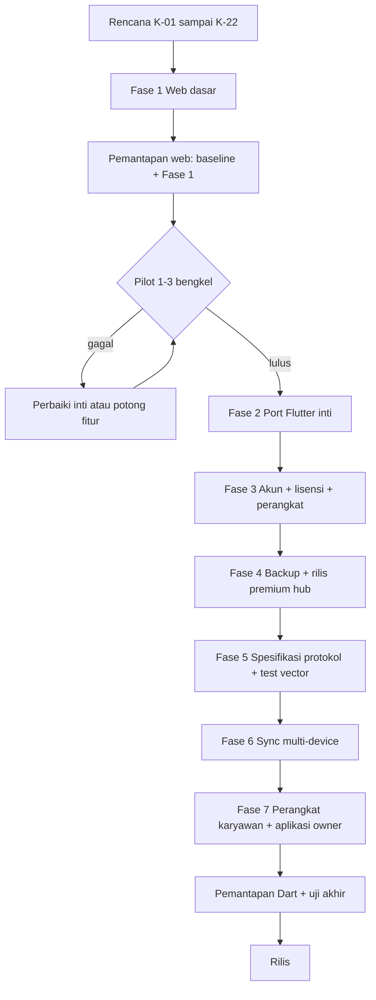

# Status dan Alur Pengerjaan Multi-Toko → Pemantapan

Status dokumen: **aktif** — 2026-11-03.

Dokumen ini adalah papan status dan alur kerja, bukan sumber aturan produk.
Aturan tetap mengikuti `K-01`–`K-22` di
[`RENCANA_MULTI_TOKO_PREMIUM.md`](RENCANA_MULTI_TOKO_PREMIUM.md). Skenario uji
tetap berada di [`RENCANA_PEMANTAPAN.md`](RENCANA_PEMANTAPAN.md). Jika status
berubah, perbarui dokumen ini; jika aturan berubah, perbarui sumber keputusan.

## Aturan fokus dan pemeliharaan

- **Fokus kode saat ini hanya web**, termasuk prototipe premium Fase 3–7.
  APK/Android, paket Windows/Mac, dan port Dart belum dikerjakan sampai kode web
  stabil dan pilot lulus.
- **Rencana hanya memuat pekerjaan yang belum ada kodenya.** Pekerjaan web yang
  sudah dibuat dicatat di dokumen ini; sisa rencana menunjuk port Dart/APK dan
  hal yang belum dibuktikan di web.
- Status dan riwayat pengerjaan dicatat di dokumen ini; skenario uji tetap di
  `RENCANA_PEMANTAPAN.md`.

## Ringkasan status

| Area | Status | Catatan |
| --- | --- | --- |
| Dokumen rencana multi-toko/premium | **Selesai** | Keputusan `K-01`–`K-22`, matriks tier, urutan fase |
| Dokumen pemantapan | **Selesai** | Skenario uji dan gerbang pemantapan |
| Web 2.7.0 inti | **Dibangun, 400 tes otomatis lulus** | Lihat bagian Status fitur web 2.7.0; uji UI manual dan pilot belum |
| APK/Android | **Ditunda** | Baru dikerjakan setelah kode web stabil dan pilot lulus; jangan membuat APK |
| Fase 1 multi-toko web | **Dibangun, pemantapan formal lulus otomatis** | Header, registry, ganti toko, isolasi, gating, kuota; 13 tes Fase 1 lulus |
| Pilot 1–3 bengkel | **Belum mulai** | Menunggu uji UI web manual |
| Port Flutter PusatkuPOS | **Belum mulai** | Terblokir pilot |
| Akun, lisensi, premium hub (web) | **Dibangun, uji otomatis lulus** | Prototipe Python/web untuk migrasi; Dart/APK belum |
| Sync, relay, kunci, perangkat (web) | **Dibangun, uji otomatis lulus** | E2E, snapshot, konflik, TTL, arsip, perangkat karyawan; Dart/APK belum |
| Pemantapan web | **Sebagian** | Baseline 3x, Fase 1 formal, 15 tes premium 3x, smoke HTTP premium lulus; uji UI manual belum |
| Pemantapan premium/Dart | **Belum dijalankan di Dart** | Web sudah lulus otomatis; port Dart belum |

Arti status:

- **Selesai**: sudah ada bukti dan tidak ada pekerjaan tersisa.
- **Dibangun, belum diuji**: kode ada, tetapi belum lulus pemantapan.
- **Belum mulai**: belum ada implementasi.
- **Terblokir**: menunggu gerbang atau fase sebelumnya.
- **Tidak dijadwalkan**: di luar lingkup sampai ada keputusan baru.

## Posisi saat ini

- BengkelPOS Radiator web 2.7.0 berjalan untuk fitur inti.
- **Fase 1 web sudah dibangun dan pemantapan otomatisnya lulus**: header dua
  baris, registry toko + `database_id`, ganti toko di panel Menu, isolasi
  database per toko, entitlement stub, gating tulis premium, dan kuota Follow up
  lokal.
- **Fase 3–7 versi web sudah dibangun dan lulus uji otomatis**: akun owner dan
  karyawan, peran/izin tambahan, password/PIN, lisensi manual, ID owner,
  perangkat + hub + batas slot, kunci toko terbungkus, relay E2E, outbox,
  snapshot terenkripsi, konflik, TTL, arsip semua toko, perangkat karyawan, dan
  ringkasan aplikasi owner.
- **Pemantapan otomatis web 2026-11-03 lulus**: seluruh `pytest` **400 lulus**
  dan 15 tes premium lulus 3x berturut; smoke HTTP premium pada server web
  sungguhan juga lulus (lisensi, akun, perangkat, snapshot, arsip, login
  karyawan).
- **Yang belum**: uji UI web manual (lebar layar, tema, header/printer, ganti
  toko, form premium, login karyawan), dokumentasi test vector protokol, port
  Dart, dan pilot 1–3 bengkel. APK/Android belum dikerjakan dan tidak dibuat
  pada tahap ini.
- Implementasi web ini adalah **prototipe migrasi**: aturan produk tetap
  `K-01`–`K-22`; Play Billing, secure storage, notifikasi, dan kunci perangkat
  sungguhan tetap harus dibuktikan di Dart/APK.

## Status fitur web 2.7.0

| Fitur | Status |
| --- | --- |
| Kasir, stok, follow-up, backup manual | Dibangun, baseline pemantapan lulus otomatis |
| Scanner HID, empat kategori unit, stok masuk, opname, laporan kelompok part | Dibangun, baseline pemantapan lulus otomatis |
| Header alamat, registry toko, ganti toko, isolasi data | Dibangun, pemantapan otomatis lulus |
| Gating premium dan kuota Follow up lokal | Dibangun, pemantapan otomatis lulus |
| Akun karyawan, peran/izin, password/PIN, audit | Dibangun, 15 tes premium lulus |
| Lisensi, ID owner, perangkat, hub uang | Dibangun, 15 tes premium lulus |
| Kunci toko terbungkus, relay E2E, outbox, konflik, TTL | Dibangun, 15 tes premium lulus |
| Snapshot terenkripsi dan replay outbox | Dibangun, 15 tes premium lulus |
| Arsip semua toko (ZIP, checksum, restore all-or-nothing) | Dibangun, 15 tes premium lulus |
| Login karyawan dan tampilan peran di web | Dibangun, smoke HTTP lulus; uji UI manual belum |
| Ringkasan aplikasi owner bertanda tangan | Dibangun, 15 tes premium lulus |
| Play Billing, secure storage, notifikasi, APK | Ditunda (butuh Dart/APK) |
| Render barcode/QR pada label dan nota | Ditunda |

## Alur kerja

Alur ringkas:

1. **Rencana** — aturan produk dan urutan fase ditetapkan di
   `RENCANA_MULTI_TOKO_PREMIUM.md`.
2. **Fase 1 (web)** — header, registry, ganti toko, isolasi data, gating, dan
   kuota Follow up lokal.
3. **Pemantapan web** — jalankan baseline dan skenario Fase 1; build web harus
   berhasil sebelum pilot.
4. **Pilot** — 1–3 bengkel nyata selama 2–4 minggu. Ini gerbang wajib untuk
   port Dart dan rilis APK.
   - Lulus: lanjut ke port Flutter dan rilis premium.
   - Gagal: perbaiki inti atau potong fitur premium yang tidak terbukti.
   - Catatan: prototipe web Fase 3–7 sudah dibuat lebih awal atas permintaan
     pemilik; pilot tetap menentukan apakah fitur dibawa ke Dart/APK.
5. **Fase 2 (Flutter)** — port layar inti dan ukur ukuran aplikasi. Paket
   APK/Android belum dikejar sampai port inti stabil.
6. **Fase 3 (akun dan lisensi)** — **acuan web sudah lulus uji**; port Dart:
   akun owner, akun karyawan, peran/izin, password/PIN, lisensi, Play Billing,
   ID owner, registrasi perangkat.
7. **Fase 4 (premium hub)** — **acuan web: arsip semua toko lulus uji**; port
   Dart: backup lengkap, rilis premium satu perangkat owner, QA.
8. **Fase 5 (protokol)** — **kode protokol web ada**; dokumen spesifikasi
   sync/kripto dan test vector wajib disetujui sebelum kode sync Dart.
9. **Fase 6 (sync)** — **acuan web: relay, snapshot, konflik, TTL lulus uji**;
   port Dart: multi-device, E2E, kunci, antrean, notifikasi.
10. **Fase 7 (perangkat dan aplikasi owner)** — **acuan web: perangkat
    karyawan + ringkasan owner lulus uji**; port Dart: thin client owner.
11. **Pemantapan akhir** — jalankan seluruh skenario premium/Dart dan uji akhir
    lintas platform.
12. **Rilis** — hanya setelah semua gerbang lulus.

## Status per fase

| Fase | Isi | Kesulitan | Status | Gerbang keluar | Uji |
| --- | --- | --- | --- | --- | --- |
| 1 | Web: header, registry + `database_id`, ganti toko, gating + kuota | Mudah–Sedang | Dibangun, pemantapan formal lulus otomatis | Pemantapan Fase 1 + build web + pilot | 13 tes Fase 1 lulus |
| G | Pilot 1–3 bengkel nyata | Gerbang | Belum mulai | Kriteria pilot lulus | Hasil pilot dicatat |
| 2 | Port Flutter inti + ukur ukuran | Sedang–Sulit | Belum mulai | Build Flutter inti + ukuran terukur; APK menyusul setelah stabil | Uji dasar Dart |
| 3 | Akun owner/karyawan, lisensi, perangkat | Sedang–Sulit | **Web dibangun, 15 tes premium lulus**; port Dart belum | Akun dan lisensi lulus uji Dart | Pemantapan bagian 7 |
| 4 | Backup + rilis premium hub | Sulit | **Web dibangun, arsip semua toko lulus uji**; rilis hub Dart belum | Rilis hub + QA | Pemantapan bagian 7 |
| 5 | Spesifikasi protokol + test vector | Sulit | **Kode protokol web ada**; dokumen test vector belum | Test vector disetujui | Review protokol |
| 6 | Sync multi-device + E2E + kunci | Sangat sulit | **Web dibangun, relay/snapshot/konflik/TTL lulus uji**; Dart belum | Sync dan konflik lulus di Dart | Pemantapan bagian 7 |
| 7 | Perangkat karyawan + aplikasi owner | Sangat sulit | **Web dibangun, login perangkat/ringkasan owner lulus uji**; Dart belum | Perangkat dan app owner lulus di Dart | Pemantapan bagian 7 |
| 8 | LAN/hub lokal | Sangat sulit | Tidak dijadwalkan | Keputusan baru | Uji terpisah |

## Status pemantapan

| Lingkup | Status | Prasyarat |
| --- | --- | --- |
| Baseline web (uang, stok, retur, void, backup/restore, keamanan) | **Lulus otomatis** — seluruh suite 400 lulus; baseline lama 385 lulus 3x; uji UI manual belum | Web 2.7.0 stabil |
| Multi-toko web (header, registry, ganti toko, isolasi, gating) | **Lulus otomatis** — 8 skenario formal + smoke HTTP; uji UI manual belum | Fase 1 selesai |
| Uji akhir web | **Sebagian** — suite 400 lulus, 15 tes premium 3x, database baru `integrity_check=ok`, smoke HTTP premium; uji UI manual dan build rilis belum | Baseline + Fase 1–7 web |
| Akun, lisensi, perangkat, premium hub | **Lulus otomatis di web** — 15 tes premium, termasuk batas perangkat, hub uang, dan arsip | Fase 3–4 web selesai |
| Sync, relay, kunci, snapshot, konflik | **Lulus otomatis di web** — amplop E2E, idempotensi, konflik opname, snapshot + outbox, TTL | Fase 5–6 web selesai |
| Perangkat karyawan dan aplikasi owner | **Lulus otomatis di web** — login perangkat, pembatasan peran, ringkasan owner bertanda tangan | Fase 7 web selesai |

## Langkah berikutnya

1. **Uji UI web manual** (pemilik): lebar 1440/1024/810/360, tema terang/gelap,
   header dua baris + layout printer, ganti toko beserta konfirmasi transaksi
   belum tersimpan, banner kuota gratis, halaman Premium (lisensi, akun,
   perangkat, sync, arsip), dan login karyawan.
2. **Pilot 1–3 bengkel** setelah uji UI manual lulus. Implementasi web Fase 3–7
   adalah prototipe lebih awal atas permintaan pemilik; pilot tetap menjadi
   gerbang sebelum port Dart dan rilis APK.
3. **Dokumen protokol + test vector** untuk relay, HLC, tanda tangan, wrapped
   key, snapshot, dan replay sebelum port Dart.
4. **Port Dart/Flutter** Fase 2–7 memakai implementasi web sebagai acuan
   perilaku; Play Billing, secure storage, notifikasi, dan kunci perangkat wajib
   diuji di Dart.
5. **APK/Android tidak dibuat** sampai kode web stabil dan pilot lulus; migrasi
   dilakukan setelah tahap web selesai.

## Riwayat pengerjaan

### 2026-11-03 — Fase 1 web dibangun

- Registry toko di `<folder database>/stores/registry.json`: toko utama memakai
  database utama, toko tambahan memakai file SQLite terpisah.
- Sesi autentikasi tetap memakai database utama; data usaha memakai database
  toko aktif sehingga ganti toko tidak mengeluarkan pengguna.
- `database_id` per database disimpan di `app_settings`, ikut backup, dan dipakai
  untuk kuota Follow up lokal.
- Entitlement stub `free`/`premium` di registry dengan default produksi `free`;
  tulis premium diblokir 403 `premium_locked`, baca tetap terbuka.
- Kuota Follow up gratis 20 kredit per `database_id`, monoton dan lokal; premium
  tanpa kuota. Kredit berkurang saat tautan follow-up/reminder dibuat.
- Header web memakai nama bengkel + alamat (fallback “Alamat belum diisi”);
  ganti toko berada di atas Ringkasan pada panel Menu.
- Panel toko gratis hanya menampilkan toko aktif tanpa tombol tambah; premium
  menampilkan daftar toko dan form Tambah toko.
- Tes otomatis: `tests/test_fase1_multi_toko.py` 5 lulus (config/isolasi/gating/
  kuota); seluruh baseline `python -m pytest -q` 377 lulus. UI diperiksa manual
  pada paket gratis dan premium memakai database uji terpisah: header, panel
  toko, tambah toko, ganti toko, isolasi pelanggan, plan card, dan banner kuota.

### 2026-11-03 — Pemantapan otomatis web dan perbaikan temuan

- **Skenario formal baru** `tests/test_pemantapan_fase1_web.py` (8 tes):
  isolasi 3 toko (pelanggan, nota/laporan harian, karyawan, supplier, stok),
  registry rusak pulih ke toko utama, file toko hilang ditandai
  `tersedia: false` dan aktivasi 409, identitas `database_id` toko cabang tetap
  saat startup, plan gratis (baca/ekspor/backup manual terbuka; tulis premium
  403 `premium_locked`), toko baru mendapat kuota 0/20 dengan `database_id`
  sendiri, salinan file database membawa `database_id` dan pemakaian kuota, dan
  5 konsumsi kuota bersamaan menghasilkan hitungan 1..5 tanpa lost update.
- **Perbaikan kuota**: konsumsi gratis sekarang atomik lewat `BEGIN IMMEDIATE`
  + `INSERT ... ON CONFLICT DO NOTHING` + `UPDATE ... WHERE value < limit`,
  menghilangkan `UNIQUE constraint failed: app_settings.key` dan lost update
  pada permintaan bersamaan.
- **Perbaikan identitas startup**: `ensure_database_id` menerima `store_id`
  eksplisit; startup menulis identitas toko utama ke entri registry toko utama
  dan identitas file aktif ke entri cabang, bukan menimpa entri cabang dengan
  data toko utama.
- **Perbaikan versi**: `APP_VERSION = "2.7.0"` terpusat di `config.py`, dipakai
  API dan banner `run.py` (sebelumnya banner masih v2.0).
- **Baseline**: `python -m pytest -q` 385 lulus, diulang 3x berturut
  (335,78 dtk / 339,37 dtk / 338,65 dtk).
- **Database baru**: 28 tabel, `PRAGMA integrity_check=ok`,
  `foreign_key_check=ok`, seed 12 stok + 10 jasa, `database_id` 26 karakter,
  kuota gratis 20.
- **Smoke HTTP** pada 127.0.0.1:8765 dengan database sementara: health 200
  versi 2.7.0; `/` dan `/static/js/app.js` 200; `/docs` 404; Host asing 400;
  Origin asing POST 403; setup PIN 201; config plan `free`; pelanggan POST 201;
  tambah toko gratis 403 `premium_locked`; backup manual 200; integritas
  database tetap `ok`.
- **Belum dijalankan pada putaran ini**: uji UI web manual di peramban
  (lebar layar, tema, header/printer, ganti toko, banner kuota) dan pilot.
  APK/Android tidak dibuat.

### 2026-11-03 — Fase 3–7 web dan uji premium

- **Akun dan peran**: akun owner/karyawan, peran `KASIR`/`MEKANIK`/`KEDUANYA`,
  izin tambahan, password awal + PIN 6 digit, audit append-only, snapshot izin
  bertanda tangan, pembatasan toko per akun, dan penolakan rute owner.
- **Lisensi dan perangkat**: aktivasi/perpanjang manual, status kedaluwarsa,
  peringatan jam mundur, ID owner + kode pemulihan, batas slot perangkat owner,
  pencabutan, pelepasan sekali per 72 jam, hub uang per toko, dan ringkasan
  aplikasi owner bertanda tangan.
- **Kripto dan sync**: kunci Ed25519/X25519, kunci toko dibungkus AESGCM,
  amplop E2E bertanda tangan tanpa plaintext, outbox idempoten, konflik opname,
  snapshot terenkripsi dengan replay outbox, dan pembersihan TTL 90 hari.
- **Arsip**: ZIP semua toko + manifest/checksum, restore all-or-nothing dengan
  salinan pengaman, registry disegarkan, dan rahasia auth/Telegram dipertahankan.
- **UI web**: tab Premium, kartu lisensi/akun/perangkat/sync/arsip, form login
  karyawan + ganti password, logout sesi, dan navigasi sadar-peran.
- **Bug yang ditemukan uji dan diperbaiki**:
  1. `authorization_service._is_money_write` memperlakukan pasangan
     `(metode, path)` sebagai string sehingga setiap tulis uang karyawan gagal
     500; sekarang mencocokkan metode dan prefix.
  2. `MaintenanceGate` menghitung `/api/admin/restore-all` sebagai permintaan
     aktif, sehingga restore menunggu dirinya sendiri 30 detik lalu 503;
     `RESTORE_PATHS` sekarang mencakup restore-all.
  3. `_apply_business_tables` memakai `.first()` milik SQLAlchemy pada kursor
     `sqlite3`; diganti `.fetchone()`.
  4. Penulisan ulang `app_settings` saat snapshot apply tidak mengisi
     `updated_at` NOT NULL; sekarang memakai `CURRENT_TIMESTAMP`.
  5. Ringkasan owner menandatangani payload berisi `datetime`; daftar perangkat
     sekarang mengembalikan waktu ISO.
- **Bukti**: `python -m pytest -q` **400 lulus** (8 menit 5 detik);
  `tests/test_premium_web.py` **15 lulus** 3x berturut (27,13 / 27,53 / 27,07
  detik); smoke HTTP pada 127.0.0.1:8123 dan :8124 dengan database sementara:
  halaman + aset statis 200, setup PIN 201, login 200, aktivasi lisensi 200,
  web hub + kunci terbungkus 200, akun 201, ringkasan owner 200, snapshot
  create/get/apply 201/200/200 dengan data dipulihkan, backup-all 200, restore
  semua toko 200, login karyawan 200 + wajib ganti password, dan rute owner
  ditolak 403 `owner_only`.
- **Belum**: uji UI manual, dokumen test vector protokol, port Dart, pilot, dan
  APK. Sesuai K-01, web tidak membuktikan Play Billing, secure storage,
  notifikasi, kunci perangkat, atau relay lintas perangkat sungguhan.

### 2026-11-03 — Audit rencana vs kode dan penutupan celah

- **ID owner (K-06)**: kartu ID besar, tombol salin, dan QR lokal berisi ID
  owner saja. Pustaka QR `qrcode-generator` 1.4.4 dimuat dari aset sendiri,
  bukan CDN.
- **Akun (K-08)**: password baru memakai bcrypt (PBKDF2 lama tetap dapat
  dibaca), tombol password acak 10–12 karakter tanpa karakter ambigu, teks
  siap kirim `PusatkuPOS — akun karyawan`, dan tombol **Salin semua** yang
  hanya aktif selama password baru tampil.
- **Login perangkat karyawan (K-07)**: form ID owner + username + password +
  token perangkat, token disimpan di `sessionStorage`, dikirim sebagai
  `X-Device-Token`, dan dihapus saat logout.
- **Backup (K-10)**: backup terjadwal hanya premium; backup lokal manual tetap
  tersedia di paket gratis. Backup, ekspor spreadsheet, dan arsip meredaksi
  hash password/PIN karyawan, token perangkat, `login_guards`, serta rahasia
  auth/Telegram.
- **Relay (K-13/K-15/K-22)**: amplop dihapus setelah semua penerima aktif
  mengakui; delta karyawan diverifikasi terhadap snapshot izin bertanda tangan
  owner (versi, toko, dan izin stok); endpoint `POST /api/devices/keys/rotate`
  membungkus ulang kunci toko hanya untuk perangkat aktif, menghapus amplop dan
  snapshot lama, serta menandai outbox untuk dikirim ulang dengan kunci baru.
- **Bukti**: `tests/test_premium_web.py` **15 lulus** setelah perubahan;
  `node --check` untuk `app.js`, `api-client.js`, dan pustaka QR lulus.
- **Belum dijalankan pada putaran ini**: uji UI manual di peramban dan seluruh
  suite 400 tes. Kode APK/Android tidak dibuat.

### 2026-11-03 — Dokumen diselaraskan dengan kode

- `README.md` memuat fitur multi-toko/premium, ID owner + QR, login perangkat,
  backup manual gratis vs terjadwal premium, redaksi rahasia, re-key, dan bukti
  400 tes / 15 tes premium. Jumlah tes lama (342) diganti.
- `RENCANA_MULTI_TOKO_PREMIUM.md` dan `RENCANA_PENGEMBANGAN_TAHAP_FINAL.md`
  mencatat prototipe web Fase 3–7 sebagai acuan migrasi; K-01 tetap menyatakan
  web bukan bukti Play Billing, secure storage, notifikasi, kunci perangkat, atau
  relay lintas perangkat nyata.
- `RENCANA_PEMANTAPAN.md` menambah skenario uji untuk ID owner/QR, password acak
  + salin semua, login perangkat, gating backup, redaksi rahasia, verifikasi izin
  bertanda tangan, penghapusan amplop setelah ack, dan re-key. Gerbang pilot
  tetap sebelum port Dart/rilis premium/APK.
- `docs/UI_COPY_INVENTORY.md` menambah layar akses, halaman Premium, toast,
  dialog, dan judul dinamis baru.
- `android/README_APK.md` dan `android/README_PIN.md` menandai bahwa APK 2.7.0
  belum memuat kode premium web dan `bcrypt`; APK tidak dibangun ulang.
- Tidak ada perubahan kode pada putaran dokumentasi ini.

## Temuan terbuka

1. **Keputusan produk — ganti toko saat plan gratis.** Backend `/api/stores`
   masih mengembalikan semua toko dan `POST /api/stores/{id}/activate` masih
   diizinkan ketika plan turun ke `free` dengan lebih dari satu toko; UI
   menyaring daftar ke toko aktif. Perlu keputusan pemilik: blokir aktivasi
   (403) atau izinkan beralih read-only.
2. **Risiko performa (belum diukur).** Laporan harian memicu `sync_items` pada
   GET; laporan all-time tanpa batas; follow-up berpotensi N+1; belum ada
   indeks gabungan untuk filter/urut follow-up; komisi dihitung ganda. Ukur
   dengan data nyata sebelum mengubah kueri.
3. **Uji UI manual** masih harus dijalankan pemilik; lihat Langkah berikutnya
   butir 1.
4. **Rotasi kunci toko.** Gunakan tombol **Ganti kunci toko** setelah
   pencabutan perangkat. Endpoint rotasi menghapus amplop/snapshot lama dan
   meminta outbox dikirim ulang; jangan memakai ulang tombol “Buat kunci toko”
   untuk mengganti kunci karena tombol itu tidak membersihkan ciphertext lama.
5. **Dokumen protokol dan test vector** belum ditulis; kode web menjadi acuan
   perilaku. Wajib disetujui sebelum port Dart (Fase 5).
6. **Batas K-01.** Web hanya membuktikan alur dan penyimpanan metadata; Play
   Billing, secure storage, notifikasi, kunci perangkat, dan relay lintas
   perangkat sungguhan tetap harus diuji di Dart/APK.

## Aturan pembaruan status

- Ubah status hanya dengan bukti: build, hasil uji, atau catatan pilot.
- Jangan menandai **Selesai** jika tes yang dirujuk belum dijalankan.
- Jika kode sudah dibuat, hapus item dari `RENCANA_*.md`; catat statusnya di
  dokumen ini.
- Jangan menyalin aturan produk ke dokumen ini; cukup rujuk `K-xx`.
- Perubahan aturan produk dilakukan di `RENCANA_MULTI_TOKO_PREMIUM.md`, lalu
  status dan alur di sini disesuaikan.
