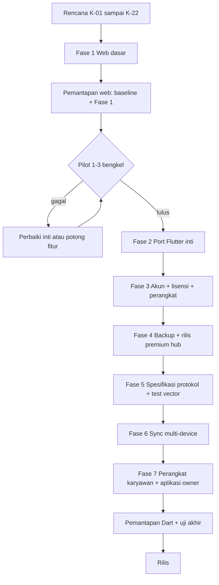

# Status dan Alur Pengerjaan Multi-Toko → Pemantapan

Status dokumen: **aktif** — 2026-11-03.

Dokumen ini adalah papan status dan alur kerja, bukan sumber aturan produk.
Aturan tetap mengikuti `K-01`–`K-22` di
[`RENCANA_MULTI_TOKO_PREMIUM.md`](RENCANA_MULTI_TOKO_PREMIUM.md). Skenario uji
tetap berada di [`RENCANA_PEMANTAPAN.md`](RENCANA_PEMANTAPAN.md). Jika status
berubah, perbarui dokumen ini; jika aturan berubah, perbarui sumber keputusan.

## Aturan fokus dan pemeliharaan

- **Fokus implementasi saat ini hanya web.** APK/Android, paket Windows/Mac, dan
  fitur premium belum dikerjakan sampai kode web stabil dan pilot lulus.
- **Rencana hanya memuat pekerjaan yang belum ada kodenya.** Jika kode sudah
  dibuat, hapus item itu dari `RENCANA_*.md`; jangan menandainya "selesai" di
  rencana.
- Status dan riwayat pengerjaan dicatat di dokumen ini; skenario uji tetap di
  `RENCANA_PEMANTAPAN.md`.

## Ringkasan status

| Area | Status | Catatan |
| --- | --- | --- |
| Dokumen rencana multi-toko/premium | **Selesai** | Keputusan `K-01`–`K-22`, matriks tier, urutan fase |
| Dokumen pemantapan | **Selesai** | Skenario uji dan gerbang pemantapan |
| Web 2.7.0 inti | **Dibangun, belum diuji pemantapan** | Lihat bagian Status fitur web 2.7.0 |
| APK/Android | **Ditunda** | Baru dikerjakan setelah kode web stabil dan pilot lulus |
| Fase 1 multi-toko web | **Dibangun, diuji otomatis** | Header, registry, ganti toko, isolasi, gating, kuota; 5 tes Fase 1 lulus |
| Pilot 1–3 bengkel | **Belum mulai** | Menunggu pemantapan web |
| Port Flutter PusatkuPOS | **Belum mulai** | Terblokir pilot |
| Akun, lisensi, premium hub | **Belum mulai** | Terblokir port Flutter |
| Sync, relay, kunci, perangkat | **Belum mulai** | Protokol belum ditulis |
| Pemantapan web | **Belum dijalankan** | Kode Fase 1 tersedia; baseline dan skenario formal belum dijalankan |
| Pemantapan premium/Dart | **Belum dijalankan** | Menunggu Fase 3–7 |

Arti status:

- **Selesai**: sudah ada bukti dan tidak ada pekerjaan tersisa.
- **Dibangun, belum diuji**: kode ada, tetapi belum lulus pemantapan.
- **Belum mulai**: belum ada implementasi.
- **Terblokir**: menunggu gerbang atau fase sebelumnya.
- **Tidak dijadwalkan**: di luar lingkup sampai ada keputusan baru.

## Posisi saat ini

- BengkelPOS Radiator web 2.7.0 berjalan untuk fitur inti.
- **Fase 1 web sudah dibangun**: header dua baris, registry toko + `database_id`,
  ganti toko di panel Menu, isolasi database per toko, entitlement stub, gating
  tulis premium, dan kuota Follow up lokal.
- Akun, lisensi, relay, kunci, dan sinkronisasi **belum dibangun**; APK/Android
  belum dikerjakan.
- Pemantapan formal belum dijalankan, tetapi tes otomatis Fase 1 sudah lulus.
  Pilot tetap menunggu pemantapan web.

## Status fitur web 2.7.0

| Fitur | Status |
| --- | --- |
| Kasir, stok, follow-up, backup manual | Dibangun, belum diuji pemantapan |
| Scanner HID, empat kategori unit, stok masuk, opname, laporan kelompok part | Dibangun, belum diuji pemantapan |
| Header alamat, registry toko, ganti toko, isolasi data | Dibangun, diuji otomatis |
| Gating premium dan kuota Follow up lokal | Dibangun, diuji otomatis |
| Akun, lisensi, relay, kunci, sinkronisasi | Belum dibangun |
| Render barcode/QR pada label dan nota | Ditunda |

## Alur kerja

Alur ringkas:

1. **Rencana** — aturan produk dan urutan fase ditetapkan di
   `RENCANA_MULTI_TOKO_PREMIUM.md`.
2. **Fase 1 (web)** — header, registry, ganti toko, isolasi data, gating, dan
   kuota Follow up lokal.
3. **Pemantapan web** — jalankan baseline dan skenario Fase 1; build web harus
   berhasil sebelum pilot.
4. **Pilot** — 1–3 bengkel nyata selama 2–4 minggu. Ini gerbang wajib.
   - Lulus: lanjut ke Flutter dan premium.
   - Gagal: perbaiki inti atau potong fitur premium yang tidak terbukti; jangan
     mulai akun, lisensi, atau relay.
5. **Fase 2 (Flutter)** — port layar inti dan ukur ukuran aplikasi. Paket
   APK/Android belum dikejar sampai port inti stabil.
6. **Fase 3 (akun dan lisensi)** — akun owner, akun karyawan, peran/izin,
   password/PIN, lisensi, Play Billing, ID owner, registrasi perangkat.
7. **Fase 4 (premium hub)** — backup lengkap, rilis premium satu perangkat
   owner, QA.
8. **Fase 5 (protokol)** — spesifikasi sync/kripto dan test vector sebelum kode
   sync Dart.
9. **Fase 6 (sync)** — multi-device, E2E, kunci, antrean, snapshot, notifikasi.
10. **Fase 7 (perangkat dan aplikasi owner)** — perangkat karyawan dan thin
    client owner.
11. **Pemantapan akhir** — jalankan seluruh skenario premium/Dart dan uji akhir
    lintas platform.
12. **Rilis** — hanya setelah semua gerbang lulus.

## Status per fase

| Fase | Isi | Kesulitan | Status | Gerbang keluar | Uji |
| --- | --- | --- | --- | --- | --- |
| 1 | Web: header, registry + `database_id`, ganti toko, gating + kuota | Mudah–Sedang | Dibangun, diuji otomatis | Pemantapan Fase 1 + build web + pilot | 5 tes Fase 1 lulus |
| G | Pilot 1–3 bengkel nyata | Gerbang | Belum mulai | Kriteria pilot lulus | Hasil pilot dicatat |
| 2 | Port Flutter inti + ukur ukuran | Sedang–Sulit | Belum mulai | Build Flutter inti + ukuran terukur; APK menyusul setelah stabil | Uji dasar Dart |
| 3 | Akun owner/karyawan, lisensi, perangkat | Sedang–Sulit | Belum mulai | Akun dan lisensi lulus uji | Pemantapan bagian 7 |
| 4 | Backup + rilis premium hub | Sulit | Belum mulai | Rilis hub + QA | Pemantapan bagian 7 |
| 5 | Spesifikasi protokol + test vector | Sulit | Belum mulai | Test vector disetujui | Review protokol |
| 6 | Sync multi-device + E2E + kunci | Sangat sulit | Belum mulai | Sync dan konflik lulus | Pemantapan bagian 7 |
| 7 | Perangkat karyawan + aplikasi owner | Sangat sulit | Belum mulai | Perangkat dan app owner lulus | Pemantapan bagian 7 |
| 8 | LAN/hub lokal | Sangat sulit | Tidak dijadwalkan | Keputusan baru | Uji terpisah |

## Status pemantapan

| Lingkup | Status | Prasyarat |
| --- | --- | --- |
| Baseline web (uang, stok, retur, void, backup/restore, keamanan) | Belum dijalankan | Web 2.7.0 stabil |
| Multi-toko web (header, registry, ganti toko, isolasi, gating) | **Sebagian** — tes otomatis lulus, skenario pemantapan formal belum | Fase 1 selesai |
| Uji akhir web | Belum dijalankan | Baseline + Fase 1 + build web berhasil |
| Akun, lisensi, perangkat, premium hub | Belum dijalankan | Fase 3–4 selesai |
| Sync, relay, kunci, snapshot, konflik | Belum dijalankan | Fase 5–6 selesai |
| Perangkat karyawan dan aplikasi owner | Belum dijalankan | Fase 7 selesai |

## Langkah berikutnya

1. Jalankan pemantapan web: baseline dan skenario Fase 1 (bagian web).
2. Setelah pemantapan lulus, jalankan pilot 1–3 bengkel; catat hasil dan
   keputusan lanjut/tidak lanjut.
3. Jika pilot lulus, mulai Fase 2 (port Flutter inti). Jika gagal, perbaiki inti
   dan jangan mulai akun, lisensi, atau relay.

## Riwayat pengerjaan

### 2026-11-03 — Fase 1 web dibangun

- Registry toko di `<folder database>/stores/registry.json`: toko utama memakai
  database utama, toko tambahan memakai file SQLite terpisah.
- Sesi autentikasi tetap memakai database utama; data usaha memakai database
  toko aktif sehingga ganti toko tidak mengeluarkan pengguna.
- `database_id` per database disimpan di `app_settings`, ikut backup, dan dipakai
  untuk kuota Follow up lokal.
- Entitlement stub `free`/`premium` di registry dengan default produksi `free`;
  tulis premium diblokir 403 `premium_locked`, baca tetap terbuka.
- Kuota Follow up gratis 20 kredit per `database_id`, monoton dan lokal; premium
  tanpa kuota. Kredit berkurang saat tautan follow-up/reminder dibuat.
- Header web memakai nama bengkel + alamat (fallback “Alamat belum diisi”);
  ganti toko berada di atas Ringkasan pada panel Menu.
- Panel toko gratis hanya menampilkan toko aktif tanpa tombol tambah; premium
  menampilkan daftar toko dan form Tambah toko.
- Tes otomatis: `tests/test_fase1_multi_toko.py` 5 lulus (config/isolasi/gating/
  kuota); seluruh baseline `python -m pytest -q` 377 lulus. UI diperiksa manual
  pada paket gratis dan premium memakai database uji terpisah: header, panel
  toko, tambah toko, ganti toko, isolasi pelanggan, plan card, dan banner kuota.

## Aturan pembaruan status

- Ubah status hanya dengan bukti: build, hasil uji, atau catatan pilot.
- Jangan menandai **Selesai** jika tes yang dirujuk belum dijalankan.
- Jika kode sudah dibuat, hapus item dari `RENCANA_*.md`; catat statusnya di
  dokumen ini.
- Jangan menyalin aturan produk ke dokumen ini; cukup rujuk `K-xx`.
- Perubahan aturan produk dilakukan di `RENCANA_MULTI_TOKO_PREMIUM.md`, lalu
  status dan alur di sini disesuaikan.
