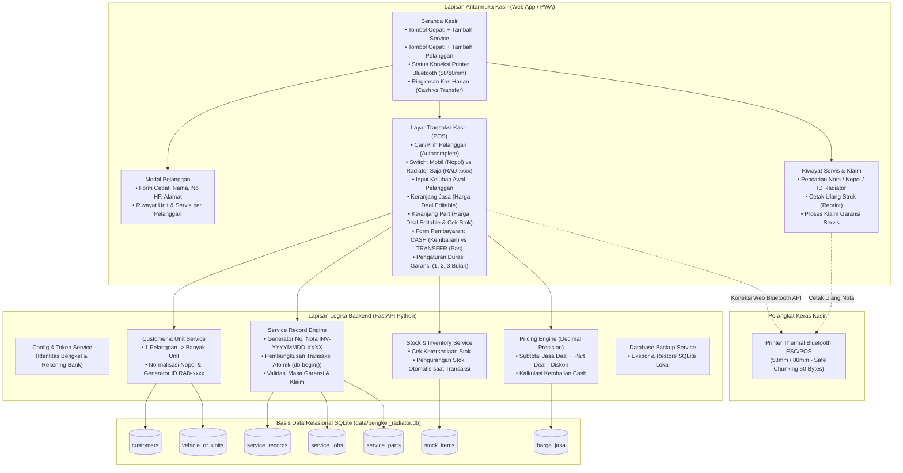

# Master Tracker: Status Proyek & Skema Implementasi — v2.0
## BengkelPOS Radiator: Sistem Kasir, Manajemen Servis Multi-Unit & Cetak Struk Bluetooth Thermal

Dokumen ini adalah **papan kendali utama (*single source of truth*)** untuk memantau status kesiapan, progres pembuatan fitur, dan skema implementasi sistem kasir bengkel spesialis radiator. Seluruh butir mengacu langsung pada [PRD_BengkelPOS_Radiator.md](file:///c:/Users/Administrator/Downloads/Aplikasi%20bengkel%20-%20Salin/PRD_BengkelPOS_Radiator.md) (v2.0) dan [BLUEPRINT_EKSEKUSI_MANDIRI.md](file:///c:/Users/Administrator/Downloads/Aplikasi%20bengkel%20-%20Salin/BLUEPRINT_EKSEKUSI_MANDIRI.md).

> **Status akhir implementasi:** kode aplikasi selesai dibangun, diaudit keamanan, dan diverifikasi. Seluruh **47 pengujian otomatis LULUS** (`python -m pytest -q`) dan alur utama antarmuka kasir telah diuji langsung di browser. Lihat Bagian 5 untuk cara menjalankan.

---

## 1. Dasbor Status Proyek Global

| Indikator | Nilai / Kondisi | Keterangan |
| :--- | :--- | :--- |
| **Status Keseluruhan Proyek** | **100% (Implementasi & Verifikasi Selesai)** | Backend, frontend, printer, laporan, direktori pelanggan, backup, dan 47 tes otomatis selesai |
| **Spesifikasi Dokumen PRD** | **100% SELESAI (`PRD_BengkelPOS_Radiator.md` v2.0)** | 9 Bab lengkap, matriks FR & 20 Skenario Uji |
| **Skema Database Relasional** | **100% TERIMPLEMENTASI (7 Entitas + Seed)** | `database/models.py`, SQLite `data/bengkel_radiator.db`, FK aktif |
| **REST API FastAPI** | **100% SELESAI** | Pelanggan, unit, transaksi POS, stok, jasa, garansi, laporan, backup/restore |
| **Antarmuka Kasir (SPA)** | **100% SELESAI & DIUJI BROWSER** | Beranda, Kasir, Riwayat, Stok & Jasa, Laporan, Pelanggan, modal & toast |
| **Konektivitas Printer Bluetooth** | **100% TERIMPLEMENTASI** | Web Bluetooth ESC/POS + fallback cetak browser; pairing printer fisik perlu diuji di perangkat nyata |
| **Pembersihan Modul Lama** | **100% BERSIH (Zero Telegram / WhatsApp)** | Arsitektur difokuskan murni pada POS Kasir lokal |
| **Konfigurasi Lingkungan (`.env`)** | **100% SIAP (`.env.example` & `.gitignore`)** | Identitas bengkel, rekening bank, token admin, parameter printer & backup |
| **Matriks Pengujian Otomatis** | **100% LULUS (47 tes; TC-01 s/d TC-20 tercakup)** | Dijalankan via Pytest dengan database sementara terisolasi |
| **Keamanan Dasar** | **100% SIBERHATI** | Endpoint backup/restore/hapus master memakai `X-Admin-Token` dengan perbandingan constant-time & fail-closed; render XSS-safe; query parameterized |

---

## 2. Skema & Arsitektur Alur Kerja Sistem



---

## 3. Pelacak Status Fitur Terperinci (Detailed Progress Tracker)

Format Status: `[Nama Modul / Fitur] : [Persentase]% [Status Keterangan]`

### Modul 1: Manajemen Pelanggan & Multi-Unit (Mobil & Radiator Copotan)
- Basis Data & Relasi Pelanggan : **100% SELESAI**
  - [x] Tabel `customers` (`nama`, `nomor_hp`, `alamat`) (`FR-CUST-01`)
  - [x] Tabel `vehicle_or_units` dengan Foreign Key ke `customers` (`FR-UNIT-01`)
  - [x] Implementasi `database/models.py` & inisialisasi database SQLite saat startup
  - [x] Repository & Service Pelanggan (`repositories/customer_repository.py`, `services/customer_service.py`)
  - [x] API Endpoint CRUD Pelanggan (`/api/customers`) dan unit (`/api/units`)
  - [x] Antarmuka **Database Pelanggan** di samping menu Laporan: daftar pelanggan + kepemilikan unit, statistik, pencarian, dan tombol Buat Servis
  - [x] Endpoint ringkasan direktori (`GET /api/customers/overview`) dengan jumlah unit per pelanggan
- Fleksibilitas Objek Servis (Mobil vs Radiator Saja) : **100% SELESAI**
  - [x] Aturan bisnis: Nopol wajib untuk mobil (`FR-UNIT-03`), ID otomatis (`RAD-YYYYMMDD-XXX`) untuk radiator lepas (`FR-UNIT-04`)
  - [x] Normalisasi Nopol mobil (uppercase & sanitasi spasi) (`TC-04`)
  - [x] Generator kode unik fisik radiator berurutan harian (`TC-05`)
  - [x] Normalisasi nomor HP Indonesia (`+62`/`62`/`08`) (`TC-02`)

### Modul 2: Transaksi Kasir, Kalkulasi Jasa & Sparepart (POS Engine)
- Mesin Kalkulasi Finansial Presisi & Fleksibilitas Harga Deal : **100% SELESAI**
  - [x] Penggunaan `Numeric(14, 2)` / `decimal.Decimal` (`FR-POS-05`)
  - [x] Harga jasa & sparepart bebas diedit (naik/turun) tanpa mengubah master (`FR-POS-03`, `FR-POS-04`, `TC-06`, `TC-07`)
  - [x] Perhitungan Total Jasa Deal + Total Part Deal - Diskon = Grand Total
  - [x] Perhitungan laba kotor per part: (Harga Jual Deal - Harga Modal Snapshot saat nota dibuat)
  - [x] Validasi CASH (kembalian otomatis) vs TRANSFER BANK (kembalian Rp 0) (`TC-10`, `TC-12`)
  - [x] Penolakan CASH kurang bayar tanpa menyimpan nota (`TC-11`)
  - [x] Validasi stok sebelum simpan; respons 409 + konfirmasi stok minus (`TC-08`, `TC-09`)
- Transaksi Servis Radiator : **100% SELESAI**
  - [x] Kolom keluhan awal & catatan pengerjaan (`FR-POS-02`)
  - [x] Rincian jasa & sparepart per nota
  - [x] Generator Nomor Nota unik (`INV-YYYYMMDD-XXXX`) (`FR-POS-01`)
  - [x] Pengurangan stok atomik dalam satu transaksi database (`FR-POS-08`)
  - [x] API Endpoint `POST /api/pos/transaction` (+ daftar & detail nota)
  - [x] Snapshot harga deal & harga modal tersimpan di nota; laba kotor dihitung dari snapshot tersebut sehingga laporan historis tidak berubah saat master stok diedit/dihapus

### Modul 3: Manajemen Stok Suku Cadang & Katalog Tarif Jasa
- Manajemen Stok Sparepart Radiator : **100% SELESAI**
  - [x] Model `StockItem` (Kode, Nama, Harga Modal, Harga Jual, Jumlah Stok) (`FR-STK-01`)
  - [x] CRUD Stok Barang via API (`/api/stock`)
  - [x] Deteksi & tampilan stok kritis/habis (<= 3 unit) (`FR-STK-02`)
  - [x] Antarmuka katalog stok di frontend + modal tambah/edit
  - [x] Penghapusan item dilindungi token admin
- Master Tarif Jasa Servis : **100% SELESAI**
  - [x] Model `HargaJasa` (nama pengerjaan, tarif standar) (`FR-SRV-01`)
  - [x] Preset jasa bengkel radiator (Korok, Las, Upper/Lower Tank, Genset, dsb.) (`FR-SRV-04`)
  - [x] CRUD Tarif Jasa via API (`/api/harga-jasa`) + modal frontend
  - [x] Penghapusan tarif dilindungi token admin

### Modul 4: Integrasi Cetak Struk Bluetooth Thermal (ESC/POS)
- Pengkodean Byte Stream ESC/POS : **100% SELESAI**
  - [x] Layout struk 58mm (32 karakter/baris) & 80mm (48 karakter/baris) (`FR-PRN-04`)
  - [x] Komponen struk: header bengkel, pelanggan/unit, keluhan, rincian, garansi, rekening bank, footer (`FR-PRN-05`)
  - [x] Perintah byte ESC/POS (init, align, bold, feed, cut) (`PRD BAB 6.2`)
  - [x] Generator ESC/POS Python + base64 payload (`services/escpos_service.py`)
  - [x] Sanitasi teks non-ASCII agar aman untuk printer thermal (`TC-17`)
- Modul Konektivitas Web Bluetooth API : **100% TERIMPLEMENTASI**
  - [x] Pemilihan protokol BLE / Serial Service (`FR-PRN-02`)
  - [x] Safe-Chunking 50 byte dengan jeda 25 ms (`FR-PRN-06`)
  - [x] Scan & connect printer dari header antarmuka (`FR-PRN-03`)
  - [x] Tombol cetak & cetak ulang nota (`FR-PRN-07`, `TC-19`)
  - [x] Fallback cetak via dialog browser bila Bluetooth tidak tersedia
  - [ ] Verifikasi pairing fisik printer BLE (membutuhkan perangkat keras nyata)

### Modul 5: Riwayat Servis, Manajemen Garansi & Klaim
- Pencatatan & Verifikasi Garansi : **100% SELESAI**
  - [x] Status garansi, tanggal kedaluwarsa, dan syarat garansi (`FR-WAR-01` s/d `FR-WAR-03`)
  - [x] Deteksi otomatis masa garansi aktif (`FR-WAR-04`, `TC-13`)
  - [x] Servis tanpa garansi (`NULL`) (`TC-14`)
  - [x] Alur klaim garansi + pencatatan tanggal klaim (`FR-WAR-05`, `TC-15`, `TC-16`)
  - [x] Klaim ganda & klaim kedaluwarsa ditolak dengan pesan jelas
  - [x] Pencarian riwayat berdasarkan nama / nomor HP / nopol / ID radiator / nomor nota
  - [x] API Endpoint Klaim Garansi (`PUT /api/service-records/{id}/claim`)

### Modul 6: Laporan Kas Harian, Rekap Omset & Manajemen Database
- Laporan Kasir & Keuangan : **100% SELESAI**
  - [x] Rekap kas masuk harian: pemisahan tunai vs transfer bank
  - [x] Ringkasan omset, jumlah nota, total jasa, total part, laba kotor
  - [x] Rekap periode 7 hari (`/api/reports/period`)
  - [x] Daftar transaksi per periode (filter tanggal)
  - [x] Riwayat stok pernah terjual (`GET /api/reports/sold-parts`): satu baris per penjualan, harga deal akhir, barang sama dikelompokkan dan urut waktu
- Cadangan & Pemulihan Basis Data (Backup & Restore) : **100% SELESAI**
  - [x] Endpoint ekspor backup SQLite (`POST /api/admin/backup`) (`TC-20`)
  - [x] Endpoint restore database dari file (`POST /api/admin/restore`)
  - [x] Validasi file restore & integrity check SQLite
  - [x] Tombol unduh backup di antarmuka, dilindungi token admin

---

## 4. Matriks Pemenuhan Skenario Uji (Test Matrix TC-01 s/d TC-20)

Seluruh skenario di bawah telah diimplementasikan dan **LULUS** pada eksekusi `python -m pytest -q`:

| ID Uji | Target Modul | Status Implementasi | Status Verifikasi |
| :--- | :--- | :--- | :--- |
| **TC-01** | Tambah Pelanggan Valid | Selesai | LULUS |
| **TC-02** | Normalisasi Nomor HP | Selesai | LULUS |
| **TC-03** | 1 Pelanggan Multi-Mobil | Selesai | LULUS |
| **TC-04** | Normalisasi Nopol Mobil | Selesai | LULUS |
| **TC-05** | Unit Radiator Copotan (`RAD-xxxx`) | Selesai | LULUS |
| **TC-06** | Jasa dengan Harga Deal Di-override | Selesai | LULUS |
| **TC-07** | Part dengan Harga Deal Di-override | Selesai | LULUS |
| **TC-08** | Servis Potong Stok Gudang Otomatis | Selesai | LULUS |
| **TC-09** | Peringatan Stok Minus / Habis | Selesai | LULUS |
| **TC-10** | Pembayaran CASH & Hitung Kembalian | Selesai | LULUS |
| **TC-11** | Pembayaran CASH Kurang Uang Ditolak | Selesai | LULUS |
| **TC-12** | Pembayaran TRANSFER (Kembalian = 0) | Selesai | LULUS |
| **TC-13** | Garansi Servis 1 Bulan Dihitung Tepat | Selesai | LULUS |
| **TC-14** | Servis Tanpa Garansi (`NULL`) | Selesai | LULUS |
| **TC-15** | Klaim Garansi Masa Aktif Berhasil | Selesai | LULUS |
| **TC-16** | Klaim Garansi Expired Diberi Peringatan | Selesai | LULUS |
| **TC-17** | Format Byte ESC/POS 58mm <= 32 Karakter | Selesai | LULUS |
| **TC-18** | Rekening Bank Bengkel Tercetak di Struk | Selesai | LULUS |
| **TC-19** | Cetak Ulang Nota Lama (*Reprint*) | Selesai | LULUS |
| **TC-20** | Ekspor Backup Database SQLite | Selesai | LULUS |

**Berkas pengujian:**

| Berkas | Cakupan |
| :--- | :--- |
| `tests/conftest.py` | Isolasi database sementara, seed data, fixture client/DB |
| `tests/test_customer_unit.py` | TC-01 s/d TC-05 + validasi input pelanggan/unit + direktori pelanggan |
| `tests/test_pos_transaction.py` | TC-06 s/d TC-12 + presisi desimal, urutan nota, rollback atomik, snapshot laba kotor |
| `tests/test_warranty.py` | TC-13 s/d TC-16 + klaim ganda & garansi kedaluwarsa |
| `tests/test_print_backup.py` | TC-17 s/d TC-20 + lebar double-width ESC/POS, restore roundtrip & validasi skema backup |
| `tests/test_security_reports.py` | Token admin (fail-closed), anti-XSS, anti-SQL-injection, laporan kas |

**Hasil eksekusi terakhir:** `47 passed, 1 warning in 9.60s` (warning deprecation `httpx`/Starlette TestClient, tidak memengaruhi fungsionalitas).

---

## 5. Catatan Implementasi & Cara Menjalankan

### 5.1 Menjalankan aplikasi
```bash
# 1. Siapkan dependensi (sekali saja)
python -m pip install -r requirements.txt

# 2. Jalankan server lokal
python run.py

# 3. Buka browser
# http://127.0.0.1:8000
```
Database otomatis dibuat di `data/bengkel_radiator.db` dan diisi data master contoh saat pertama kali berjalan.

### 5.2 Menjalankan pengujian
```bash
python -m pytest -q
```
Tes memakai database sementara terpisah sehingga data kasir asli tidak tersentuh.

### 5.3 Token admin
Operasi sensitif (backup, restore, hapus sparepart, hapus tarif jasa) membutuhkan header `X-Admin-Token` yang nilainya diambil dari `UI_ACCESS_TOKEN` di `.env`. Perbandingan token memakai `hmac.compare_digest`. Bila `UI_ACCESS_TOKEN` kosong, endpoint sensitif bersifat *fail-closed* (HTTP 503) sampai token dikonfigurasi. Antarmuka akan meminta token sekali per sesi browser dan menyimpannya di `sessionStorage`; token dihapus otomatis jika server menolak (401).

### 5.4 Printer thermal Bluetooth
- Gunakan Chrome/Edge di desktop atau Chrome di Android. Web Bluetooth hanya aktif pada `localhost` atau HTTPS.
- Printer BLE dengan layanan `18f0`/`ffe0` (varian `ff00`/`ff10`/`ff20`) didukung.
- Bila pairing gagal atau browser tidak mendukung Web Bluetooth, gunakan tombol **Cetak Browser** sebagai fallback.
- Uji pairing dengan printer fisik tetap diperlukan sebelum operasional; lingkungan pengujian otomatis tidak memiliki perangkat Bluetooth.

### 5.5 Struktur singkat proyek
```text
api/            # Router FastAPI, skema Pydantic, dependency admin token
database/       # Model SQLAlchemy 2.0, session/engine, seed data
repositories/   # Akses data pelanggan, unit, nota, stok, jasa
services/       # Logika bisnis: POS, harga, stok, garansi, laporan, ESC/POS, backup
frontend/       # SPA vanilla JS, CSS, modul Web Bluetooth
tests/          # 47 pengujian otomatis (TC-01 s/d TC-20 + keamanan, laporan, direktori)
run.py          # Entry point server lokal
```

### 5.6 Hasil audit keamanan & bug terakhir (2026-10-28)

| ID | Tingkat | Temuan | Perbaikan |
| :--- | :--- | :--- | :--- |
| SEC-01 | High | Endpoint admin (backup/restore/hapus) terbuka bila `UI_ACCESS_TOKEN` kosong | Fail-closed HTTP 503 sampai token dikonfigurasi |
| SEC-02 | Medium | Perbandingan token memakai `!=` (rawan timing attack) | `hmac.compare_digest` |
| BUG-01 | High | Laba kotor historis memakai modal master terkini & hilang bila master dihapus | Snapshot `service_parts.harga_modal` + migrasi/backfill otomatis |
| BUG-02 | Medium | Restore menerima SQLite valid tanpa skema aplikasi | Validasi `integrity_check` + 7 tabel wajib |
| BUG-03 | Low | Nama berkas backup dapat bentrok dalam detik yang sama | Timestamp mikrodetik |
| BUG-04 | Medium | Baris double-width struk melebihi 16 kolom pada kertas 58mm | Lebar efektif menjadi setengah saat mode double-width |
| BUG-05 | Low | Diskon melebihi subtotal membuat UI menampilkan Rp 0 tetapi server menolak | Diskon diklem ke subtotal di antarmuka |

**Risiko residual yang disepakati:** pairing printer BLE tetap perlu uji perangkat nyata; aplikasi tanpa login cocok untuk localhost/LAN tepercaya; penomoran nota berurutan belum anti-race untuk multi-kasir simultan (aman untuk satu kasir); migrasi otomatis hanya tersedia untuk SQLite.
